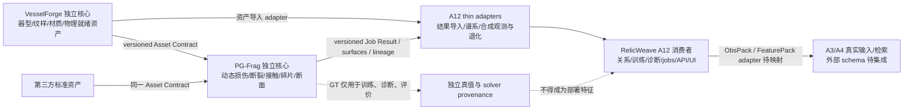

# VesselForge / PG-Frag 升级评估

评估日期：2026-10-03（Asia/Shanghai）  
代码快照：`60df338`。本文是范围和难度评估，不是实现验收；没有升级代码、冻结配置、历史资产或生产数据。总纲全文审阅记录见 [指南审阅](C:/Users/xiemo/Desktop/ShardForge/relicweave-synlab/tmp/review_20261003/pgfrag/guide_audit.md)，A12 数据/代码差距证据见 [data gap audit](C:/Users/xiemo/Desktop/ShardForge/relicweave-synlab/tmp/review_20261003/pgfrag/data_gap_audit.md) 和 [engineering gap audit](C:/Users/xiemo/Desktop/ShardForge/relicweave-synlab/tmp/review_20261003/pgfrag/engineering_gap_audit.md)。

## 决策摘要

升级可行，但不能视作“把 A12 几何切割器改名为物理碎裂”。VesselForge 是中到高难度的几何/资产平台工程：可从 A12 母体、纹样和材质基础提炼，并补齐稳定的 CAD/mesh、physics-ready asset、验证与导出契约。PG-Frag 是很高难度的新仿真核心：A12 有程序化切面、事件/来源映射和启发式能量/缺陷机制，但没有指南要求的动态材料损伤、裂纹传播、求解器接触、碎片运动与物理断面校准。全指南 v1.0 目标涵盖独立安装、多后端、fidelity profiles、二次碎裂和 HPC，属于两套产品，不是 A12 一次版本升级。

建议采用**独立核心/代码库/版本/CI + A12 thin adapters**，并从 v0.1 最小纵向用例开始联调。A12 在运行时消费、导入和评价 VF/PG 结果，不应成为两核心的内部依赖；它继续负责 RelicWeave 的受控合成/真值、观测与退化、关系/训练、诊断及现有 jobs/API/UI。契约先行、早期小样本联调，可减少两种代价：把大核心塞入 A12 会锁定实现并重复平台；拖到 v1.0 才集成则会把 schema、lineage、特征泄漏和真实 A3/A4 适配冲突推迟到最后。

| 升级项 | 难度 | 当前可复用底座 | 主要新增工作 |
|---|---|---|---|
| VesselForge | **中到高（工程）** | A12 参数化器型/表面 chart、规则和程序纹样、材料 profile、网格/资产存储、seed 与 provenance | 独立资产 API、参数 CAD/Loft/Sweep 部件、结构化纹样/材料输出、可靠 mesh/体网格验证、physics-ready 契约；实际生产观测还须消费冻结的材料/纹样绑定 |
| PG-Frag | **很高（仿真）** | A12 静态切割/fragment mesh、seed、truth/lineage、QA 与数据导出可作 legacy baseline 和适配参考 | 一个真实可运行的 PD backend、时间演化损伤/裂纹、接触及碎片提取；材料试验校准、断面历史 lineage、数值/物理 benchmark 和成本测量 |
| A12 集成 | **高（接口与验证）** | A12 的 observe/relations/training/diagnostics、jobs/storage/API/UI 和真值隔离设计 | 独立 Asset/Job/Result adapters，真实外部 A3/A4 字段映射，阶段能力接线，特征泄漏门，以及多层 freeze/replay/验收 |

此处的“难度”是依赖与验证工作量级判断，不是工期、资源吞吐或成功率承诺。未知事项包括首发几何/尺寸/材料与加载边界、真实校准样本、可接受误差/守恒门、目标硬件/时长/内存和 solver 许可/可用版本。

## 最小可信交付路径

### 先区分骨架贯通和物理可信

指南 v0.1 的结构要求不是单独“旋转体原型”：VesselForge 明确列出“参数化旋转体 + Loft/Sweep、规则纹样、基本 Physics-Ready export”；PG-Frag 列出统一 Job schema、一个 PD backend、基本碰撞和碎片提取；两项目还要有独立 repo、CI、版本、CLI 和 Python API（指南表 028 R002，P0525–P0528）。所以若现有 A12 只覆盖旋转体样本，不能说已达到指南 v0.1；需实际演示 Loft/Sweep 路径和物理就绪导出。

另设两级验收，避免误称：

1. **v0.1 骨架/数值原型门：** 用小型、可复算 fixture 验证资产、材料、事件、Job/Result 契约，backend 调用/错误路径、基本接触、碎片/表面导出、lineage 与几何/数值检查。允许先用未校准参数做接口和数值原型，但只能标成 prototype/candidate。
2. **真实陶瓷物理可信门：** 冻结材料参数及来源、测量和加载协议、独立试件；比较首裂位置/时间、分叉、碎片谱、断裂能、守恒及断面尺度统计，并给误差/重复性门槛。完成前不称已验证真实陶瓷，不能把 v0.1 软件骨架 PASS 折算成物理真实性 PASS。

建议首个试点窄到一种脆性陶瓷材料族、一个尺寸范围、一种简单器物族与一种可重复事件。PD backend 先经同用例基准再选，不预先认定 PeriLab 一定适配。PeriLab 官方列有 PD formulation、damage/contact、MPI 与 FEM-PD coupling 能力，但项目尚无本地集成 benchmark；官方 coupling 文档也限定了耦合区单元形状，不能承诺通用任意 3D 自适应。见 [PeriLab 官方仓库](https://github.com/PeriHub/PeriLab.jl) 和 [FEM-PD 文档](https://perihub.github.io/PeriLab.jl/stable/theory/theory_FEM_PD_coupling/)。Chrono 应作为碎片分离后的刚体/接触候选，不称断裂 solver，见 [Chrono API overview](https://api.projectchrono.org/introduction_chrono.html)。

### 后续阶段边界

| 阶段 | 指南里的路线（摘要） | 进入下一阶段前必须补齐 |
|---|---|---|
| v0.1 | VF 旋转体 + Loft/Sweep、规则纹样、Physics-Ready export；PG 一个 PD backend、基本碰撞、碎片提取；两个独立 CLI/API/CI。 | 明确 schema/单位、样本尺寸与材料、可重放 job、失败语义和第一版验证阈值。不能遗漏 Loft/Sweep。未校准 backend 只证明骨架。 |
| v0.3 | VF 几何节点/SDF、UV/SVG/网格 adapter；PG PeriLab + Chrono adapter、材料插件/随机场；manifest、SDK、benchmark。 | 证明 adapter 能力边界、版本/许可、重复性、资源和公共 validator；backend 不可用时结构化失败，无静默替换。第三方 backend 对照后才晋级。 |
| v0.5 | VF 部件语法、复杂器形、AI SVG/3D 与 PBR backend；PG 在 FEM-PD / phase-field / OpenRadioss 中接至少两类并支持多材料/界面；服务化。 | 每类 solver 的材料/事件/物理范围、许可、收敛和误差对照；多材料及界面参数数据；REST/gRPC/headless 安全和恢复测试。候选列表不表示三类都要从第一版启用。 |
| v1.0 | VF 批量空间/验证、GUI 可选；PG 稳定多后端、profiles、二次碎裂、HPC；可分别安装/发布/第三方使用。 | 安装兼容矩阵、schema 迁移、profile 数值目标、二次碎裂状态传递、实际扩展/资源曲线、端到端发布证据。全指南产品级难度很高。 |

TRELLIS/AI 3D、Phase-field、高速 JH-2、FEM-PD、自研 NOSB、HPC 不是 v0.1 的必需前提。进入 v0.3/v0.5 时也须依照指南的 P1–P5 复用流程、许可证与 benchmark 决定是否纳入，而非按候选表逐项打勾。

## 与 RelicWeave V1.44 / A12 的边界

总项目主线是从真实的低质/局部观察检索真实邻片，证据不足时建议补拍或 STOP；A12 是服务该主线的受控合成、预训练和诊断支线，而不是新的主检索产品。该定位和 A3/A4、冻结真实迁移的依赖已在 [RelicWeave 总计划审阅](C:/Users/xiemo/Desktop/ShardForge/relicweave-synlab/tmp/review_20261002/plan_audit.md) 核过。新 VF/PG 结果可帮助 A12 产生更受控的合成样本；不能取代真实输入、全图库检索、真实补拍流程、A3/A4 接口或独立 T0–T3 迁移评价。

### 可复用不等于已经达标

| 层 | 可复用资产 | 当前不能宣称的能力/硬缺口 |
|---|---|---|
| VesselForge 输入端 | [`docs/a12/architecture.md:22–48`](C:/Users/xiemo/Desktop/ShardForge/relicweave-synlab/docs/a12/architecture.md:22) 有 24 族母体、12 材料族、16 纹样族及 storage/seed/provenance 等模块索引。可作资产来源、fixture、旧版对照和初期 exporter 参考。 | 注册器数不是 24 种器物都经过视觉/实物验收。A12 资产合同不是指南的跨软件 Asset Contract。标准 observe 调用在 [`synlab/observe/routes.py:737`](C:/Users/xiemo/Desktop/ShardForge/relicweave-synlab/synlab/observe/routes.py:737) 把 mesh/tag/face id/name 交给 scene builder；尚未证据证明生产 RGB 消费了冻结 material profile 与 pattern recipe。展示 GLB/专用外观工具不能替代这一 production path。纹样几何变形后须重新审计母体，不能复用变形前 QA（[`synlab/pipeline.py:1577–1582,1618–1619`](C:/Users/xiemo/Desktop/ShardForge/relicweave-synlab/synlab/pipeline.py:1577)）。渲染接线修复已获授权但本次暂停，当前报告不宣称已完成。 |
| PG-Frag 输入/断裂 | A12 `synlab/fracture` 有共享 cutter、静态 fragment mesh、来源映射和经验参数路径；适合保留为**明确命名的 legacy baseline**。 | [`synlab/materials/catalogue.py:21–24`](C:/Users/xiemo/Desktop/ShardForge/relicweave-synlab/synlab/materials/catalogue.py:21) 明示 E、ν、KIC 为 `UNKNOWN`，且 procedural cut statistics 不是 fracture-mechanics solver。静态切割、Weibull 缺陷缩放或能量账本不是动态材料求解/真实断裂验证。动态结果还必须表示 historical fracture lineage，不能用目前拟合或可见性推断。 |
| 几何/QA | 母体 audit、mesh 拓扑、共享断口映射、守恒与报告框架可复用为 validator 思路。 | [`synlab/mothers/audit.py`](C:/Users/xiemo/Desktop/ShardForge/relicweave-synlab/synlab/mothers/audit.py) 曾出现非共享几何接触漏报/预算状态假完整的复现；替换 patch 目前归档、该生产文件恢复到 `139a5d5` 基线，修复未验收。旧隐式样本 [`measure_delivered.json`](C:/Users/xiemo/Desktop/ShardForge/relicweave-synlab/data/a12_reports/implicit/measure_delivered.json) 的 source coverage 为 `0.993161...`，低于 `0.999`；它是 triangle-face-key 修复前快照，修复后需重算，不能由水密/正体积掩盖此失败。 |
| 观测/退化 | A12 有 cameras、软件渲染、成像链、degrade registry 和诊断组件。 | 斜平面解析 ray-plane spike 在 [`render_depth_spike.json`](C:/Users/xiemo/Desktop/ShardForge/relicweave-synlab/tmp/review_20261002/data/render_depth/render_depth_spike.json) 测到当前深度插值最大误差约 2.7–3.0 mm（不同配置），这是已知待修/待回归的观测正确性问题；不是所有畸变场景的误差界，也不能以“通道存在”称深度精确。物理真实度、视觉着色和真实材料断裂统计必须分开门控。 |
| 消费者/训练/API | A12 的 truth、observe、relations、training、diagnostics、episodes、jobs/storage/API/UI 仍是 RelicWeave 工作流资产。架构要求 TruthPack 与白名单特征分离，forward 只读 feature asset（[`architecture.md:10–17`](C:/Users/xiemo/Desktop/ShardForge/relicweave-synlab/docs/a12/architecture.md:10)）。 | [`contract_diff.json:1–20`](C:/Users/xiemo/Desktop/ShardForge/relicweave-synlab/docs/a12/contract_diff.json:1) 标为 `MAIN_REPO_INTEGRATION_PENDING`，外部 contract ref 为 null，A3/A4 字段映射 pending。另，API handler [`handlers.py:607–642,665–672`](C:/Users/xiemo/Desktop/ShardForge/relicweave-synlab/synlab/api/handlers.py:607) 只有 freeze_spec/audit/export/display_lod 有实际 handler，其余 stage 受 run-capability gate；有 job catalog/POST API 不等于完整自动化生产链已接通。A12 代码模块与脚本有真实产物，但集成适配必须逐阶段证明。 |

因此 A12 应当是 VF/PG 输出的**独立消费者**：接收版本化资产/仿真结果、保留谱系并生成观测/关系/诊断；对 solver truth 建独立标签/评价通道，绝不把 GT id、seed、装配姿态、历史断裂映射注入部署特征。只有等实际 A3/A4 schema 与模型输入可用，thin adapter 才能将合成 Pack 映射到主项目合同；`a12.obs.v1` 不能自证兼容。

## 关键验收门与停止/换方案条件

指南表 029/030 列了指标**类别**而未给任何数值门槛。因此实施前要冻结 threshold、数据来源、计算方式和统计单位。最小门至少包含：

- **VesselForge：** 外形实际尺寸误差、参数单调性/seed 复现；闭合/非流形/自交/正体积和最小壁厚；体网格成功率及最差单元质量；pattern seam/motif 完整与布局约束；Region/material/thickness 场完整度；单位资产和批次 CPU/GPU/内存/耗时。
- **PG-Frag：** 无 NaN/发散及时间步/分辨率收敛；按 backend 定义的质量、动量、角动量、能量账本；首裂位置/时间、裂纹传播/分叉、碎片数和尺寸谱、断裂能与独立实验对照；断面重建误差/拓扑/粗糙度；同 benchmark 跨 backend 可解释差异。
- **A12 adapter：** Asset/Job/Result roundtrip 和版本迁移；材料/坐标/单位/lineage 明确；断面和母体关系稳定；Truth/Feature 防泄漏；同一 frozen run/replay；任务失败和未知能力显式拒绝。验收统计同时保留失败分母，不能以成功样例替代完整候选/运行量。

### 现实质量门不能被几何可运行或视觉效果替代

- **器型与表面：** 对目标实物参考固定器型、尺寸、口沿/颈肩腹足关系、壁厚范围和曲率连续性门；按样本测真实曲率/尺寸偏差。注册了器型或网格闭合不等于对应真实器物样式通过。
- **纹样：** 按参考器物检查 motif 风格/语义、纹样出现区域、主辅纹层级、重复节奏和接缝；明确绘制/釉下彩是颜色/材质层，刻划/模印/浮雕必须改变实体几何。normal map/shader 的亮暗不算实体浮雕。
- **材质：** PBR 外观响应（albedo/roughness/光照/渲染器）与力学本构（E、ν、密度、强度/断裂能、损伤律）分别测试。视觉材质接线不证明本构校准；机械模型正确也不自动证明 shader/透射/釉面外观真实。
- **断口：** 将 solver 生成的宏观裂面几何、测量到的粗糙度/方向统计与可选微细节 shader 分开记录。微观增强必须标明派生来源/尺度，不能用高频贴图或后处理补偿宏观形貌不符。

这些门要求有明确来源的真实器物/断裂试样与测量协议。无实物 reference 时只能标“工程内部合理性/尚未标定”，不得用现实风格、材料真实性或统计一致性作结论。

### PG 公共语义与 RelicWeave 关系标签分离

PG 公共 Result 应表达与器物类别和上层任务无关的几何/材料、损伤与断裂状态、接触与碎片运动（pose、质量/惯量、线/角速度等）、通用断裂事件/时间、片段及表面谱系、参考/材料坐标和完整求解溯源/验证报告；不得依赖 `historic_R2`、`current_fit`、`evidence_visible` 等 RelicWeave 标签或 A12 role。A12 adapter 再从 PG 的双侧裂面与历史事件谱系派生 `historic_R2`；对当前几何单独计算 `current_fit`；通过观测质量/可见性证据单独得 `evidence_visible`。三者不能互相替代，也不能把派生 GT 注入部署特征。

动态断裂经过回弹、侵蚀/材料缺失或后续接触后，表面几何无需满足旧静态 cutter 的 exact-gap 数值；新 PG profile 要定义自己的双侧映射、缺失/回弹语义和不确定度门。这个区分**不修改、不放宽** A12 现存静态 cut baseline 的共轭/差隙门，旧基线数据也不重写。

满足指南的算法晋级须同时有：成熟实现检索、模块级许可证/NOTICE、支持矩阵、目标问题最小基准、公共 validator、版本/依赖/硬件/seed manifest、可重复性和回退方案。CGAL 不能笼统假定全库同一许可，应按 package 核对（[CGAL 官方 package/license manual](https://doc.cgal.org/latest/Manual/packages.html)）。Phase-field 动态 fragmentation 有 crack widening 研究，适合当 reference/candidate，而非自动真值（[2026 CMAME 论文](https://doi.org/10.1016/j.cma.2026.118942)）。遇到同一根因第三次补丁仍未收敛时，停止细节补丁并复审表示/算法；替换算法前做有真实门槛的 bounded spike，记录 before/after 数字，不准放宽门限或静默 fallback。详见 [A12 engineering policy](C:/Users/xiemo/Desktop/ShardForge/relicweave-synlab/docs/a12/engineering_policy.md)。

## 本机能力探针边界

engineering gap audit 的 `find_spec`/版本探针能发现 Gmsh 4.15.2、Open3D 0.19、Torch 2.11.0+cu128 等包；`env_report()` 报 Torch CUDA available。Julia/PeriLab、Chrono/PyChrono、OpenRadioss、MPI runtime/mpi4py 和 CadQuery/OCP 等当前未配置。Portable Blender executable 可从 finder 定位，但 `bpy` API capability 与前端 UI flag 不一致，不能仅依其 `bpy` missing 把 subprocess renderer 判为绝对不可用，也未在本次重跑 Blender。探针只证明包/环境发现线索，没运行任一 PG solver、性能或物理 benchmark；GPU Torch 不证明 PG 后端可用 GPU。详见 [engineering gap audit §3–4](C:/Users/xiemo/Desktop/ShardForge/relicweave-synlab/tmp/review_20261003/pgfrag/engineering_gap_audit.md)。

## 成本与仍未知的部分

目前不能给可信的人员月、吞吐率、GPU 小时或物理验收概率：没有冻结设备、实体体积/粒子间距、边界条件、事件时长、材料批次和校准误差。只可说明条件性尺度关系：固定三维体积、固定 horizon/粒距比、同 solver 与同一物理事件时长时，若粒距 (h) 减半，理想粒子数约增 8 倍，显式稳定时间步近似随 (h) 减半则步数约增 2 倍，若每步工作与粒子数近线性，求解工作量约增 16 倍。这是理论估算，不是实测；接触、邻域、稀疏性、自适应和并行会改变成本。渲染三角面数不能直接当 solver DOF；本机 GPU/Torch 可用也不能推出 solver 提速。

首版启动前需决策或测量：

1. 器型、尺寸/壁厚范围、纹样/附件及 Physics-Ready 的字段/拓扑验收值。
2. 首发脆性材料及 E、ν、ρ、强度/韧性/断裂能、缺陷统计的来源/不确定性；不接受未标定默认数值冒充测量参数。
3. 事件的初始状态、边界/接触、时间步/分辨率收敛、断面重建方案和独立实物样本。
4. Asset/Job/Result schema、每个 backend 支持矩阵、版本/许可、失败码、输出 lineage 与配置兼容策略。
5. 真实运行机、内存/耗时预算、最小 benchmark 大小及 stage 晋级/停止阈值。
6. 真实 RelicWeave A3/A4 的 ObsPack/FeaturePack、图库与 retrieval/job API；建立匹配 adapter 与不泄漏标签的真实冻结迁移测试。

在这些值未知时应写 `UNKNOWN/PENDING`，不编造工时或完成百分比，也不以指南中的“百万级 DOF/粒子”作为已实现目标。

## 建议执行顺序

1. 取得首版用例/真实校准能力，先冻结字段、单位、试件/事件、阈值和资源预算；若无校准数据，明确将阶段结论限制在接口/数值原型。
2. 建立独立 VF / PG 核心骨架和版本化 Asset/Job/Result 契约；先以少量样本联调 A12 adapters。VF 先完成旋转体 **及 Loft/Sweep** 的真资产输出，PG 接入一个经 benchmark 选择的 PD backend、接触和 fragment extraction。
3. 用公共 validator 和测量基准检查 geometry、solver、断面和 lineage；失败项保持 FAIL/PENDING。动态断面与历史关系作为输出主字段，不把 `historic_R2` 和当前贴合/可见性互相替代。
4. 只有 v0.1 门和许可/资源证据通过后才扩 v0.3 PeriLab/Chrono、几何/UV adapters；以后按 v0.5/v1.0 需求有选择地加入更高成本 solver、multi-material/HPC。
5. A12 消费链接通后，再映射 A3/A4 外部合同、做合成数据诊断和冻结 T0–T3 真实迁移。合成规模、QA_PASS 或 loss 变化不能代替真实检索/动作收益。

### 参考证据

- 指南原件及逐段/逐表提取件：[`PGFrag_VesselForge_Guide_v11.docx`](C:/Users/xiemo/Desktop/ShardForge/PGFrag_VesselForge_Guide_v11.docx)、[`guide_extracted.txt`](C:/Users/xiemo/Desktop/ShardForge/relicweave-synlab/tmp/review_20261003/pgfrag/guide_extracted.txt)、[`guide_metadata.json`](C:/Users/xiemo/Desktop/ShardForge/relicweave-synlab/tmp/review_20261003/pgfrag/guide_metadata.json)。原件 SHA-256 为 `1eb926d3be9d081f236db2b0c47f573a9e283e51295e9bb2969b5c0d32224d19`；抽取包含正文 658 段、32 表，无内嵌图片。
- A12 当前实现及差距细项：[`data_gap_audit.md`](C:/Users/xiemo/Desktop/ShardForge/relicweave-synlab/tmp/review_20261003/pgfrag/data_gap_audit.md)；其 store census、QA 角色边和 39 项 targeted test 属专项证据，不等于 solver 或真实物理验收。
- 工程接口/部署/依赖审查：[`engineering_gap_audit.md`](C:/Users/xiemo/Desktop/ShardForge/relicweave-synlab/tmp/review_20261003/pgfrag/engineering_gap_audit.md)；其中 package probe 和 portable Blender 检查不等同功能或 solver 验收。
- RelicWeave 总计划/交接角色：[`plan_audit.md`](C:/Users/xiemo/Desktop/ShardForge/relicweave-synlab/tmp/review_20261002/plan_audit.md)。
- PeriLab coupling 与 solver 建议、CadQuery 与 package license 限制见正文相邻官方链接；这些证明项目/文档能力说明，不证明本仓库已经集成或 benchmark 通过。
