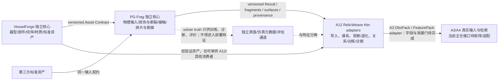

# PGFrag / VesselForge Guide v1.1 内容审阅（面向升级范围）

审阅日期：2026-10-03（Asia/Shanghai）  
源文件：`C:\Users\xiemo\Desktop\ShardForge\PGFrag_VesselForge_Guide_v11.docx`  
源文件 SHA-256：`1eb926d3be9d081f236db2b0c47f573a9e283e51295e9bb2969b5c0d32224d19`  
抽取件：[`guide_extracted.txt`](guide_extracted.txt)，SHA-256 `d146bca12fddd3b66d258ebba7f91671ed71a556fd4edaaf88654bba9bf1f3f4`；[`guide_metadata.json`](guide_metadata.json)。

## 结论

这份 v1.1 文档是 VesselForge 与 PG-Frag 两个独立通用基础设施项目的**技术总纲、候选算法池和分阶段路线**，不是逐项可直接实现/验收的完整规格。它规定了对象边界、复用原则、输入输出抽象、候选后端层级、项目化方向和里程碑；但关键数值门槛、材料与几何边界、基准数据、资源预算及具体 schema 均未定。总体升级可行但难度高：VesselForge 属中到高的几何/资产工程；PG-Frag 的动态求解与校准是很高难度的新核心；A12 适配和主项目验证另有接口与数据隔离工作。

最重要的边界：**A12 仍是 RelicWeave 的受控合成、观测、关系、训练和诊断消费者，不改名为 VesselForge/PG-Frag，也不被这两个项目取代。** VesselForge 和 PG-Frag 是各自独立的核心产品/代码库，经稳定契约和 A12 thin adapters 逐步接入；早期就做最小纵向联调，不等独立产品做到 v1.0 才第一次集成。A3/A4 真实检索仍是 RelicWeave 主线，A12 的合成输出不能替代真实输入、真实候选检索和冻结迁移实验。

## 审阅覆盖与文档层级

已按 DOCX 的 `word/document.xml` 正文顺序抽取并逐段、逐表阅读：658 个段落、32 个表格；正文没有嵌入图片，metadata 中记录的包内 media 数量为 0，也无脚注/尾注。另读了 header/footer 部件；未将整份 Word 渲染成页面，因此这是内容审阅，不是版式审阅。精确定位以下均使用抽取件里的 `[Pxxxx]` 正文段号及 `[TABLE nnn]` 表号。

- 总定位与强制共性原则：P0005、P0017–P0075、表 003/004。两项目须独立发布、可替换后端、无 GUI 运行、记录 seed/provenance；优先复用成熟软件，只有检索、许可证审查、能力评估和小型基准证明不适用后才允许自研。Candidate/Experimental 不自动成为 Stable。
- VesselForge 的总目标和“必须实现”能力：P0080、P0085–P0094；几何、修复、纹样、UV、浮雕/PBR 各路线主要是表 007–016 的建议或候选，不可将候选列表逐项误读成 v0.1 门槛。
- PG-Frag 的系统、输入/材料/事件接口：P0287–P0312、表 017；算法比较在 P0313–P0370、表 018；材料/缺陷随机场在 P0402–P0432、表 020/021；断裂后碎片运动分层在 P0434–P0454、表 022/023；断面与 profile 在 P0455–P0488、表 024。
- 独立交付及互操作：P0489–P0518、表 025–027；路线表是 P0520–P0544、表 028；指标类别是 P0546–P0575、表 029/030；P0577–P0627、表 031/032 重申“参考组合，不是唯一标准答案”。
- 文档自身也明确算法推荐非永久排名，晋级要过基准/材料标定/真实实验或可信数值基准：P0070–P0075、P0627、P0656–P0658。

## 阶段范围与真实难点

下表“指南最低范围”忠实概述表 028；“建议先行验收”是把路线变成可测交付所需的收敛建议，不冒充文档已有数值标准。阶段发布前应先冻结相应阈值和 fixture，不能只凭代码存在或示例图通过。

| 版本 | 指南列明的最低范围 | 难点与建议的最小验收门 | 难度判断 |
|---|---|---|---|
| **v0.1 骨架** | VesselForge：参数化旋转体 **加 Loft/Sweep**、规则纹样、基础 Physics-Ready 导出。PG-Frag：统一 job schema、一个 PD backend、基本碰撞、碎片提取。各自独立 repo、CI、版本、CLI、Python API。（表 028 R002 / P0525–P0528） | 将首个可校准用例严格收窄为一个脆性陶瓷材料族、简单尺寸明确的器物和单一受控事件；VesselForge 至少分别演示旋转体与一个真实 Loft/Sweep 部件（如把手/壶嘴/附件），并交付带区域、壁厚/材料字段和 provenance 的契约资产。PG-Frag 必须让同一冻结 job 可重放，显式记录求解失败，产出连通碎片及断面身份；用小型实物或可信基准检查数值稳定、拓扑、质量/能量账本及裂纹/碎片统计。CLI/API 与 schema 独立安装/测试。仅有几何切割、Weibull 随机缩放或断面粗糙度，不足以宣称这是 PD 求解器或经过材料校准。 | VF 中高工程难度；PG 单材料/单后端原型已是高仿真难度；整个 v0.1 高但可通过窄垂直切片控制。 |
| **v0.3 多后端** | VF 增加 Geometry Nodes/SDF adapter、xatlas/BFF、SVG motif、OpenVDB/Gmsh；PG-Frag 接 PeriLab 与 Chrono adapter、材料插件和随机场；插件 SDK、manifest、benchmark。（表 028 R003 / P0529–P0532） | 重点是契约和行为兼容，不是“安装成功”：同一输入的能力声明、版本/依赖/seed 可复现、失败显式、公共验证报告及 backend 对照。PeriLab 应先以目标问题做小 benchmark 后再升为 Candidate/Stable；Chrono 用于已分离碎片的刚体/接触阶段，不能称为断裂求解器。PeriLab 官方文档确有多类 PD、接触和耦合能力，但其 FEM–PD 耦合区形状存在限制，不能承诺通用任意 3D 自适应耦合（[PeriLab](https://github.com/PeriHub/PeriLab.jl)、[官方 FEM–PD coupling 文档](https://perihub.github.io/PeriLab.jl/stable/theory/theory_FEM_PD_coupling/)）。 | 中高到高；首要成本来自跨工具格式/语义、可重放验证和参数校准，不只是 adapter 代码。 |
| **v0.5 通用化** | VF：部件语法、复杂器形、AI SVG/AI 3D backend、PBR backend。PG-Frag：FEM-PD、phase-field、OpenRadioss 三类中至少两类 adapter，多材料/界面。共同增加 REST/gRPC、headless scheduler、文档站。（表 028 R004 / P0533–P0536） | “两个 solver adapter”必须先定义各自能力子集、边界条件、兼容材料/事件、统一输出验证和对照基准；不能以包装器存在当作物理可信。多材料/界面需要可追溯区域字段、界面本构参数来源与独立样本。Phase-field 动态裂纹扩宽需进入对照门，不能自动作真值（指南 P0340–P0344、P0488；[2026 研究 DOI](https://doi.org/10.1016/j.cma.2026.118942)）。PeriLab coupling 限制和 CGAL 逐 package 许可证都须按实际功能/部署核验（[CGAL package/licence overview](https://doc.cgal.org/latest/Manual/packages.html)）。AI 生成分支仍需 Physics-Ready 几何验证，不能绕过封闭、壁厚、尺度和拓扑门。 | 很高；多 solver、多材料以及服务化是多个独立风险面，必须用明确用例筛选能力。 |
| **v1.0 独立产品级** | VF：批量参数空间、资产验证，GUI/Blender 插件可选。PG-Frag：稳定多后端、fidelity profiles、二次碎裂、HPC。两项目分别可安装、发布并供第三方使用。（表 028 R005 / P0537–P0540） | 对“稳定”的验收要涵盖干净环境安装、兼容性矩阵、API/schema 版本迁移、错误与资源限额、后端 manifest、跨 backend 基准、边界/极端 fixture、可追溯发布。Profiles 需绑定可测精度/资源区间；二次碎裂需验证状态/质量/动量传递；HPC 需提供实际扩展测量和失败恢复证据，不能从单机或 GPU 可用直接推断吞吐。 | 很高；这已是两套可独立维护的工程产品目标，不是 A12 内一个功能迭代。 |

v2.x 的学习型 grammar、生成式控制、自适应 FEM→PD、GPU、复杂材料库和社区生态在表 028 R006 / P0541–P0544，属于后续研究平台，不应倒灌成 v0.1 先决条件。

### 计算成本与外部依赖

指南列出众多候选并没有选定或 benchmark 的含义。首版应先基于单材料、单事件、有限尺度的数据确定 profile 和预算；不用 TRELLIS/AI 3D、Phase-field、FEM–PD、自研 NOSB、高速 JH-2、HPC 全部起步。若显式粒子 PD 在固定物理体积 (V)、固定 horizon/粒距比下将粒距 (h) 减半，理想情况下粒子数随 (V/h^3) 增至约 8 倍；若稳定时间步也近似减半，同一物理时长约多一倍步数，按每步近线性工作的简化估计约 16 倍工作量。**这是条件化复杂度估算，不是本项目实测**；邻域、接触、稀疏度、内存和并行效率会改变结果。百万面渲染网格不等于百万 solver DOF，也不能由 Torch/CUDA 可用推断物理求解加速。

CadQuery/OpenCascade、Gmsh、CGAL、OpenVDB、PeriLab、Chrono 等可以作 adapter 候选；选择前应做版本/平台/许可证/输入尺度/精度/维护审查。CadQuery 文档是 B-Rep/CAD 路径的一个官方入口（[CadQuery 文档](https://cadquery.readthedocs.io/en/stable/intro.html)）；CGAL 的许可证需按实际 package 逐项核对，不能笼统把整个 CGAL 写成统一许可证。PeriLab 的官方功能清单也不能代替 RelicWeave 集成 benchmark。

## 规格缺口：路线不能直接充当验收合同

1. **无数值门槛。** 表 029/030 给出几何有效率、壁厚违规、mesh 质量、发散率、守恒、裂纹/碎片统计、断面拓扑/粗糙度、扩展性等指标名称，但未给阈值、误差定义、采样置信区间或统计检验（P0546–P0575）。各阶段需自行冻结目标值，没冻结前只能记“指标待定”，不能写 PASS。
2. **几何目标未定。** 未指定器物尺寸/壁厚范围、曲率和细节尺度、坐标精度、材料区域分辨率、体网格等级或目标网格质量数值。表 017 只要求真实尺度、封闭实体/可转换表示、坐标系等抽象字段。
3. **材料范围与标定未定。** 没有首版材料名单、材料参数数据来源、温度/应变率范围、批次差异、置信区间或真实破坏实验数据。表 020/021 列出了可组合本构、随机场、缺陷和界面候选，却未给可直接用于校准的数值参数包。
4. **事件/求解配置未定。** 表 017 给 `F(G,M,I,E,C) → Result`，并列出 Backend、精度、时间步/容差、输出选项；未给实际 job JSON/类型 schema、边界条件规范、接触参数、事件持续时间、时间步策略、粒子/网格收敛方案、backend capability 错误格式。
5. **没有验收 fixture 与成本上限。** 未固定实物试件、冲击/落摔工况、测量协议、几何真值、裂纹标注、参考求解、运行机器、内存/时长预算及吞吐目标。“百万级 DOF/粒子”出现在扩展性指标中（P0574–P0575），不是已给的性能承诺或初始门槛。
6. **互操作还停留在示例包。** 表 026 给 manifest/几何/fields/ornament/provenance 文件树，P0503 规定 PG-Frag 只依赖 Asset Contract；但没有字段级 schema、单位字典、精度/空值语义、坐标变换、压缩、版本兼容与迁移规则。
7. **许可证与部署没有最终决策。** 指南明确要求逐库 license、可维护性、失败显式和 backend 版本记录（P0038–P0071、表 027），但候选软件和每阶段目标平台的确切版本、再分发方式、编译/运行环境仍需 ADR/基准决策。

因此，指南足以选方向和阶段边界，不能仅凭其中“建议指标”或“候选后端”直接编排生产实现。每个阶段开工前应生成可复现的最小 benchmark 包、数值门槛、数据来源和预算；未确认的项保持 `UNKNOWN/PENDING`。

## RelicWeave A12 的角色、依赖与边界

### 目标系统关系

指南 P0017、P0022–P0027、P0077、P0500–P0503 规定的是“独立资产/独立断裂引擎 → 标准契约 → 任意上层使用”。RelicWeave 的具体架构决策是在这一体系旁边保留 A12 合成与诊断消费者，同时保留 A3/A4 真实观察和检索主线：

两种极端都不合适：把两个物理/几何核心直接塞入 SynLab/A12，会扩大内部耦合、把独立后端与版本锁定到 A12，也容易复刻成熟几何/求解功能；等 VF/PG 做到 v1.0 才联调，则会把 Asset/Job/Result 语义冲突、A12 泄漏规则和真实 A3/A4 适配问题推迟到最后。更稳健的交付边界是独立 repo/core、独立版本/CI，早期冻结小型契约，并在 v0.1 纵向用例中联调 adapter；按版本渐进加字段和后端。可共享工作区/测试数据，不共享库内私有对象作公共接口。

### A12 中可复用的部分与不能宣称的部分

| 项 | 当前证据与判断 |
|---|---|
| A12 是什么 | README 第 1–10 行明确将本仓库称为基于 A12 V1.2 的独立合成碎片实验室，并标 `MAIN_REPO_INTEGRATION_PENDING`。`docs/a12/architecture.md:5–17` 定义母体→纹样→共享断裂→CleanTruth→损伤→观察/特征→发布/训练/诊断；`:22–48` 列出 mothers、materials、patterns、fracture、truth、physical、observe、degrade、relations、training、diagnostics、episodes、API/UI 等模块。它是可复用的消费者/实验平台。 |
| VesselForge 可复用资产/部件 | A12 已有参数化器型、纹样、表面标签/区域、材料 profile 和图案几何能力，可作为存量来源、对照或早期 Asset Contract exporter 原型。`architecture.md:22–48` 是模块索引，不证明每个器型或纹样都通过实物审查。外部 VesselForge 仍应独立维护并由 adapter 接入，不应把现有 A12 mothers 直接命名为 VesselForge 产品达标。 |
| PG-Frag 不可由 A12 fracture 代码等同 | A12 有共享切割几何、多个 cut backend、来源映射和事件树等可供 legacy baseline/数据生成使用的部件，但这不等于指南所定义的时间演化 PD/FEM/phase-field 等动力学断裂、动态接触和校准的碎片动力学。`synlab/materials/catalogue.py:21–24` 明确 Young’s modulus、Poisson ratio、fracture toughness 是 `UNKNOWN`，procedural cut stats **不是** fracture-mechanics solver。物理启发缩放、Weibull 缺陷场或守恒账本各自是局部机制/审计，不能合并成“真实物理模拟已完成”。旧 A12 cut 算法可保留为明确标名的 legacy baseline，不标 PG FAST 或 calibrated solver。 |
| 输入输出合同 | A12 `docs/a12/contract_diff.json` 顶层状态是 `MAIN_REPO_INTEGRATION_PENDING`，external contract ref 为 null，`a12.obs.v1` 的外部字段为 unknown/unmapped（如 obs RGB/points/depth/quality、检索 index identity、job records）。因此 A12 并未现成满足指南 Asset/Job/Result contracts，也未证明接入 RelicWeave 主项目 A3/A4。用版本化 importer/exporter 做映射，并保留 schema diff 与拒绝未知字段。 |
| Truth 与部署特征隔离 | `architecture.md:10–17` 规定 TruthPack/标签和白名单特征分开，forward 只读特征；这应成为 PG-Frag→A12 的强制接口约束。裂纹/真实邻接/原装配姿态/seed 等求解 truth 可供训练、诊断和评估，不可被写进部署输入特征或候选打分。需通过 adapter schema 检查和反事实测试重新验证，不只依赖文档规则。 |
| A3/A4 与训练 | A12 关系、训练、诊断 API 可作为受控实验设施和合成预训练消费者，但它们不是总计划的真实图库检索链。A3/A4 schema 和主仓实现缺席，故先取得实际外部合同、建立 ObsPack/FeaturePack 字段映射，再做冻结 T0–T3 与独立真实验证；A12 episode 也不能证明真实补拍策略有效。 |

另外，RelicWeave 总计划在 [`tmp/review_20261002/plan_audit.md`](../../review_20261002/plan_audit.md) 已核实：A12 是服务于 A3/A4 的合成实验支线，目标包含候选召回、主动补拍/STOP和冻结真实迁移；因此两个新基础设施只能改善 A12 数据的资产/断裂生成能力，不能取代 A3/A4 检索、主线观测、关系/训练职责或真实 T0–T3。

## 建议的接手顺序（供后续总评决策，不是本轮实施授权）

1. **先定首个用例合同和实验门。** 选一类有可追溯参数来源的脆性陶瓷、一个尺寸区间、一种简单器型族、一个明确事件；冻结 Geometry/Material/Initial State/Environment/Config 的字段、单位和 provenance，并定义统计与数值阈值及机器预算。未有材料数据时明确只做工程原型，不作真实性声称。
2. **建立独立 VF 与 PG 核心骨架，但从首个 vertical slice 联调。** VF 按指南 v0.1 覆盖旋转体和 Loft/Sweep、结构化规则纹样与 physics-ready export；PG 只接一个经小 benchmark 选出的 PD backend、基本接触与碎片抽取；将 `Asset Contract`、`Job/Result` schema、适配错误及回放 fixture 一起版本化。PeriLab 先当 Candidate，不因被列为稳定候选就自动 promotion。
3. **做验证后再扩到 A12。** 导入/导出保存来源 lineage 与材料/表面分区；断裂后需审计碎片身份及断面映射；TruthPack 与 ObsPack/FeaturePack 物理隔离。将合成观测接到 A12 现存观察/关系/训练/诊断，再按真实 A3/A4 schema 做 thin adapter；当前真实主链不完整，应保留 `PENDING`。
4. **按证据升版，而非按后端清单升版。** 每次进入 v0.3/v0.5/v1.0 前，先比较正确性、校准误差、稳定性、资源和许可；没有预算、数据或可验证技术收益的候选留在 Candidate/Experimental，AI、phase-field、高速本构、adaptive FEM–PD 和 HPC 不应因路线图存在就自动进入首版。

本审阅未给工时/月份或吞吐承诺：缺少机器、求解器粒度、样本数、材料实验、误差门槛及后端可用性，任何精确排期都会是假精确。主要剩余未知是首版材料/事件/几何边界、可用于校准的实物试件和测量协议、单个 backend 的能力/许可证/benchmark、可接受误差和 CPU/内存/时长预算，以及 A3/A4 的最终字段契约。
