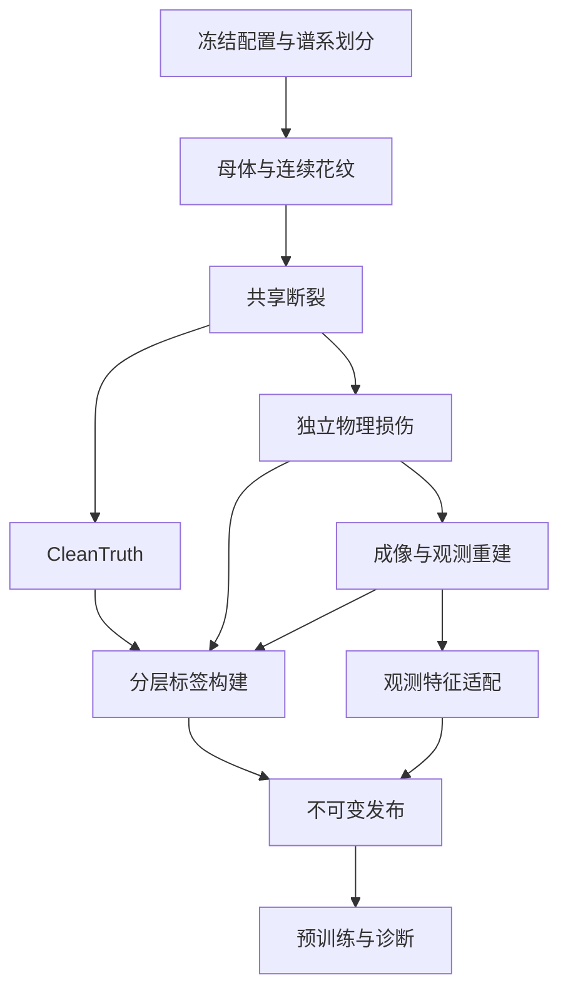
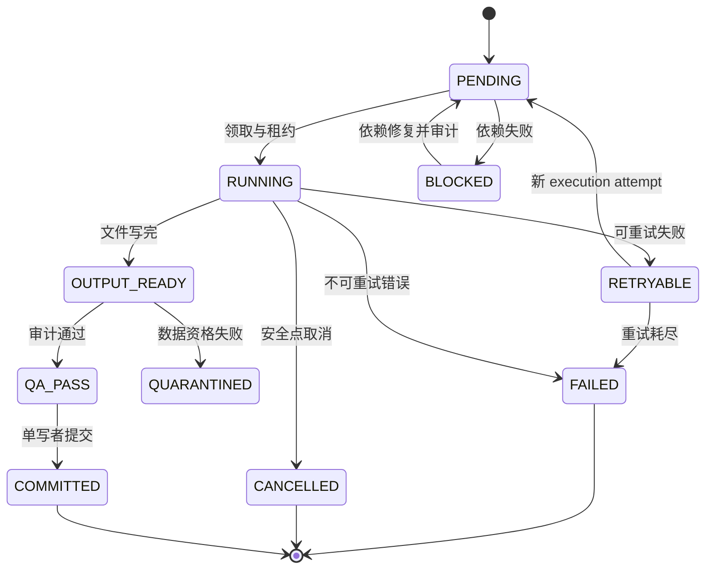

# A12 可控合成碎片实验室、大规模预训练与退化诊断平台

**Codex 完整实施方案 · V1.2 · 2026-10-01 · 深度审计修订 · 开源现成库优先**

本文件面向实际开发：规定实现什么、使用什么算法、代码怎样组织、UI 怎样操作、如何证明实现有效。本次审计依据为用户提供的 V1.1 Markdown 附件；未读取其引用的 V1.45 Word、A3/A4 完整接口或实际仓库。因此，外部合同须在 M00 核验，不能凭引用声明已经兼容。新增接口、目录和命令均是**拟实现规格**，不是现有仓库能力清单。

审计输入：`A12_Codex_Execution_Plan.md`（V1.1）；附件 SHA-256：`be02d9de1d5f4c7e46ed214723c10a9792d297806ddf5c16b1127ec6f5b51612`。原附件引用的 Word 文件名、版本和 hash 仅是其溯源声明，本次未独立验证。本文不改写历史 X/E 系列实验、既有失败判决或已冻结确认协议。对既有冻结实验的变更必须另建协议版本。

**交付边界：完整的程序化实验平台，外加可验证的预训练与诊断流程。** 合成逼真程度、真实邻片找回能力、具体模型的科研收益分别验收。实现平台不自动等于获得科研正结果。

**V1.2执行约束：优先复用现有项目模块与成熟开源库；现成能力能直接调用就直接调用，能适配就只写适配层。确认没有满足本项目精度、真值和运行约束的现成实现后，才从零编写缺失部分。** 下文算法公式和步骤描述的是必须满足的行为与验证依据，不默认要求手写算法内核。第2.3–2.6节规定逐项复用方案，开发卡、验收和末尾Codex提示词同步适用。

本版将问题分为确定的规格冲突、缺失的执行协议和需要 PoC 验证的风险；逐项证据与修正映射见随附 `A12_Deep_Audit_Report_V1.2.md`。本版只完成方案审计，不声称平台算法、性能或真实迁移已经实测通过。

**开发入口**：先读第 30.1 节和第 30.18 节，再按模块依赖实现。先交付可训练、可审计的核心闭环；24 器型、12 材料、16 纹样、四断裂后端、31 轴及所有 UI 仍属于最终范围。PILOT 发布不等于完整平台验收，规模不足时保留真实状态。

## 导航

| 部分 | 内容 |
|---|---|
| 0–3 | Codex 执行规则、目标、技术选择、工程组织 |
| 4–6 | 数据包、坐标、权限、随机性、调度与恢复 |
| 7–10 | 24 种器物、12 材料、16 类花纹、4 个必做断裂后端 |
| 11–15 | 分层真值、物理损伤、成像、几何退化、31 轴完整规格 |
| 16–19 | 候选库、主动观察、预训练、退化诊断与统计 |
| 20–23 | UI、API、配置与 CLI、资源和存储 |
| 24–28 | 开发执行卡、验收矩阵、失败处理、交付清单、启动提示词 |
| 29 | 技术依据与来源 |
| 30 | 观测资格、具体执行协议、风险控制、阶段发布与新增验收 A24–A36 |

## 0. 给执行本文件的 Codex

### 0.1 开始前必须完成的仓库检查

1. 确认当前工作目录与 Git 状态，读取适用的 `AGENTS.md`、项目 README、依赖清单、现有测试和启动方法。
2. 用 `rg` 查找现有 `ObsPack`、`FeaturePack`、数据 loader、图像与点云编码器、候选检索、FastAPI 路由、前端页面和实验报告导出逻辑。记录实际路径与输入输出，不能凭本文件猜测已有代码位置。
3. 生成 `docs/a12/repo_inventory.md`：现有模块、可复用模块、缺口、接口差异、测试入口、设备信息。现有可用流程继续工作；A12 通过适配器接入。
4. 若仓库不存在：建立独立 `relicweave-synlab` 工程，完成本文所有核心模块；提供 `ObsPackAdapter` 和独立浅基线。标记 `MAIN_REPO_INTEGRATION_PENDING`，不得假装已经接入主项目。
5. 若存在多个方案版本：对 A12 新实现以本文为实施依据；读取实际 V1.45/A3/A4 后生成 contract_diff 和适配映射，发现冲突时先解决受影响接口再接主仓；旧冻结数据和实验保持只读，字段差异通过版本化迁移器处理。
6. 在新写算法前，完成第2.3节的开源能力匹配和最小PoC，输出`docs/a12/reuse_manifest.json`。通用算法已有合格实现时必须复用，不因“自己写更灵活”而另建实现。

### 0.2 工作原则

- 技术选择顺序：现有项目合格模块→成熟开源实现→现成实现的适配/扩展→有缺口证据的最小自编部分。不能重复实现通用布尔、BVH/KDTree、三角剖分、滤波、重建、索引、SVG解析、表单框架和优化器。
- 分阶段完成核心功能，首个闭环只是第一阶段，不能交付到 MVP 就停止。
- 每个函数返回真实结果或结构化错误。禁止用随机数曲线、预制排行榜、空实现、假任务进度代替算法。
- UI 必须读取真实 job、asset、release、train run 和 diagnosis report；测试 fixture 只在测试环境启用并显式标记。
- 不一次性训练巨大模型。先验证真值、数据权限、浅基线和可重复性，再扩容量与复杂度。未知外部合同、未通过的高风险后端只能阻塞其依赖模块；合格独立链路按第 30.18 节形成有限范围发布，供训练和诊断使用。
- 模块失败允许隔离，必须继续完成不依赖该失败模块的工作，并记录阻塞；最终按模块状态交付，不能把阻塞项标为通过。
- 修改后运行与变更相关的测试；到阶段验收运行相应集成测试。保留命令、退出码、版本、实际输出和失败分母。
- 历史结果、确认数据、clean 资产和 release 禁止原地重写；修订创建新版本。

### 0.3 完成状态

| 状态 | 含义 | 证据 |
|---|---|---|
| SPECIFIED | 只有设计 | 本文件、接口与执行卡 |
| IMPLEMENTED | 代码存在且能调用 | commit、入口、基础测试 |
| QA_PASSED | 工程与数据资格通过 | 验收日志、资产和报告 |
| VALIDATED | 冻结协议上的实验完成 | 全查询结果、统计区间、成本 |
| RELEASED | 通过发布门并可恢复使用 | 不可变 release、hash、恢复记录 |

模块“已实现”和研究“有收益”分别记录。研究结果允许 `NOT_SUPPORTED`、`NOT_ESTABLISHED`、`STOP-QA`，都不是程序可以修改的成绩。

## 1. 目标与完整范围

### 1.1 必须回答的四类问题

1. **数据量**：固定质量与算法，增加独立母体和训练碎片，是否改善全库邻片找回？
2. **数据质量**：固定模型与母体，仅改变一个退化因素，哪些证据丢失最致命？
3. **算法**：固定输入、候选池和预算，静态、多模态、循环或反证机制是否有可归因增益？
4. **真实迁移**：合成预训练是否改善独立真实碎片的检索、数据效率或可靠性？

### 1.2 核心交付范围

| 维度 | 完整范围 | 完成条件 |
|---|---|---|
| 器物 | 24 个独立注册品种 | 每类可参数化、能输出合格实体、能断裂 |
| 材料 | 12 材料族、4 层状组合 | 表面/断面有统计差异、层来源明确、支持适用损伤 |
| 花纹 | 16 类 | 真实程序生成、周期与尺度审计、断裂继承 |
| 断裂 | 平面、共享粗糙切割、共享形变 Voronoi/Power、二次破碎 | 四后端均过真值和薄壁验收 |
| 退化 | P01–08、I01–10、G01–08、X01–05，共 31 轴 | 每轴零强度、五档、重放、实测变化和标签版本检查 |
| 观测 | 传感器上界部分几何、代理扫描、实际运行照片重建子集 | 三路线及输入资格分开；手机主张必须走 PHONE_RGB；失败照实计数 |
| 关系 | 多正例 R2、R1、R0、灰区、开放库与无邻片 | 全邻片集合闭合；训练采样不误标 R2 |
| 动作 | 规则可达观察、成本、STOP、完整轨迹 | 动作后重检全库；奖励隔离 GT |
| 训练 | 五类核心任务、课程对照、T0–T3 迁移 | 现有输入合同、有效 mask、checkpoint 恢复 |
| 诊断 | N、Q、算法、交互、域迁移和失败类型 | 配对母体统计、固定分母、完整失败报告 |
| 操作界面 | 生成、预览、退化、批量、发布、训练、诊断、恢复 | 所有结果来自真实后端 |

选配：`fracture-modes` 物理插件、Gray–Scott 图案、学习型主动观察/RL、上下文与解释监督。选配缺失不取消核心计数；实际 MVS 子集是验证扫描路线的必做内容，不能以“可选”隐藏未完成。

### 1.3 规模与资格层级

| 层级 | 计划规模 | 用途与门槛 |
|---|---|---|
| L0 闭环 | 1–5 母体、约 8–60 片 | 几何→断裂→损伤→观测→训练→报告真实串通 |
| L1 pilot | 100 独立母体、约 2000 接受片 | 识别正确性、失败类型与资源瓶颈 |
| L2 完整覆盖 | 至少 480 独立母体，约 1 万片 | 24 器物各至少 20 母体；16 纹样、12 材料及所有核心模块覆盖 |
| L3 规模资格 | 嵌套 1 万/5 万/10 万接受片 | 实测资源可承担、读取训练可用、确认集冻结；完整规模证据 |
| L4 研究扩展 | 50 万片候选 | 仅在 10 万曲线显示收益且存储/算力可承担时扩展 |

母体数、谱系数、事件数、片数、邻边数、观察数、关系曝光和 episode 数分别统计。重复断裂同一母体不能增加独立母体数。目标每母体约 20 片是预算假设，不强行切到固定片数。

## 2. 技术选择与环境

### 2.1 默认方案

| 层 | 技术 | 实现职责 |
|---|---|---|
| 核心算法 | Python、NumPy、SciPy | 直接调用采样、插值、FFT、滤波、空间查询和统计；补项目场与配方 |
| 实体几何 | trimesh + manifold3d | 封闭体布尔、拓扑、体积、来源适配 |
| 共享体网格 | Gmsh 适配器 | 材料体和分区面的共形四面体；共享位移由项目实现 |
| 离线成像 | Blender Cycles、独立 bpy worker | 材质、相机、灯光、线性 RGB、标签通道 |
| 图像与观测 | OpenCV、Open3D；已有GPU增强时复用Kornia | 直接调用滤波/编码/相机与点云算法，统一单位和确定性 |
| 照片重建 | COLMAP CLI 适配器 | SfM、去畸变、PatchMatch、融合 |
| 训练 | 现有 PyTorch 编码器/主干 | 合法观测表示、局部 token、关系及多任务训练 |
| 候选索引 | 现有检索；否则FAISS IndexFlatIP，PyTorch/NumPy精确结果校验 | 归一化向量后精确余弦；近似索引仅后续优化 |
| 元数据 | SQLite；沿用既有ORM/队列 | 库负责事务/连接与一致备份；blob 与语义资产分表，项目负责状态约束 |
| 配置/CLI | 现有Pydantic与CLI；无现成CLI时Typer | 自动schema、字段校验、OpenAPI和命令入口 |
| 纹样路径/字形 | Shapely、svgpathtools、Pillow；按需字体工具 | 二维路径/布尔/栅格化，补母体chart与周期约束 |
| SDF表面提取 | Open3D RaycastingScene、SciPy ndimage、scikit-image | 已有距离/形态学/marching cubes内核；项目做减法与误差守卫 |
| 资产 | Parquet、Zarr、图像 tar、JSON | 按访问模式选择，见第 23 节 |
| 后端 | 现有 FastAPI | 配置验证、任务创建、资产读取、SSE、报告 |
| 前端 | 优先现有前端框架；无现成框架时 React + TypeScript + Vite | 页面、类型化 API、表单、任务与比较 |
| 三维/图表 | Three.js / GLTFLoader；现有图表库或 ECharts | 展示派生 GLB、局部点云、配对曲线与热图 |
| 验证 | pytest、属性测试、前端现有测试框架、Playwright | 几何/合同测试、故障注入、真实 UI 链路 |

不根据“最新版本”安装所有库。以兼容测试冻结依赖 lock、二进制 hash 与驱动。trimesh 的官方布尔入口支持 Manifold/Blender 与体积检查；本项目仍需自己维护面来源和断口语义。[R1]

### 2.2 环境隔离与 doctor

- `synlab-core`：Python 3.11/3.12 中选择与项目兼容的一个，锁定。负责几何、调度、API 与数据读写。
- `synlab-train`：与现有 PyTorch/CUDA 环境一致；通过文件和 release 合同连接 core。
- Blender：使用其自带 Python。通过配置文件启动子进程，不把 PyTorch 与整套核心依赖装进 bpy。
- Gmsh、COLMAP、物理插件：各自登记版本、资格与输入约束；插件依赖不污染主环境。
- 前端：沿用实际 Node 与包管理器 lock。没有前端时才建立 Vite 工程并固定经过构建验证的版本。

`synlab doctor --json` 必须依次验证：依赖导入；毫米盒体切割；有空腔薄壳切割；Blender 后台渲染；线性 RGB/整数 ID/深度读取；投影回环；Parquet/Zarr 写读；SQLite 事务；小型 PyTorch tensor；训练与渲染 GPU 租约互斥。输出 `env_report.json`。能力缺失以真实错误显示，禁止提供假结果。

### 2.3 开源复用决策：开发前的必做步骤

1. 查现有模块、官方文档、作者仓库与可用版本，匹配输入/输出、平台、精度、性能、可追溯来源和维护情况。以实际安装版为准，不仅依据库名称判断支持。
2. 先做最小真实PoC：一个常规体和一个薄壁/孔洞/边界样例；确认CPU/GPU路径、单位、随机数、来源属性与关键失败行为。选择可以达到本文合同的实现。
3. 标记复用方式：`DIRECT`直接调用；`ADAPTER`单位/字段/版本适配；`EXTENSION`在现成内核上增加本项目约束；`CUSTOM_GAP`没有合格实现后的最小新逻辑。项目专属业务规则可以是EXTENSION；不能借此把通用内核也重写。
4. 某候选不适用时记录具体证据，例如不支持周期边界、缺面来源、误差超预算、不可安装；检查同类可行替代。通常至少比较两个候选，确实只有一个候选或范围很窄则如实记录，不填虚假评估。
5. 只有查找和PoC证明缺口时进入CUSTOM_GAP：写明缺什么、为什么适配不足、最小需要编写的函数、复用的底层库和验收方法。形成记录后按用户授权继续实现，不额外引入确认流程。
6. 锁定通过PoC的版本/commit、安装来源、许可证文件与依赖；标准库同样算复用。升级后重跑受影响资格，不能用安装报错作为从零重写的理由。

`reuse_manifest.json`每模块最低字段：`module`、`requirement`、`candidates`、`selected_dependency`、`version_or_commit`、`source_url`、`license_ref`、`mode`、`adapter_path`、`poc_command`、`poc_result_ref`、`gap_reason`、`custom_scope`、`acceptance_ids`。DIRECT/ADAPTER的gap字段允许null。该清单是实现证据，不向产品普通用户展示工程细节。

### 2.4 逐模块的开源复用矩阵

下表为默认实现路线，不要求把所有候选都安装。已经有合格实现时沿用；新增依赖按实际使用引入。API签名以lock对应官方文档为准。

| 能力 | 首选现成库/接口 | 复用方式 | 仅需补写的项目部分 |
|---|---|---|---|
| 参数与随机数 | NumPy Generator；SciPy qmc LatinHypercube/Sobol | DIRECT+ADAPTER | 分模块seed、谱系split、可行配额 |
| 剖面插值 | SciPy PchipInterpolator/BSpline | DIRECT | 厚度/曲率限制、器物参数与chart |
| 旋转/挤出/扫掠 | trimesh.creation.revolve/extrude_polygon/sweep_polygon [R15] | DIRECT+ADAPTER | 有厚度封闭剖面、构件语义、薄壁QA |
| 二维轮廓与偏移 | Shapely/GEOS [R16] | DIRECT | 母体尺度与合法区域；不冒作三维测地算法 |
| 实体布尔/连通块 | manifold3d；trimesh.boolean与split [R1] | DIRECT+ADAPTER | 同一C、来源映射、事件树、debris账本 |
| 最近点/射线/SDF | Open3D RaycastingScene、trimesh proximity [R17] | DIRECT+ADAPTER | 单位、origin标签、歧义mask、thin-wall守卫 |
| Voronoi/Power分区 | SciPy HalfspaceIntersection/ConvexHull，既有合格分区库 [R21] | DIRECT+EXTENSION | 加权半空间、有限盒、内部可行点、全cell记录 |
| 共形体网格 | Gmsh [R3] | DIRECT+ADAPTER | 共享面拓扑登记、标签导出与共同warp |
| 物理断裂选配 | fracture-modes作者实现 [R2] | ADAPTER | 单位、GT接入、薄壳适用与成本报告 |
| 规则线/噪声场 | NumPy向量运算/FFT；SciPy ndimage滤波 | DIRECT+EXTENSION | 周期系数、毫米尺度、配方与抗混叠约束 |
| Poisson点阵 | SciPy qmc.PoissonDisk [R18] | DIRECT+EXTENSION | 周期缝/曲面度量/变半径约束与审计 |
| Bezier/SVG | svgpathtools [R19]；Shapely二维填充 | DIRECT+EXTENSION | 有界花叶grammar、瓦片重复、chart映射 |
| 字符绘制 | Pillow文字布局/绘制；已有字体工具 [R20] | DIRECT+ADAPTER | 一次排版冻结、字体来源、周期图案位置 |
| 体素损伤/等值面 | SciPy ndimage；scikit-image.measure.marching_cubes [R22][R28] | DIRECT+EXTENSION | 退让场、ROI、分块halo、只减材料与标签更新 |
| 模糊/重采样/JPEG | OpenCV GaussianBlur/filter2D/resize/imencode [R23] | DIRECT+ADAPTER | 毫米/像素参数、basis、zero bypass、测量 |
| GPU可微滤波 | 已有Kornia filters [R24]，或原有增强链 | DIRECT | 仅需要GPU/可微时接入，不重复CPU/GPU内核 |
| 高光/遮挡/DOF | Blender Cycles/节点/场景 [R7] | DIRECT+ADAPTER | 实际场景配方、标定、观测/标签通道隔离 |
| 点云法向/采样/简化 | Open3D；已有合格点云模块 [R13] | DIRECT+EXTENSION | 嵌套采样顺序、区域配额、独立误差测量 |
| 多视图重建 | COLMAP [R10] | DIRECT+ADAPTER | 相机/掩码/argv、失败分母与校准 |
| 训练与向量检索 | 现有PyTorch编码器/loss组件；FAISS [R11][R25] | DIRECT+EXTENSION | 多R2/灰区mask、项目任务、标签权限与公平预算 |
| schema/API/CLI | Pydantic/FastAPI，既有CLI或Typer [R26][R29] | DIRECT+ADAPTER | 字段、跨字段约束、路由与结果语义 |
| 执行与元数据 | 现有任务队列/ORM；无现成时ProcessPoolExecutor+sqlite3，需ORM时SQLAlchemy [R30] | DIRECT+EXTENSION | lease/资源互斥、资产提交日志、恢复不变量 |
| 参数表单/界面 | 现有UI组件；React缺表单时RJSF+AJV [R27] | DIRECT+ADAPTER | 中文字段文案、业务动作、真实结果联动 |
| 三维/图表 | 现有Three.js/GLTFLoader与图表库 [R12] | DIRECT+EXTENSION | 资产LOD、对比、联动与正确测量来源 |

Shapely只解决二维几何。Open3D signed distance要求实体水密、内外定义明确；观测开放网格不能直接当真实实体SDF。[R16][R17] SciPy PoissonDisk的默认能力不等于自动具备周期/曲面/变半径约束，扩展后的实测点距必须达标。[R18]

### 2.5 自编范围与算法说明的解释

允许按缺口证据补写：连续母体坐标/语义、器物配方、有界随机纹样grammar、周期约束、共享C构造规则和origin映射、共同warp、断裂事件树、三层标签、31轴配方与效果审计、合法正负采样、主动观察可达性、数据权限、资产事务与研究指标。这些应建立在现成几何/数值/训练/数据库内核上。

例如“实现Poisson点阵”优先调用SciPy并加周期审计；“实现Marching Cubes”调用scikit-image；“实现粗糙断裂”是生成共享C、调用Manifold并维护真值；“实现照片重建”是调用COLMAP；“实现多正例loss”只补项目合法索引/聚合规则并用PyTorch logsumexp/CE等已有运算。章节中的推导用于验算行为，不能作为重写内核的指令。

某开源算法不满足特定合同，只隔离缺失能力。例如普通分区不能给出共享粗糙面，就在现成半空间/网格内核之上加共同warp，而不是自写完整几何引擎；现成退化库只有gamma图噪声，就用NumPy RNG和已有相机流程补线性RAW配方，不能错称已满足传感器模型。

### 2.6 依赖引入与回退

每类核心能力默认只选一个主后端与一个必要校验/回退路线，避免同时接入多套功能相同的框架。训练骨干、任务队列、组件库和增强框架已有可用选择时保持该选择；缺能力先扩展接口。

能力探测失败时给出DEPENDENCY_CAPABILITY_MISSING或明确后端错误，尝试已记录替代；没有合格替代再进入CUSTOM_GAP。无声切换到自编实现、粗精度或oracle路线都不允许。依赖与license记录随release交付；新功能能正常调用且通过业务资格才算集成完成，不因完成pip install就标IMPLEMENTED。

## 3. 软件架构与目录职责

### 3.1 资产依赖图



标签构建器可以读取 Truth；模型 forward 只接收特征适配器产生的白名单。Scene、Sensor、ISP、GeometryObs 与 FeatureProtocol 在观测子流水线中按顺序执行。UI/API 创建任务并读取已提交结果，不在请求线程运行重型算法。

### 3.2 目标代码组织

下表是目标模块位置；集成现有工程时可调整实际目录，但必须在仓库清单记录映射。

| 路径 | 必须实现的内容 |
|---|---|
| `synlab/cli.py` | 第 22 节全部 CLI；退出码与 JSON 输出 |
| `synlab/schemas/` | 配置、六种 Pack、Result、run、report；未知字段拒绝 |
| `synlab/registry.py` | 器型/材料/纹样/断裂/31 轴注册、版本、适用范围 |
| `synlab/seeds.py` | 稳定 hash、独立随机子流、canonical JSON |
| `synlab/mothers/` | 旋转壳、板、扫掠、构件组合、24 品种 |
| `synlab/patterns/` | 16 族、连续场、距离场、烘焙、几何位移、QA |
| `synlab/fracture/` | 刀具、平面/粗糙/分区/二次破碎、来源映射 |
| `synlab/truth/` | clean、physical、visible 标签与关系闭合 |
| `synlab/physical/` | P 算子、SDF 分块、层损伤、材料不增加守卫 |
| `synlab/cameras/` | 轴转换、K、crop、可达轨道、U 近远档 |
| `blender_scripts/render_worker.py` | 配置入口、线性成像、独立标签和资源释放 |
| `synlab/observe/` | 理想部分观察、代理、COLMAP、观测质量估计 |
| `synlab/degrade/` | 31 轴 compiler/apply/measure，阶段与组合守卫 |
| `synlab/relations/` | gallery、全 R2、hard negative、开放库 |
| `synlab/episodes/` | 可达动作、成本、STOP、环境与冻结轨迹 |
| `synlab/training/` | adapter、collate、loss、curriculum、checkpoint |
| `synlab/diagnostics/` | 固定池评测、配对实验、区间、N90/Qcrit |
| `synlab/jobs/` | 调度、lease、GPU 互斥、重试、恢复、单写者 |
| `synlab/storage/` | 不可变资产、shard、索引、hash、release |
| `synlab/qc/` | 几何、投影、权限、配对、覆盖、发布资格 |
| `synlab/api/` | 第 21 节路由与观测/研究响应分离 |
| `frontend/src/features/synlab/` | 第 20 节页面、交互、三维、报告 |
| `tests/a12/` | 解析 fixture、集成、恢复、31 轴、UI 验收 |
| `configs/a12/` | 闭环、pilot、覆盖、资源、训练、诊断冻结配置 |
| `docs/a12/` | 运行手册、接口、版本、验收和实现状态 |

### 3.3 通用 Result

```json
{
  "status": "QA_PASSED",
  "output_refs": [{"asset_id": "a_opaque", "hash": "sha256:..."}],
  "input_hashes": ["sha256:..."],
  "qa_report_ref": "qa_opaque",
  "metrics": {"volume_error_ratio": 0.0002},
  "error": null
}
```

失败时 `error={code, stage, message, attempt, retryable, seed_ref, config_hash, evidence_refs}`。日志包含实际 stdout/stderr、wall time、CPU RSS、GPU 峰值和 IO 字节。示例数值只是响应结构演示，不能预填实际报告。

## 4. 数据合同、坐标与权限

### 4.1 六种 Pack 与派生标签

| Pack | 必需字段 | 输出位置与用途 |
|---|---|---|
| MotherPack | lineage、parent、prebreak components、参数、mesh、surface map、material field、hash、unit | 生成与研究审计；不是部署特征 |
| TruthPack | event/revision、leaf fragments、接口 patch、历史 R2、装配变换、重心对应、QA | 监督与真值审计 |
| PhysicalPack | fragment、damage recipe、mesh、survivor map、lost volume、revision/hash | 损伤后的真实实体；保留 clean 引用 |
| ObsPack | opaque sample ID、RGB、部署 mask/ROI、camera、部分 geometry、OBS_EST quality、presence/validity | 唯一可进入模型的观测来源 |
| RelationPack | query/candidate、R 标签、灰区、hard type、监督 valid、loss mask、pool | loader 可读标签；forward 不读答案 |
| EpisodePack | 初始观察、动作空间、成本、观察引用、状态、STOP、奖励规格 | 规则/策略比较；GT 只供环境算奖励 |

`PhysicalTruth` 和 `VisibleLabels` 是 TruthPack 的版本化派生标签，不再增加核心 Pack 数。`features / labels / provenance` 三个对象分开返回，不通过字典合并制造泄漏。

### 4.2 数组形状与有效性

| 字段 | 形状/类型 | 规则 |
|---|---|---|
| RGB | `[H,W,3] uint8`；线性源单独 float32 | 来源、响应、编码、原始 hash 记录 |
| integer label | `[H,W] uint16/int32` | 研究语义标签；不插值出小数类别 |
| deployment mask | `[H,W] bool/float32` | 预测/计时人工来源；与 GT 标签分开 |
| points | `[N,3] float32` | scale_valid=true 才用局部 mm；否则声明 arbitrary/reconstruction unit；空模态 `[0,3]` 且 presence=false |
| normals | `[N,3] float32` | 从受损观测估计；normal_valid 单列 |
| depth_z | `[H,W] float32` | 相机 z，单位 mm；invalid mask 独立 |
| K、T | `[3,3]`、`[4,4] float64/float32` | frame 名称、语义和变换方向显式 |
| quality | `[V,R,Cq] float32` | view/region/channel；每项 valid、来源与估计版本 |
| local tokens | `[L,256]` 起步 | L 可变；位置、模态、source grouping、valid |
| correspondence | 两侧 face_id+barycentric、界面来源和 valid | 只监督；网格版本变化必须重映射 |

数组元数据带 unit、frame_id、shape、dtype、schema、asset_hash。padding 在 attention、pooling、loss 全部排除，不能把零点或零图当真实证据。

### 4.3 坐标与相机

- 权威几何：毫米、右手系。Blender 场景若用米，所有长度明确乘 `0.001`，导出时可逆转换。
- 定义 `T_AB` 把 B 坐标映到 A。W 为装配世界，F 为片局部，S 为随机扫描框架，C 为相机。
- 每片独立随机扫描姿态；同片各 view 共用可观测 S 框架。SO(3) 使用归一化 Gaussian 四元数等正规采样，不用均匀欧拉角冒充均匀旋转。
- 模型不读 `T_WF`、原始装配坐标或候选间真相对位姿。
- OpenCV 相机：右、下、前；Blender 相机局部：右、上、负 z 视线。适配矩阵明确写入代码并以解析点回环测试。
- crop/resize：像素仿射 A 时 `K_new = A K_old`；旋转图像或畸变模型不能套错轴，必要时去畸变后重建相机模型。
- 光线距离 r 与 z 不同：单位射线 d 下 `z = r*d_z`。用已知平面验收，不根据文件名推测深度语义。
- 真实图像没有合格尺度来源时 scale_valid=false，不能从模拟器、clean 尺寸或 GT 配准补毫米比例。部署使用的相机外参必须是实际测得或估得；精确渲染/装配外参仅供隔离参考路线。每个字段携带 source_kind、estimator/calibration ref 和 valid。像素中心、crop/resize 的半像素偏移及 COLMAP 转换见第 30.3 节。

### 4.4 白名单与隔离

允许：实际 RGB、可获得/预测的 mask 与 ROI、OBS_EST 质量、可用相机与标定、受损观测点云/网格及有效尺度、合法上下文字段。

禁止进入 forward：parent/object/bag ID、seed、generator family ID、interface ID、关系答案、historical_R2、mate_present、truth pose、clean 隐藏表面、GT 厚度/法向/曲率、精确损伤强度、spurious_mask、hard_case_tag。

部署标签不等于研究标签。自动断口 ROI 首选现有分割器；没有合格模型时，使用可计时的人工/可观测几何候选基线，并单列 `MANUAL_OBS` 或 `HEURISTIC_OBS`。精确 GT ROI 只在 `ORACLE_ROI` 对照使用，不能将它作为 SY-Q0_OBS 默认输入。

测试包括：白名单递归检查、模型导出依赖检查、标签文件移走后推理仍能运行、随机替换 provenance/标签内容不改变 features、不同片的扫描随机化检查。线上资产接口只返回观测派生物；研究真值接口采用独立响应类型和服务端角色鉴权。审计覆盖 ROI、融合、质量估计、候选过滤和检索全部阶段，不限于 forward；还要测试顶点/点/面排列、source ID 和缓存命名的侧信道，见第 30.12 节。

### 4.5 谱系与数据划分

先划分 `shape_lineage_id`，再生成母体、纹样、事件和观察。相同基础 mesh 的缩放、换色、微扰、替代断裂、二次破碎、同源扫描属于同谱系。内部默认 train/dev/confirm=80/10/10，确认集开启前冻结；比例不足时先修改计划，再冻结。

同母体不同替代碎裂不能放入同一个候选库，它们重叠占据原材料。器身与盖保留 prebreak_component；原有装配接触不属于新断裂 R2。

谱系簇取 shape lineage、真实物理母体及其派生关系的保守连通闭包；参数模板 ID 不自动等于母体 ID，新抽随机 seed 也不自动产生新独立谱系。另建器型、纹样模板、后端、材料与相机工况留出。背景/光照覆盖各 split，避免 split 与渲染风格绑定。近重复形状做几何指纹检查；纹样允许有意重复作为困难负例，但模板留出实验必须隔离模板族。

## 5. 稳定随机性与配置版本

### 5.1 随机数子流

每个模块独立派生：shape、material、pattern、cut、damage、camera、light、sensor、geometry、sampler。pattern.evaluate 只读冻结系数，禁止在查询点或 fragment 内重新抽随机数。

```python
import hashlib
import json

def seed64(master_seed: int, *parts) -> int:
    payload = json.dumps(
        [master_seed, *parts], ensure_ascii=False,
        separators=(",", ":"), sort_keys=True, allow_nan=False,
    ).encode("utf-8")
    return int.from_bytes(hashlib.sha256(payload).digest()[:8], "little")

# 固定显式 key，不依赖 worker 编号、完成顺序或 Python hash()。
# np.random.Generator 的 bit generator 类型与版本写入 env_report。
# 例如：seed64(master, lineage, event, fragment, "damage", axis, basis_id)
```

执行重试默认不换内容 seed，只增加 execution_attempt；更换 seed、网格预算、算法参数或 precision 是新的 generation_variant/spec_hash，并保留原尝试和拒绝原因。配对实验的基础对象不可在不同档分别换 seed。所有强度共用 basis_id，不能每档重抽破坏配对。加入 worker、任务重排和单个失败重跑，不应改变其他样本。

### 5.2 配置编译

配置输入统一转 typed schema，拒绝未知字段、NaN、负厚度、非法单位、未注册轴、不支持的材料组合和阶段逆序。canonical JSON 固定排序、浮点编码、数组顺序与单位，不用 YAML 原文直接判断语义相同。

使用Pydantic/既有schema校验器实现这些约束，CLI复用既有入口或Typer。compiler校验CUSTOM_GAP依赖的reuse记录，缺证据时拒绝该自编内核注册；普通项目配方/标签/业务逻辑按EXTENSION登记。

`job_id=hash(stage + canonical_spec + input_hashes + code_fingerprint + backend_fingerprints + schema_versions)`；code_fingerprint 至少包括 commit、dirty diff、实际使用的未跟踪源码和配置内容 hash，不能只记 commit；hash 依赖完整配置。廉价缓存和权威资产分开；encoder 变化、crop 变化、geometry 变化必须失效对应特征。

M00 取得并验证实际 `rw-schema-1.1` 后才建立主项目 adapter；缺少原 schema 时使用 `a12.obs.v1` 独立入口并标 INTEGRATION_PENDING。A12 配置采用 `synlab.v3` 的严格实现；旧 `synlab.v2` 只有存在真实定义和样例才提供只读兼容，不能凭名称编造迁移器。迁移输出新版本和 migration_report，不静默补答案字段。

## 6. 调度、提交与恢复

### 6.1 任务状态机



暂停与取消属于 run 控制状态；不把正在写文件的 job 直接当 COMMITTED。取消停止新步骤，保留已提交资产、失败和日志；恢复从安全点继续。

### 6.2 具体程序

1. planner 生成 DAG 和资源估算；依赖必须 COMMITTED 后 job 才可领取。
2. 本机 scheduler 用事务领取任务，写 owner、lease expiry、heartbeat、attempt。SQLite WAL 仍只有一个写者，数据库放本机盘。[R9]
3. CPU worker 只写 job/attempt 独占目录；GPU worker 必须持有租约。渲染、MVS、训练共享同一互斥租约。GPU lease 过期不等于进程已退出；接管前必须停止并确认旧进程组释放设备，否则进入 GPU_DRAIN_PENDING，禁止启动新占用者。
4. 输出写临时文件→flush/fsync→数量/长度/hash 校验→OUTPUT_READY→数据 QA。
5. 同盘原子 rename 单个完成资产，再由单写者事务提交 asset_refs 和 manifest。多文件发布的可见性以 commit 记录为边界，不能假定整个目录 rename 就涵盖所有文件系统。
6. job 再执行先核验已提交结果 hash。过期 lease 进入恢复审计；旧 worker 回来不得再次提交，提交需验证 fencing token/attempt。
7. release 只引用 COMMITTED 且 QA_PASS 资产；验证完整引用闭包，写不可变 release manifest。

### 6.3 数据库最低表

| 表 | 最低字段与约束 |
|---|---|
| runs | run_id、spec_hash、status、scope、created_at、revision |
| jobs | job_id、run、stage、inputs、state、attempt、lease_token、owner、heartbeat |
| dependencies | job_id、depends_on；无环验证 |
| blobs | blob_hash 唯一、relative_path、size、提交记录；只负责字节去重 |
| assets | asset_id、blob_hash、role、schema、unit/frame、interpretation_hash、QA；同字节允许被不同语义资产引用 |
| events | 自增 event_seq、run/job、state revision、message、time |
| releases | release_id、manifest hash、scope、freeze time；不可改内容 |
| gpu_leases | device、owner、token、expires_at；设备占用互斥 |

元数据和资产文件之间采用可恢复提交日志。DB commit 前掉电：文件可作为孤立候选重新审计；DB commit 后文件缺失：标为数据损坏并阻止读取。恢复不能靠把成功数手动补齐。

### 6.4 资源守卫

起步 CPU 几何进程 2–4、每库线程 1–2；任务 RSS 总目标不超过 30 GB，GPU 工作目标 24–26 GB，渲染队列 2–4 个 ready asset。通过实际 profiling 调整，不把这些初值当实测保证。

磁盘 70% 提示、80% 限制新增重任务、90% 停止新资产任务；已提交数据继续可读。每任务先估临时峰值，在事务中登记 disk/RAM/VRAM reservations；按所有并发预留之和准入，不能各自看到同一空闲容量便同时开工。容量不足返回 `BUDGET_EXCEEDED`。瞬时执行失败最多重试 3 次且内容 seed 不变；数值/参数修订创建显式 variant，不能假装同一重试。各档任一资格失败保留配对 roster，并计失败；禁止只保留五档全部通过的母体作为确认样本。

## 7. 参数化母体生成

### 7.1 有厚度旋转壳

输入无量纲轮廓比例、尺寸 mm、壁厚场、足圈与复杂度；输出封闭材料体，不是只有外皮的曲面。

先用SciPy插值形成合格封闭材料剖面，再调用trimesh的旋转/挤出/扫掠和Manifold布尔。下列步骤是剖面与语义约束；仅在原函数确实不能保留所需chart/拓扑且适配也失败时补最小生成段，不手写整套旋转/挤出或布尔内核。[R15]

1. 用 PCHIP 或 B 样条构建剖面中线 `q(s)=(r(s),z(s))`，s 为剖面弧长。限制控制点有序、r 非负、曲线无自交。
2. 计算二维单位法向 n(s)，构建内外壁 `q±(s)=q(s)±0.5*t(s)*n(s)`。径向减常数仅作简化基线，斜壁真实法向厚度需上述偏移。
3. 检查局部曲率与壁厚，偏移曲线自交、负内径或薄于最小厚度即拒绝。轴附近底部采用专门封底拓扑，避免重复轴顶点和退化三角形。
4. 周向生成 `p(s,θ)=(r(s)cosθ,r(s)sinθ,z(s))`；口沿连接内外壁，底部闭合陶瓷材料。敞口空腔保留，不能用平盖把碗口填实。
5. 曲线与周向按弦误差/曲率自适应采样。原型 128–256 周向段；最终以误差验收，而不是固定段数。
6. 低幅非轴对称变形共同作用于内外壁，例如椭圆截面、偏心和有限周向模式。所有位移经过最小厚度与自交 QA。
7. 保存 surface_tag：外壁、内壁、口沿、底足、配件；保存从母体 xyz 到表面 chart 的映射和合法图案区域。

常规尺寸起步 80–300 mm，壁厚 2–10 mm；极薄与厚块独立 stress 配额。真实样本校准后才能称真实分布。

### 7.2 24 品种注册表

每个名称必须有独立生成入口和至少 3 个有实际形状作用的参数；共用底层算法可以，不能同 mesh 改名凑数。

| ID / 品种 | 构造程序 | 核心形状变量 |
|---|---|---|
| V01 碗 | 旋转薄壳 | 深径比、口沿、足圈 |
| V02 深盘 | 深盘剖面旋转 | 深度、底盘宽、壁角 |
| V03 浅碟 | 浅剖面与低足 | 边缘起伏、盘底曲率、口沿 |
| V04 杯 | 旋转壳，可加柄 | 杯腹、杯高、柄截面 |
| V05 高足杯 | 杯壳+封闭高足 | 足高、足根、杯腹 |
| V06 罐 | 肩腹口剖面 | 肩位、腹径、口径 |
| V07 瓶 | 颈肩腹剖面 | 颈长、肩角、腹径 |
| V08 双耳瓶 | 瓶体+两扫掠耳 | 耳弧、连接根厚、耳高 |
| V09 壶 | 壶体+柄+有厚度流 | 流角、流径、柄形 |
| V10 带盖壶 | 壶体与独立盖组件 | 盖缘、配合口、钮形 |
| V11 坛 | 大腹短颈 | 腹口比、肩弧、底径 |
| V12 盆 | 大开口薄壳 | 底口比、深度、足部 |
| V13 盒 | 圆角截面挤出壳 | 长宽高、转角、盒缘 |
| V14 盖 | 圆/多边截面盖实体 | 盖厚、扣缘、拱度 |
| V15 灯盏 | 浅器体+灯嘴 | 盏深、嘴长、嘴角 |
| V16 香炉 | 腹体+支脚/孔 | 足数、足根、孔位 |
| V17 花盆 | 有厚度壳+排水孔差集 | 孔径、底口比、锥度 |
| V18 砖 | 圆角实体板 | 长宽厚、边槽、翘曲 |
| V19 平瓦 | 有厚度参数板 | 厚度、边缘槽、坡面 |
| V20 弧瓦 | 弧面扫掠厚壳 | 弧径、包角、长度 |
| V21 曲面板 | B 样条双曲率厚壳 | 双曲率、翘曲、厚度 |
| V22 碑板 | 厚板+刻字/浮雕 | 长宽、倒角、装饰区域 |
| V23 小雕像 | 封闭超二次体/扫掠组合 | 姿态、比例、连接厚度 |
| V24 装饰构件 | 参数基础体布尔/浮雕板 | 对称、重复数、局部厚薄 |

把手/耳/足通过有体积交叠的封闭构件并入，布尔后检查根部厚度。有厚度壶流保留管内空腔。盖和器身是独立 prebreak component，保存同母体关系但不把原接触标断裂 R2。导入雕像 mesh 必须有来源、谱系、资格与许可记录。

### 7.3 采样、多样性与返回前 QA

- 离散类别用配额，连续参数默认 Latin Hypercube；抽比例再抽尺度，以减少不可行组合。[R4]
- 生成 feasible combination matrix；不做 24×12×16×31 全笛卡尔积。每类至少跨 2 个可行独立因素，薄壁、素面、高曲率、重复纹样和复杂连接单列配额。
- 连续 Sobol 替换需按 2 的幂生成；约束拒绝后记录不再保留原均衡设计，不能删点后仍宣称完整 Sobol 平衡。[R5]
- `coverage.parquet` 列 planned/attempted/accepted/quarantined、分布、参数分位与拒绝原因。
- 每个母体：水密、朝外正体积、无自交、无未解释退化面、最小厚度、空腔、来源标签和 chart 合格。失败不能输出空 mesh 冒充成功。
- 24 类各 20 独立母体需至少 480 母体。100 母体 pilot 不能通过完整覆盖门。

## 8. 材料与层结构

### 8.1 MaterialProfile

分开保存：外观参数（线性 albedo、roughness、IOR、transmission）、几何统计（颗粒/孔隙/粗糙谱）、程序切割统计（方向与相关长度）、未来力学参数。未校准的杨氏模量、泊松比、韧度为 UNKNOWN；不能把噪声幅度叫材料断裂韧度。

定义纯函数 `material_at(mother_xyz, surface_tag)`，返回层、连续颜色与方向场。断裂后查询同一母体场，颗粒/纤维不会在相邻片边界重新随机生成。

| ID / 材料 | 必须实现的区别 | 适用与边界 |
|---|---|---|
| M01 粗陶 | 大颗粒、孔隙、不均匀坯色 | 向内掉粒与粗糙断面 |
| M02 细陶 | 细颗粒、短相关长度 | 独立磨光与侵蚀 |
| M03 炻器 | 致密、低孔隙 | 可有釉面高光与缺测 |
| M04 白瓷 | 浅坯色、薄壁、釉 | 小尺度断口与薄壁守卫 |
| M05 彩瓷 | 瓷体+母体连续彩绘 | 外绘不传播到新断面 |
| M06 施釉陶 | 陶体+独立釉层 | 层交界、掉釉与坯损分开 |
| M07 玻璃 | 透明/半透明、高光、光滑弯切面 | 合法扫描可缺测；理想深度单列 |
| M08 石材 | 矿物颗粒、层理方向 | 各向异性切面和风化 |
| M09 石膏 | 浅色多孔、粉化 | 颗粒与侵蚀统计 |
| M10 骨质 | 多孔、内外层差、方向场 | 程序统计，不声称生物力学 |
| M11 木质 | 连续纤维/年轮、方向性边缘 | 程序撕裂统计，不声称真实裂纹求解 |
| M12 金属 | 反射、腐蚀层、程序切面 | 塑性断裂不在核心程序后端中 |

### 8.2 四层组合

1. 坯体+釉；2. 坯体+彩绘；3. 石质+表面涂层；4. 木基体+涂饰。

支持两模式：`SHADING_LAYER` 只改外观与材质标签；`GEOMETRIC_LAYER` 根据母体外壁距离生成真实有厚度层实体。前者不输出精确剥层体积或几何剥落真值。真实层需水密、层间无未解释重叠、连续场/层来源和最小厚度 QA。

新增断面暴露坯体和实际层截面；不能将所有新面沿用彩绘。损伤记录每层残留；几何材料损失与颜色变化分别计量。

## 9. 随机花纹生成：完整算法

### 9.1 接口与六步流程

`build_pattern(mother, spec, seed) -> PatternRecipe`；`evaluate(recipe, chart_points) -> PatternChannels`。

PatternRecipe是项目逻辑，底层采样/曲线/SVG/字体/滤波按第2.4节直接调用现成库。16族是16种受控配方与组合，不要求16个从零实现的绘图引擎。

Recipe 包括 family、palette、surface regions、primitive params、频带系数、warp、height policy、资源 hash、版本。通道：线性 albedo、roughness、height_mm、pattern_region。输入含 surface_tag、periodic u、profile s_mm、mother_xyz；查询函数不取 RNG。

1. 抽主族、区域、调色板、尺寸、线宽、相位，最多叠 2 个辅助层；素面和强重复固定配额。
2. 建解析场/矢量路径/点集；一次生成并冻结。
3. 用低幅连续场扰动颜色、线宽或路径；clean 里的图案不包含假装磨损的随机掉漆，掉漆由 P05 负责。
4. 组合通道，检查范围、真实毫米尺度与合法边界。
5. 几何浮雕/刻线先作用完整母体，QA 后再断裂；normal map 只作外观，不能替代真实几何。
6. 按需烘焙带 hash 的缓存和 mipmap。碎片查询母体原场；新断面查询材料体场。

### 9.2 周期坐标与连续噪声

旋转体 `u=atan2(y,x)/(2π) mod 1`；s 为真实剖面弧长。底足/内壁/配件分 chart，记录合法绘制边界。强不规则体可用三平面颜色投影或局部 chart，但不能称三平面混合为全局测地 SDF。

周期随机傅里叶场：

$$n(u,s)=\sum_{j=1}^{J} a_j\cos(2\pi(k_j u+f_j s)+\phi_j),\quad k_j\in\mathbb Z,\; f_j\ [\mathrm{mm}^{-1}].$$

整数 k 保证 u=0/1 的值和一阶导数相同。在母体面积加权采样上去均值、归一 RMS，保存实测频带能量。周向间距 `2πr(s)/|k|` 随半径变，不能宣称整个器物同一毫米间距。

自然斑驳使用 3–5 个频带，起步相邻频率约×2、振幅×0.5；最终按局部最短波长与投影足迹控制。有限 Fourier 是主几何频谱实现；Perlin/fBm 是可替换外观场，不能认为有限 octave 自动严格带限。

domain warp 使用周期位移场，记录单位转换，检查 Jacobian 正向与最小奇异值。warp 后重新测频谱，颜色纹理低通/mipmap；几何细节不足必须细化或拒绝，不能悄悄换 normal map。

### 9.3 距离场、抗混叠与 16 族实现表

线条 alpha：`1-smoothstep(w/2-footprint, w/2+footprint, distance_mm)`。footprint 来自纹理采样与投影，不是随意常数。线宽候选 0.5–3 mm、间距 5–30 mm；必须满足线宽小于间距和局部可表达能力。

| 族 | 必须实现的算法 | 关键参数与实际检查 |
|---|---|---|
| PAT01 素面 | 常色+可选低频颜色场 | 可完全无纹样；颜色范围、均匀度 |
| PAT02 环带 | s_mm 周期中心线距离 | 带宽、间隔、相位；周向无缝 |
| PAT03 条纹 | 周期线性相位距离 | 方向、周期、宽度；周向整数频数 |
| PAT04 格网 | 两组条纹 mask 并/交 | 交角、间距、混色顺序 |
| PAT05 波浪 | 正弦/Bezier 中心线到曲线距离 | 波长、幅度、宽度；周期端点匹配 |
| PAT06 点阵 | 晶格或周期 Poisson disk+圆距离 | 密度、半径、排斥距；跨缝检查 |
| PAT07 三角 | 周期三角瓦片、边线距离/重心填充 | 边长、朝向、线/实心 |
| PAT08 回纹 | 周期折线路径、线段最短距离 | 转折数、宽、留白；瓦片端点连接 |
| PAT09 交叉线 | 2–3 组线场分层叠加 | 交角、疏密、允许缺笔 |
| PAT10 花叶 | 有界 L-system/Bezier 骨架+叶轮廓 | 枝长、角、叶间距、最大段数 |
| PAT11 局部徽记 | 程序矢量符号或合法 SVG 路径 | 位置、大小、空白区域、资源来源 |
| PAT12 字符 | 有许可字体矢量/光栅距离图 | 字序、字号、字距；字体 hash |
| PAT13 窑变 | 连续低频+细斑场、调色板映射 | 斑块尺度、roughness 相关度 |
| PAT14 浮雕 | 平滑 mask→正 height_mm→完整体位移 | 高、坡度、网格误差与壁厚 |
| PAT15 刻线 | 曲线距离→负位移/封闭刀具差集 | 宽深、交叉处厚度、材料移除 |
| PAT16 组合 | 区域 mask 与上述层有限组合 | 混合次序、有意边界、连续性 |

所有 16 族提供三档复杂度及至少 20 独立母体实例；不得以 16 张固定图片通过验收。

### 9.4 Poisson disk 点阵：现成采样器与周期扩展

1. 默认用`scipy.stats.qmc.PoissonDisk`生成固定半径欧氏候选点，明确rng、radius、ncandidates与可用bounds；关闭可能破坏最小点距的后处理优化。禁止重写库已有的active-list/邻格采样内核。[R18]
2. chart仍是`(x=C_ref*u, y=s_mm)`。如安装版支持目标bounds则直接使用；否则按同一个标量归一尺度采样并裁合格区域。x/y不能分别缩放后还宣称相同毫米排斥距。
3. 周期缝用现成候选加x±C_ref副本，通过SciPy cKDTree或现有邻域模块检查最近距；用稳定顺序剔除违反跨缝排斥的点，记录剔除率、实际密度和最大空隙。若有合格原生周期采样器，直接替换此扩展而不重写内核。
4. 变半径需两点半径和+留白。候选仍用库生成，扩展只负责实际半径条件/保留规则与补采；补采共用冻结recipe/basis，最终密度不足则失败，不放宽点距掩盖不足。
5. 映回母体，检查同surface_tag的曲面距离。强曲率使用现有mesh测地/最短路实现或经验证的局部度量；欧氏KDTree只作候选加速。内外壁不因欧氏接近互相排斥，不把不同表面当同一chart。
6. 冻结最终中心/半径、sampler版本、扩展策略和实测点距。曲线/primitive距离查询用已有空间索引与几何库。

只有上述现成采样与扩展不能满足已证明的周期/变半径合同，才在CUSTOM_GAP记录后补最小采样段。Bridson公式为校验依据：固定r的二维格边长r/√2，环带面积采样ρ=r√(1+3U)，邻域范围随最大排斥距变化；这些不要求在默认路线手工重写。[R6]

### 9.5 花叶、字符与窑变

花叶先复用现成合格grammar/路径工具；没有满足冻结路径与段数合同的grammar时只补有界turtle解释器：从F开始，`F→F[+F]F[-F]`，3–5代且设总段数上限；分枝概率由节点路径hash固定。`[`/`]`压栈/恢复，角度与长度来自Recipe。Bezier对象、弧长和分段复用svgpathtools；二维闭轮廓/填充复用Shapely/Pillow，采样弦误差候选小于线宽的1/8。叶沿弧长放置，不手写SVG解析器或通用Bezier求解器。[R16][R19] 椭圆代数距离仅作近似时记录，不当精确欧氏SDF。

回纹/徽记在周期瓦片内建共享端点路径，查询相邻副本最小距离；字符整段排版一次，碎片不重新排版。字体和 SVG 来源 hash 冻结，资源解析限制支持元素；失败返回错误，不调用外部脚本。

字符首选Pillow已有布局/绘制与项目字体工具。需要栅格距离图时用SciPy distance_transform_edt并写清像素尺度；需要矢量轮廓时复用字体工具输出路径。不编写字体解析/排版引擎。[R20][R28]

窑变核心版为多尺度连续斑块色场，roughness 有相关但不同子流。Gray–Scott 是可选图案生成器：二维 U/V 反应扩散，u 周期、s 无通量；记录扩散、反应、时间步与稳定性。选配未实现不影响核心窑变族，但不能称模拟真实烧成物理。

### 9.6 花纹验收

- 同 chart 随机 1000 对 u=0/1 点，线性颜色误差候选≤1e-5；一阶导数有限差分/解析差异进入预算。合法绘制边界单列。
- 查询顺序、batch 大小、worker 数改变不改变场值；fragment ID 变化不重新随机生成场。
- 母体外表面切割两侧靠近同一断裂曲线的点查询原场，检查来源继承与颜色；新断面必须暴露坯体，而不是继承彩绘。
- 线宽/点距/最短波长在曲面实际测量，记录分位和局部范围；浮雕/刻线另验几何存在与精度。
- 同模板异器、同器非邻片、素面困难例齐全；不依赖每母体唯一花纹。
- 纯背景负控不携带目标轮廓；silhouette-only 单列形状基线。背景诊断超过标签先验时调查采样和 split，不修改旧确认集。

## 10. 断裂算法与程序

### 10.1 共享刀具体：主算法

默认“现成实体内核+共享C扩展”：平面刀具使用trimesh基础体，粗糙C使用NumPy/SciPy场与现成网格工具，交/差直接调用Manifold。后续Power/共形分区复用SciPy/Gmsh。自编范围为共享构造、参数约束、来源映射和真值，禁止重写CSG、Qhull、四面体剖分或BVH。

对待切材料体 M 生成切割基 `(e_u,e_v,n)`。以锚点 o 为原点，用毫米 u/v 表示高度场：低频弯曲+3–5 个有限 Fourier 频带。所有系数一次抽样；在材料交集带面积加权去均值、归一 roughness RMS。候选幅度 0.02–0.3 mm、波长 0.2–3 mm，受厚度/坡度/资源守卫。

将共享面 `w=h(u,v)` 向负 w 封闭成水密实体 C，并执行：

$$M_- = M\cap C,\qquad M_+=M\setminus C.$$

**两侧用同一个离散 C、同一容差和 hash。** 不能各抽噪声、各做简化，也不能通过 ICP 修复不互补的真值。

具体步骤：

1. 从材料体积/表面抽锚点，方向各向同性或显式材料方向偏好；探针筛无交和擦边候选。
2. 选不平行参考轴构建正交基，将 M 转局部，取包围盒+margin。
3. 低密度估计材料交集带；高频只在该带+halo 存在，远侧平滑衰减。共享面初始间距最短波长/8。
4. 三角边中点/内部点评估解析 h 与插值误差；超过 0.01 mm 候选表面误差或法向预算则共边细分。无 T 接点，边两面，侧面/底面远离 M。
5. 验 C 水密、朝外、正体积、无自交。超面数/内存返回 `PRECISION_BUDGET_EXCEEDED`；不静默降低最短波长。
6. 通过 Manifold 执行交/差，拆**全部**连通分量。每分量带稳定排序键、来源与 tiny 状态。
7. 体积守恒、重叠、共享面距离、法向、来源审计通过后才能加入断裂树。

0.2 mm 波长按 8 点需要约 0.025 mm 网格间距；100×100 mm 全域网格可能千万量级，必须局部细化/共形过渡并测资源。平均 1 万顶点不能被当这个精度的承诺。

### 10.2 面来源与局部对应

输出面记录 `origin_kind=mother_surface/interface`、原母面或 cutter triangle、interface_id、side、重心来源与 ambiguity。原连续纹样按母体 chart 重查；断面坯体按 mother_xyz 查询。

优先通过直接 manifold3d 的来源 run/original ID、face ID 和属性适配。face ID 不是自动可用的重心映射；给每个原三角显式来源键，再在其局部二维坐标重建裁剪片与 barycentric，方法见第 30.5 节。若包装器不能提供可靠来源，用母体/刀具 BVH 距离、法向、共享区域联合分类；靠近两来源的面设置 ambiguous。超过预注册歧义面积门就拒事件，不能所有 face 都强行指定精确来源。

实际离散 C 是断面权威面，解析 h 是构造与误差参考。只对实际材料内、双方当前叶片均占有的公共裁剪 patch 面积采样，不能在整个 C 三角上无条件采样。保存 source patch 与双方 face_id/barycentric、面积权重和误差；不要求两边顶点编号相等。

### 10.3 多片分裂与二次破碎

按片体积、长宽比、目标分位缺口决定待切片优先级，不纯粹不断对半切成棋盘。目标 8–30 片先分层；尝试次数与最小体积/尺寸冻结。tiny 碎屑归档、守恒分母保留，不能只留下最大分量。

二次破碎：A→A1/A2/… 后，将 A–B 旧 patch 与新叶片材料相交裁剪；仅真实有效面积的子片保留 B 邻边。新切面同样建 patch。每次重建当前叶图、对称性、来源、共享面积；ancestor tree 是历史，不是当前直接邻接。

### 10.4 Voronoi/Power 统一分区

种子采材料体/薄壳附近；cell_i 为距离平方减权重最小域。对 i/j 的半空间：

$$2(s_j-s_i)^Tx\le\|s_j\|^2-\|s_i\|^2+w_i-w_j.$$

w 单位 mm²；先与覆盖 M 的有限盒相交，再与 M 相交。零权重是 Voronoi。8–30 种子首版保留所有约束，普通 Delaunay 邻接不能直接用于带权 Power 剪枝。空 cell、多连通 cell、tiny 全记录；种子数不等于片数。

半空间求交优先`scipy.spatial.HalfspaceIntersection`及其Qhull后端，凸壳优先`ConvexHull`；所需严格内部点用已有`scipy.optimize.linprog`求解Chebyshev-center约束。空/退化cell明确处理，不能拿普通Voronoi函数伪装Power。若仓库已有合格带权分区器则直接沿用。[R21]

**非平面分区必须统一变形**：

1. 建 cell 与母体交集的共享界面拓扑，统一节点/面键；将公共面纳入同一 Gmsh 模型，生成整个材料体的共形四面体。第 30.4 节先要求一个实际可网格化的共享 PLC/BRep；不能把 Manifold 输出 STL 当作 OCC 实体直接做 BooleanFragments。
2. 用体标签标 cell。外壁节点固定，内部共享节点用同一连续位移场和过渡权重移动；两侧不各自 warp。
3. 每个四面体检查有向体积>0、相对 Jacobian 和最小奇异值；验证共形连续性与包括空腔在内的全边界映射，并按第30.4节使用充分条件证书或交叠/覆盖数值复核。局部 determinant 正不能脱离这些前提单独声称全局保证；失败降低位移形成新 attempt，不能留下折叠。
4. 从带标签四面体提取各 cell 边界，公共面两侧共用节点且外法向相反；建立 interface patch。
5. 先验规则盒两/三 cell 和正四面体，再迁移薄壁、孔与高曲率。网格资格失败则该后端 FAIL；平面分区可以作为基线保存，但不能算完成形变后端。

Gmsh 提供共形网格工具，项目负责约束拓扑、随机场、厚度和真值；它不自动提供真实裂纹力学。[R3]

### 10.5 后端注册与资格

| 名称 | 必做 | 独立验收用例 |
|---|---|---|
| plane_shared_cut | 是 | 盒、空腔碗、擦边、多个连通块 |
| rough_shared_cut | 是 | 零幅平面回归、同 C、最短波长、来源映射 |
| warped_partition | 是 | Power 符号、零权重、三 cell 交汇、共享 tet、薄壁 |
| secondary_fracture | 是 | A–B 旧面裁剪、多邻片、tiny、祖先与叶图分离 |
| fracture_modes | 选配 | 依赖/许可、薄壁 cage、GT 适配、统计和单位成本 |

物理插件遵循作者实现与许可，隔离求解器依赖；不将该算法列为原创，不把外观近似认定真实陶瓷力学。[R2]

## 11. 真值与损伤后的标签

### 11.1 关系定义

- R2：同一次 clean 事件的当前叶片共享真实**材料新断裂面**，面积超过冻结数值有效阈值。
- R1：同物理母体、同一互斥事件库，但没有直接有效断裂面。
- R0：不同物理母体。
- TINY_CONTACT：真实小接触但处于数值灰区；保存原面积，不假装明确负例。
- UNKNOWN：关系或来源无法确认；loss_mask=false，不能编码为 R0。

点/边接触、穿过空腔的 cell 相邻、原来器身/盖接触、同环带、母体外表面贴近，都不自动是 R2。R2 对称、无自环、不传递。

### 11.2 三层标签时序

1. **CleanTruth**：冻结历史 R2、共享曲面和几何对应。
2. **PhysicalTruth**：damage 后测材料残留、接触退让、current_fit_valid 和残余对应。历史 R2 不变；已磨掉的真邻片不能改负例。
3. **VisibleLabels**：render/observe 后投影与遮挡检查，双方都残留、可见且映射误差通过才进入对应监督。无法辨认像素、伪面和孔洞不作错误负匹配。

每份标签带 clean/physical/obs/camera revision 与 correspondence_version。任何上游 hash 改变必须重建下游标签。不能在 clean finalize 时预生成 visible_valid。

### 11.3 接触、对应与监督

接触 patch 按实际 interface triangle 裁剪取交；面积阈值同时有绝对 mm² 和相对母体面积定义，首轮候选绝对 0.1 mm² 仅用于数值噪声筛查，冻结前按精度/最小结构校准。

clean 共享法向在相同 S 框架检查 `angle(n_A, -R_SA_SB*n_B)`；`R_SA_SB` 取显式变换矩阵的旋转部分，不能混用未定义的 AB 坐标。两侧 outward normal 必须相反；比较同向法向会错判。对应点用 transform 到各自 S，再经 K 投影，仅监督使用 GT transform。

损伤后原面对应可能失效；精确残留、可验证内退关联与未知三类分别记录。SDF 新生退让面不沿用原 barycentric，不能凭最近 clean 面强制制造“精确对应”。第 30.6 节规定有效映射和 UNKNOWN 判据。mesh 重三角化后不能沿用旧 vertex ID。残留接触和几何伪面带不同 valid，部署质量只从观测估计。

## 12. 物理损伤：P01–P08

### 12.1 仅移除材料的 SDF 算子

SDF/最近点首选Open3D RaycastingScene用于合格闭合实体；体素域滤波/距离变换调用SciPy ndimage，等值面调用scikit-image marching_cubes。开放观测面只用合法无符号距离/估计，不能套有符号实体假设。下式退让场、分块halo、只减材料守卫与标签映射属于本项目扩展，不从零写SDF查询或Marching Cubes内核。[R17][R22][R28]

定义本算子 source 的闭合实体 SDF d0 在材料内部为负。单因素五档全部从同一冻结 source 出发；联合损伤按编译 DAG 使用上一步 Physical 作为 source。固定非负退让基底 b(x)、ROI 权重 α(x) 与强度 t：

$$M_t=\{x:d_0(x)+t\alpha(x)b(x)\le0\},\qquad t\ge0.$$

固定基底下该集合随 t 增大嵌套收缩。数值提面后再与当前 source 相交，并测离散误差。相交只保证不超过 source，独立提面并不自动保证不同强度的离散结果严格嵌套；必须逐档检查或使用第 30.7 节的嵌套修正并披露数值修正量。**t=0 直接返回当前 source 的原资产引用和字节，不进行无意义重采样。**

实现流程：确定断面/边缘/外壁 ROI→扩大最大侵蚀深度+提面 halo→按统一网格原点与间距分块→查询 d0→加非负场→marching cubes/合格提面后端→块缝共节点/一致插值→合并/清理→与 clean 相交→水密/来源/体积/厚度/ROI 外漂移 QA。

初始间距不大于最小壁厚/6、最短结构/4，最终以实测距离和实体误差验收。必须测峰值 RSS；空间自适应或窄带处理，不在每片永久保存全域高密度 SDF。

### 12.2 磨光、磨圆、侵蚀、缺角是不同算法

**P01 断面磨光**：在可单值 patch 的自身 outward 高度坐标中，原高度 f，低通目标 g。取 `c=min(f-g)`，`target=g+c`，使 target≤f；`recession=f-target≥0`，按 ROI/强度内退。两片各自基底独立；不同 side 坐标方向需正确翻转。单因素五档固定滤波半径和完整退让基底，仅改变 recession_strength；半径扫描作为独立 variant，不能同时宣称同一基底的嵌套侵蚀。多值/高曲率区域转局部 SDF 形态学开运算/合格内退方法。必须测指定高频 RMS 降低、最大退让、体积与厚度；halo 区单列，不能因半径变大就认定磨光成功。

**P02 边缘磨圆**：从断面边界/外凸棱边得到边缘距离，构建向内倒角或局部 SDF 凹陷，沿边缘用连续权重过渡。测棱边曲率与退让；不能以全片 Laplacian smooth 代替。

**P03 坯体侵蚀**：断面 ROI 的非负平滑退让场，控制深度并限制最小壁厚。测损失体积、残留接触、ROI 外漂移。

**P04 缺角**：固定中心/方向的椭球或不规则封闭刀具，强度扩大同一嵌套刀具体后做差。按断面/口沿/外壁配额抽位置；目标残留面积通过离线量测求参数，不通过检索性能挑 seed。

`DIAG_SHARED_LOWPASS` 可低通共享 h 后重新切双方，但它可能增加材料且保持完美互补，只是频带诊断；不能作为 P01，也不增加 31 轴数量。

### 12.3 外观、污染、外表与裂层

- P05：冻结连续排序场 rank(x)，不同保留比例阈值产生嵌套 paint mask。被去除的彩绘显露釉/坯体，不能简单全涂黑；测原彩绘可见残留面积。
- P06：平滑斑块场混合污垢颜色与 roughness；核心版只改变表面外观。厚土层改变几何时使用显式污染实体 variant，区分新增污染与原器物材料，重算可见性。
- P07：仅原外表面 ROI 侵蚀，保存尺寸漂移、壁厚与外表偏差，不对内部隐藏表面回填。
- P08：`coat_loss` 作用着色/真实层；`geometry_crack` 用有限宽刀具移除真实材料。画线只能算外观裂纹。若分裂出连通块，按第 30.8 节登记 PhysicalComponentPack 和 clean ancestry，保留全部材料账本。核心检索采用一 clean 片一冻结代表体的保守策略；不得把多个会相对移动的体拼成单一刚性扫描，也不得把同祖先物理子片当普通负例。不新增原 clean 历史邻边。

### 12.4 物理 QA

P01/02/03/04/07 和几何 P08 测 `damaged⊆clean`（数值容差内），水密、正体积、最小厚度、丢失体积/面、来源残留；不自动修到原形。P05 外观变化的实体 hash 应不变；P06 外观核心版同样不改几何。

可嵌套删除轴固定基底，残留量单调；粗糙谱/光照/任务得分不要求逐点单调。声明变化未测得返回 `OPERATOR_NOT_REALIZED`，不得把参数成功写入当验收成功。

## 13. 相机、成像与物理近远档

### 13.1 可达场景

以手机+转盘为当前采集模型：分离“旋转片体与支撑”和“静止背景”；每帧暂停后拍摄。起步缓存 12 个整片视图（3 层高度×4 方位）和必要局部帧。12 帧是训练缓存预算，不能当 MVS 所需数量保证。

部署式取景采用规则轨道或 OBS 预测 ROI；基于真断口 normal 的最优取景标 `ORACLE_VIEW` 单列，不混入合法默认输入。翻面、重新装夹、移动 U、调焦都记录真实可达性与成本。

### 13.2 渲染输出

Blender worker 接收 PhysicalPack、camera/profile、灯光/背景、输出引用；先低成本 32/64 sample 比较，在开发/工程校准数据上选择通过 RGB/细节 QA 的配置，并在确认集生成或启封前冻结。去噪只作用 RGB。

- 场景线性 RGB：记录色彩变换与原始 float 数值。
- 精确几何可见性：针孔射线/独立几何 pass，输出深度 z、ID、surface 标签与遮挡。
- 混合/景深/运动边界：保存 uncertain mask，精确对应监督排除无法归于单一表面的像素。
- GT 分割与断面标签：研究标签；部署 mask/ROI 另由观测流程取得。
- 原始图、crop 与 source grouping：局部 crop 不是独立拍摄；支持标记与标尺文字遮蔽。

Blender 的 Z、Position、Object/Material Index pass 不采用 RGB 相同的抗锯齿行为，不能直接作为模糊 RGB 的精确像素标签；实际通道在 doctor 用解析平面与整数 ID 图确认。[R7]

### 13.3 成像算子顺序

I01/I02/I09/I10优先调用OpenCV滤波、重采样与编解码，已有GPU训练增强则复用Kornia；冻结kernel/rng/参数后调用确定性算子。不要以每个axis独立手写卷积、JPEG或插值。NumPy现成随机数生成Poisson/read-noise；项目只补线性单位与噪声配方。库函数必须放正确光学/传感器/ISP阶段，现成颜色增强不能自动当真实RAW噪声。[R23][R24]

**Physical/场景 → 曝光量与光学失焦/曝光期运动积分 → 传感器采样与噪声 → gain/白平衡/响应/ISP → 量化/编码 → 合法 crop/尺寸派生。** I04 的 exposure_gain 在光子计数前生效；数字增益另设 variant，不能与曝光量互换。 I06 高光和 I07 遮挡属于场景，需重渲染；编码尺寸必须与图像坐标合同一致。

线性噪声简化基线：

$$x=\max(L\,2^{EV},0),\quad y=\frac{\operatorname{Poisson}(g x)}{g}+\mathcal N(0,\sigma_{read}^2).$$

g 是有效光子尺度，σ 是读噪。随后做相机响应和编码，不能直接在 gamma/JPEG 上宣称实现 RAW 传感器模型。只有 JPEG 时标 `ISP_PROXY/JPEG_PROXY`，用实拍平坦区/暗区残差校准；完整手机 HDR、锐化、降噪不在该简化式中。[R8]

I01 高斯 PSF 是速度基线；深度相关失焦用焦点、孔径、深度形成弥散圈近似或 Cycles DOF。I02 从定向核起步，曝光中小姿态轨迹积分为可替换 variant。PSF/轨迹/曝光实际保存，非单一 blur_level。

### 13.4 U 物理前后调节

camera profile 定义 `GLOBAL/MID/LOCAL`：工作距离、U 位置、K/畸变、焦点/光圈、有效 FOV、ROI、景深、允许移动范围和动作秒数。

虚拟 U 移动**改变沿光轴的相机外参并重新渲染**，按实测焦点档更新内参/畸变；不能用 resize/crop 放大模拟物理靠近。I09 是同工作距离下数字分辨率损失，独立控制。

同片远/中/近、同光同姿态配对，量标尺 mm/px、清晰结构、断口有效像素、景深、裁切、重建残差和邻片找回。过近失焦/超 FOV/碰撞不可达保留为失败；未经实台校准 profile 标 `STRESS_UNCALIBRATED`。

**采集台的实际结构与程序接入：** 将镜头所在的手机/相机夹具整体固定在沿光轴前后移动的直线滑台上，提供刻度、位置锁止和可重复的远/中/近定位；不依靠数字变焦。灯架与支撑姿态单独固定并记录，移动夹具后重新对焦，核验防抖/焦点变化及相机内参。行程上下限由实际最近可对焦距离、夹具间隙、视场与机械碰撞检查确定，不在没有镜头规格时承诺固定行程或最小分辨率。

程序保存 `u_position_mm`、`working_distance_mm`、`focus_setting`、`camera_profile_revision`、`image_size`、`fov_mm`、`mm_per_pixel`、`sharpness_metric`、`calibration_refs`、`action_time_seconds`。手动模式让操作者移动、锁止、拍摄标尺并确认实际位置，模拟器只重放已登记档位；自动模式只有既有运动控制器已完成回零/限位/位置有效检查后才可发送运动指令，未连接则显示手动模式。

在无畸变、局部正对成像平面的针孔近似下，横向采样 `mm/px≈Z/f_x`，用于预算；最终以实拍标尺与分辨率靶确认。每个档位报告采样间距、可分辨细节/MTF、景深覆盖与重建成功率。靠近通常提高对象像素占比，但景深、失焦、反光和覆盖可能变差，优化目标是实际可用证据与找回性能，不能只比较图像宽高。A12的仿真、相机页、episode成本与诊断报告均引用同一个profile版本。

## 14. 观测几何、伪凸起与实际 MVS

### 14.1 三路线

| route | 程序 | 结论边界 |
|---|---|---|
| ideal_visible | 可见射线→z 反投影→片内融合 | 部分几何传感器上界 SENSOR_UPPER_BOUND；手机 RGB 部署结论不能直接引用 |
| proxy_scan | 部分观察+相关噪声/孔/漂移/简化/伪面 | 压力代理；实际校准后才主张扫描逼近 |
| photo_mvs | RGB 与实际获得的标定→COLMAP 完整重建 | 区分 SYNTHETIC_RENDER 和 REAL_CAPTURE；手机主路线；禁止 GT 位姿/深度/尺度进入重建 |

ideal_visible/proxy_scan 的 depth-view 路线按 z、K 与声明的估计/参考姿态反投影融合；photo_mvs 直接使用其估计 cameras、depth 或 fused cloud，不从模拟器 z/T 再生成输入。只排部署 mask 允许排的支撑/背景；GT mask 属 oracle 对照。保留 view/pixel 来源作样本内分组，输入 ID 必须局部重编号。真值 normal/curvature/thickness 只监督；输入这些字段由受损观测计算，未知或缺测 validity=false。

### 14.2 G01–G07 的程序原则

点云读写、voxel/均匀采样、法向、邻域和QEM使用Open3D或现有合格模块；固定优先序、区域配额与误差守卫为适配层。FPS若无现成合格实现且不是必须，不新写O(N²)循环，先用库采样+冻结序满足嵌套合同。

- 深度误差：每帧低频相关场+随距离/入射角变化方差+固定离群概率。实拍 MVS 用其残差校准，不能照搬主动深度传感器后叫手机 MVS。
- 稀疏：冻结每点随机优先级或完整 FPS 顺序，分 ROI/非 ROI 后取嵌套前缀；不重复点伪装密度。
- 孔洞：连续图像/表面 mask 删除连通区域，保存实际局部覆盖与位置。
- 帧漂移：一帧一份 SE(3) 扰动，再反投影/融合；逐点白噪声不等于配准漂移。
- 标定：扰动 K/畸变用于反投影，再融合；真实输入相机字段按故障解释保持相应错误，不偷偷用 GT K 修复。
- QEM：保断口 ROI/边界，按误差预算停；Open3D 简化接口可作基线，但 quadrics 代价不是直接等于最大 Hausdorff，须独立实测验收。[R13]
- 尺度：缩放观测框架，更新合法尺寸/scale 字段及其可信度，不改变 clean 实体。

所有几何退化后重算法向/曲率、邻域与 valid。直接扰动 clean normal/curvature 仅作 descriptor 诊断，不增加 31 轴计数。

### 14.3 G08 三种伪表面

**只改 Observed，Clean 和 Physical hash 不变。** spurious_mask 仅审计/监督，不送模型。

1. `bump`：从观测 ROI 抽中心，局部切平面上半径 r，沿观测估计法向加紧支撑隆起，例如 `h*(1-(ρ/r)^2)^2`（ρ<r），边缘值与一阶导数为 0；冻结中心/半径/方向。重算法向和拓扑。
2. `false_patch`：从观测边界孔选环，生成曲面三角补面并控制翘曲/偏移。保存原孔与新增面；不能用 clean 知道正确孔面后再添加“误差”。
3. `bridge`：同一片观测的两不连通区域选择锚点，用有宽度扫掠带连接并三角化。桥宽/路径冻结；不跨不同候选片合并样本。

量测：新增面积、最大/P95 位移、normal 偏差、连通分量/Euler 辅助量、假匹配/误排率。强度零原样返回；五档采用同基底。3D 伪面不自动改原 RGB，若联合影响图像需新建明确 joint recipe 并重算对应。

G08 真正验收必须至少看到：合法零档、局部正凸起、错误封孔、假桥改变连通性、GT hash 不变、模型输入中无 spurious_mask。只加点噪声不能替代这三种能力。

### 14.4 实际 MVS 子集

分别登记“合成渲染图的实际 COLMAP 运行子集”和“独立实拍校准子集”；二者的来源不可混淆。规划先用 2 母体/20 片验证真实管线，再冻结约 20 母体/400 片代表清单，含素面、重复纹样、釉面、薄片、U 近档与支撑遮挡；先小样测试，完整子集统计所有计划片。每片 30–120 有重叠帧为起点，真实覆盖决定追加。

```text
feature_extractor
sequential_matcher 或 exhaustive_matcher
mapper
image_undistorter
patch_match_stereo
stereo_fusion
```

参数适配实际 COLMAP 安装版帮助；命令与完整 argv 存日志。known-pose 的 point_triangulator 等辅助路线仅标 oracle，对照不能覆盖合法 SfM 失败。[R10]

固定相机拍转盘物体时，静止背景和旋转物体违反单一刚性场景；先使用可部署 mask 排除背景/支撑特征，或用经验证相机绕物体路线。尺度靶须刚性同转并有可用识别/三角化链路；仅在背景放静止尺不能据此给物体 MVS 定尺。稀疏特征 mask 与 dense/filter mask 能力分别探测，不能假定前者自动约束后者。改焦点分 camera group；翻面/重新装夹先独立重建，再用合法重叠或实测夹具变换对齐。

稀疏资格不通过则停止 dense，保存 `STOP-SFM`；无 GPU/后端则 `MVS_NOT_AVAILABLE`，不能回填理想深度作成功。记录注册帧率、重投影、覆盖、孔/伪面、尺度、耗时/内存、检索保留及失败原因。有合格合成参考才报 mm 误差；真实无参考只报重复性/代理指标。

## 15. 31 轴退化注册与完整实施表

### 15.1 注册接口

每轴实现 `parameter_schema / sample_basis / apply / measure / validity_rules`，字段包括 stage、unit、supported_materials、cost_class、version、requires、changed_fields、label_dependencies、identity_behavior。

```python
# 接口规格；实现时替换成实际 typed classes。
class DegradationOperator:
    def sample_basis(self, context, seed): ...
    def apply(self, source, parameters, basis): ...
    def measure(self, source, result, audit_context): ...
    def validate(self, source, result, measurement): ...
```

stage 为 PHYSICAL、SCENE、OPTICS、SENSOR、ISP、GEOMETRY_OBS、FEATURE_PROTOCOL，并细分 exposure、frame_selection、mask_estimation、sfm、per_view_geometry、fusion、surface、quality、feature 等 substages。compiler 按第 30.2 节的字段依赖 DAG 排序，不能只按大 stage 排序。X05 展开 camera/light/ISP profile 到对应早期阶段；X04 只扰动实际 OBS_EST，不用 oracle 强度替代估计。

### 15.2 P 轴：8 项

| 轴 / apply | 参数与五档候选 | measure 与必须满足的实际变化 |
|---|---|---|
| P01 polish_interface | recession_strength=0/.25/.5/.75/1；radius_mm 固定为通过分辨率资格的一档 | 指定频带 RMS 下降、损失量、壁厚；不新增材料 |
| P02 round_edge | recession_strength=0/.25/.5/.75/1；edge_width_mm 固定，向内圆角/形态学配方 | 棱边曲率/退让、厚度和接触残留，效果与 P01 区分 |
| P03 erode_interface | depth_mm=0/.05/.1/.25/.5 | 接触/体积损失、ROI 外漂移；嵌套实体 |
| P04 chip_material | contact_loss_target=0/.1/.25/.5/.8 | 实际面积损失达到冻结容差；刀具/碎屑和守恒 |
| P05 remove_paint | retained_fraction=1/.75/.5/.25/0 | 原彩绘有效残留嵌套；几何 hash 不变 |
| P06 dirt_cover | coverage=0/.2/.4/.6/.8 | 实际覆盖、纹样/断口可见率；外观版实体不变 |
| P07 erode_outer | depth_mm=0/.025/.05/.1/.2，壁厚守卫 | 外表漂移、体积与厚度；不作用隐藏其它区域 |
| P08 crack_or_coat_loss | affected_area=0/.05/.1/.2/.3 | variant 区分颜色/层几何/裂口；实际裂宽/层残留 |

表中非零档可在原型阶段调参，进入冻结资格后不根据模型表现改门。薄壁/不适用材料明确拒绝，不能用其它算子替代却沿用编号。

### 15.3 I 轴：10 项

| 轴 / apply | 参数与五档候选 | measure 与阶段约束 |
|---|---|---|
| I01 defocus | 等效 sigma_px=0/.5/1/2/4 | PSF/模糊评分/局部结构；OPTICS，深度相关 variant |
| I02 motion_blur | length_px=0/3/5/9/15 | 实际方向与核、清晰度；曝光运动积分 variant |
| I03 sensor_noise | zero / photon g=16000/8000/4000/1000，read σ 随档固定 | 线性亮暗 SNR/方差，SENSOR；零档 bypass |
| I04 exposure | magnitude_ev=0/.5/1/1.5/2，正/负子配置分开 | 饱和/暗部损失，不把正负拼成单调标量 |
| I05 white_balance | gain 偏差=0/.025/.05/.1/.2，固定方向向量 | 灰卡/颜色偏差、范围；真实后冻结 profile |
| I06 specular | saturation_target=0/.1/.2/.3/.4 | 场景灯/BRDF 重渲染，实际高光/跨视图不稳定 |
| I07 occlusion | target_coverage=0/.15/.3/.45/.6 | 3D 遮挡体重渲染；目标/断口可见面积 |
| I08 fewer_views | baseline V0 原样；代理例 12/8/4/2/1，MVS 按 V0 的冻结子集比例 | 固定优先轨道嵌套删除、覆盖/基线角度 |
| I09 lower_resolution | baseline 原样；1024 源的候选 1024/768/512/256/128，其他源用冻结相对比例 | 抗混叠后降采再适配网络；128 为新增 stress 档 |
| I10 jpeg_loss | identity / quality=90/75/60/40 | 同源编码误差、字节、块效应；零档不重新编码 |

I06 的零档是同源基准场景，不要求物理釉面天然没有高光；I03 零档是额外注噪关闭，不把已有渲染噪声隐去。实际测量同时记录 baseline 与增量，不能强行声称输出达到零噪声/零高光。

### 15.4 G 轴：8 项

| 轴 / apply | 参数与五档候选 | measure 与实现限制 |
|---|---|---|
| G01 depth_error | target_rms_mm=0/.05/.1/.5/1 | 有参考审计深度 RMS/相关性/离群；部署估计另列 |
| G02 sparse_points | baseline 原样；有效 N0 源按 1/.5/.25/.125/.0625 前缀，8192 为预算上限示例 | 有效密度/ROI 配额，固定嵌套顺序 |
| G03 regional_holes | retained_coverage=1/.8/.6/.4/.2 | 连通孔面积与位置；不只均匀丢点 |
| G04 frame_drift | translation=0/.25/.5/1/2 mm；rotation=0/.5/1/2/3 deg | 每帧 SE3 再融合，残差与重影；两量分报 |
| G05 mesh_decimation | max_error_mm=0/.01/.025/.05/.1 | 独立实际 Hausdorff/normal/ROI 保留；identity bypass |
| G06 scale_drift | ratio_error=0/.005/.01/.025/.05，正负独立 | 合法尺度字段错误/观测尺寸，Truth 不变 |
| G07 calibration_error | f_ratio=0/.005/.01/.02/.03，principal=0/1/2/3/5 px | 重投影/深度偏差；反投影前作用 |
| G08 spurious_surface | height_mm=0/.05/.1/.25/.5；固定 r=.2–2 mm、数量配额 | bump/false_patch/bridge；新增面、位移、连通和 hash |

同一 G08 五档实验固定数量/位置/半径，仅高度变化；数量敏感性另设 variant 固定高度。假桥可用桥宽/面积作为强度，与 bump 高度分别命名，不将所有参数同时变动还称单因素。

### 15.5 X 轴：5 项

| 轴 / apply | 参数与五档候选 | measure 与禁止事项 |
|---|---|---|
| X01 missing_modality | missing_rate=0/.25/.5/.75/1 或固定分支移除 | presence/valid、来源；不填 GT/零图假装有效 |
| X02 segmentation_error | boundary_px=0/1/2/3/5，缺块/误检 variants | 对研究标签测 IoU/边误；输入原 mask 来自 OBS |
| X03 context_error | missing/conflict rate=0/.1/.2/.3/.5，分开 | 实际错误来源/缺失，不从 parent 编码答案 |
| X04 quality_miscalibration | bias/temperature=identity + 4 档冻结方向 | OBS_EST 偏差、ECE/下游风险；不直接读真实强度 |
| X05 profile_shift | baseline + 4 个留出 camera/light/ISP presets | 具体工况向量/域分层；离散档无标量单调主张 |

axis 是配方家族；P08、G04、G07 等必须注册单因素 variant 与 BUNDLED_STRESS variant，见第 30.9 节。所有轴包含无效/不适用数据资格，不能把缺上下文构造为必然冲突。X02 crop/ROI 改变后同步 K/像素变换。

### 15.6 质量配置与组合编译

SY-Q0_OBS（SY-Q0 别名）=当前声明 input_profile 下的同源无额外退化观察。PHONE_RGB 的 3D 只能来自照片重建；ideal_visible 另标 SENSOR_UPPER_BOUND，不能共用一个默认部署 Q0；Q1=轻扰动；Q2=实拍校准候选，未校准则标 stress；Q3=明确严重单因素；Q4=相关联合困难；Q5=指定证据移除。`ORACLE_WORLD` 为隔离真值上界，不能训练部署式模型。

Q5 至少分别提供：几何高频移除、断口 RGB 移除、3D 模态移除、纹样移除、上下文移除。它们可用信息不同，不能统称一个“最低质量”并要求一致召回。

compiler 必须拒绝：物理损伤放观测之后；高光/遮挡伪装成在线涂块；gamma 图当线性传感器；G04/G07 在融合后假装帧误差；G08 改 clean；oracle quality 进入 X04 输入；不支持材料；重复互相矛盾轴。

### 15.7 每轴的公共验收合同

1. level0 是任何 source 的真正恒等，不强行裁成 12 view/8192 点/1024 分辨率。额外强度零返回原内容/hash；身份 wrapper 的 provenance 可增加记录，但资产 bytes 不变。
2. 五档同 basis 重放；固定环境重复内容一致或达到声明数值复现层级。
3. 有连续材料删除/观察删除的轴测嵌套；颜色/噪声/域变换测预期分布，不要求任务分数单调。
4. 实际测量覆盖声明目标；数值容差、合理失败和不适用计数公开。
5. 改 Physical 必须重算 PhysicalTruth/所有下游，改 Obs 必须重算 VisibleLabels/FeatureAdapter；不改 historical_R2。
6. 每轴至少 20 个独立适用母体的正向案例；另有不支持/越界/资源失败案例。同一批母体可覆盖多个轴，不增加独立计数。
7. 输出 `operator_measurements.parquet`：axis/variant/level/basis、计划参数、实际量、unit、source/hash、validity、校准状态和结果。

## 16. 关系样本、候选库与困难负例

### 16.1 GalleryBuilder

每个 gallery 固定物理母体与互斥断裂事件集合，排除 query 自身。保存全 R2 集合 `N_G(q)`，不根据可见程度删邻片。构造完整库、固定删除全部邻片的开放库、1k/10k/100k 嵌套库；gallery_distractor_only 谱系默认与训练谱系隔离，数量不足标 GALLERY_SIZE_PENDING，不准借训练片凑独立确认库。每库有独立 `pool_id/gallery_version/hash`。

mate_present 属于 query×gallery，不是 fragment 的固定标签。同一 query 在完整库有邻片、删除库无邻片，必须都能表达。

关系文件不物化全 N²。10 万片无序两两约 50 亿，64 字节一条约 320 GB 只是关系行就已昂贵。保存稀疏全 R2、按需 R1/R0 与索引，库内评测从固定候选集合直接检索。

### 16.2 训练采样器

1. 均衡抽 lineage，再选该母体一个有效事件、query 与观察版本；同候选库不混替代断裂。
2. 正例从完整 R2 抽 1–2 个；跨 batch 累计覆盖每个 R2，监督仍保存全集合。
3. 起步每 query 4 个 R1、4 个 R0；R0 配额覆盖同型异器、纹样近似、几何近似和普通异器。缺 R1 时显式 fallback 到 R0，不能伪造 R1。
4. 删掉负例集合中的**全部**历史 R2 和 TINY_CONTACT，不能只排当前抽到的正例。UNKNOWN 不进入正负 loss。
5. 分开统计 R2 边曝光、母体曝光、困难类型曝光；loss 先正例内平均、再 query 平均，防多邻片主导。
6. 不可辨的严重 Q5 配置记录曝光，可预注册减排序权重并增加不确定/拒识监督；评测不得移走这些 query。

sampler 返回 query/candidate 索引、observations、labels、provenance。索引不送 embedding，不将 hard_type 或 mate_present 直接输入主干。

### 16.3 困难负例挖掘

先按合法可观测特征检索 Top200 训练 gallery；标签仅用来排除历史 R2/灰区和确认 R1/R0。候选选择不读取装配距离、共同界面 ID 或真值位姿。

冻结 encoder 时缓存可复用；解冻后按周期刷新，记录 encoder hash、缓存年龄与负例曝光。缓存仅来自 train，dev/confirm 不回灌训练。保留随机负例，以免只学少数挖掘例；随机/困难测试分别报告。

支持 hard groups：同器非邻、同型异器、同模板异相位、纹样像但几何错、几何近但纹样/厚度错、重损伤真邻片、多邻片 query、库中无邻片。纹样缺失不等于纹样冲突；几何孔洞不等于反证。

## 17. 主动观察 episode 与循环机制

### 17.1 环境接口

`reset(episode_id)->initial ObsState`；`available_actions(state)->actions`；`step(action)->new ObsState,cost,done`。环境可用 GT 计算奖励，策略只读已揭示观察。

动作：补方位、补高度、U 近/中/远、局部断口帧、切灯/偏振、重新装夹/翻面、STOP。只有 camera profile 已声明可达动作能执行；任意相机瞬移不计免费动作。

支持预渲染动作，但未选动作的图像不能提前进入策略特征。每步记录 action_id、旧/新 obs_version、原始帧、拍摄/人工/推理秒数、失败和停止原因。

### 17.2 奖励与评测

起步离线奖励：全库 CovRecall 增益−λ_time×新增时间−λ_risk×新增误荐事件。验证/部署 observation 不含 reward、GT、done-success 或据 GT 筛出的 action availability；只有环境训练侧可以返回奖励。权重仅 train/dev 选择冻结。新证据到达后更新 query 编码、**重检整个固定 gallery**，候选集可变；只重排原池另标 `POOL_RERANK_ONLY`，不能当候选恢复能力。

规则基线先实现：均匀补拍、覆盖优先、单步质量优先、基于 train/dev 学得的观测收益预测器做 greedy 预测收益/成本、STOP。直接按当前 GT Cov 增益挑动作归 ORACLE_ACTION，不能列为合法规则基线。RL/CTM 学习型策略为后续研究，但规则可达 episode 是核心。

同照片数/同时间下比较；保留全部失败轨迹和 STOP，不只报告成功动作。输出错→对、对→错、不必要动作、净召回增益、误荐风险、额外时间。Oracle 最佳动作只是上界。

### 17.3 机制压力任务

按同一 query 冻结初始池与动作集合，先给误导纹样，再揭示断口/观测几何；比较静态、普通共享循环、质量状态、反证与证据回读。支持 missing/misleading 两类，不能把缺失当强反证。内部 tick 与外部动作分开计时；更深/更多步收益要有等算力对照。

## 18. 大规模预训练：可执行设计

### 18.1 复用编码器与输入张量

首轮复用 A3/A4 图像编码器、观测几何编码器、静态关系头；不另造大骨干。

优化器、autograd、AMP、checkpoint张量序列化、CE/Huber/logsumexp直接调用PyTorch；数据分片与batch构建沿用现有loader。已有合格对比学习/局部匹配组件优先适配，但必须调整多R2/UNKNOWN/valid分母。特征检索先现有模块，否则FAISS IndexFlatIP；模型投影头/任务组合与合法标签属于项目扩展，不新写训练框架或向量索引。[R11][R25]

| 张量 | 结构 | 关键约束 |
|---|---|---|
| global/fracture RGB | `[F,V,3,H,W]` | F 为 batch 去重片数；view/pixel valid |
| local tokens | `[F,L,256]` 或分支 token list | 保留 view、像素、modality、source grouping |
| points/normals | `[F,N,3]` 与 point/normal valid | 观测扫描坐标、scale_valid |
| quality/presence | `[F,R,Cq]`、`[F,Cm]` | OBS_EST 和合法缺失；不是 oracle |
| pair index | `[Q,C,2]` 索引 | 不做身份 embedding |
| labels | R2、对应、贴合、quality target、loss mask | 单独返回，不拼特征 |

起步每片最多 256 活跃局部 token，但不是固定长度。按可见断口/有效面积、质量和空间分层配额；小 ROI 最低配额，超额保回取索引。不把整片均值/CLS 当全部断口证据，活跃预算 128/256/512 分别验收保留率、显存与检索。

几何缺失通过 masked pooling/gating；不足点/token 保真实数量，不重复填充。冻结 encoder 的合法 token 缓存包括输入 hash、crop、token policy、encoder hash；解冻或输入变化失效。

### 18.2 五项核心任务与损失

**A. 同片多视图表示**：有实际共同可见区的两 view 为正例，投影头后 InfoNCE。其他片的已知 R2/灰区从普通负例排除，防错误推远真邻片。训练特征队列仅 train，记录版本和陈旧范围。

**B. 邻片检索主任务**：明确分为可独立缓存的双塔初检与 TopM 局部精排，接口及损失衔接见第 30.10 节。初检的余弦 logit 与精排 logit 分别训练和报告。每个正例分别面对自己的正例 logit+合法负例，避免多正例概率和只奖励最容易的一个。

$$L_{rank}(q)=\frac1{|P_q|}\sum_{p\in P_q}\left[\log\left(e^{s(q,p)/\tau}+\sum_{n\in N_q}e^{s(q,n)/\tau}\right)-s(q,p)/\tau\right].$$

计算 logsumexp 避免数值溢出；temperature 在 dev 选择。其它正例不进入负例。

```python
# scores_pos/scores_neg 均来自模型；标签仅构建合法索引。
losses = []
for score_pos in scores_pos:
    logits = torch.cat([score_pos[None], scores_neg]) / temperature
    losses.append(torch.logsumexp(logits, dim=0) - logits[0])
loss_rank_query = torch.stack(losses).mean()
# batch 再按有效 query 平均；无有效项显式跳过并计数；空正例或无合法负例时不得直接运行下面示例。
```

**C. 局部断口对应**：query 与 candidate token 相似度矩阵，加无匹配 dustbin。仅双方残留/可见/映射合格点为正对应。第一版 masked cross entropy，第二版带 dustbin Sinkhorn partial assignment 独立比较，但必须声明 token/采样点的容量和质量分配；多视图重复 token 与网格粗细差异会产生多对多对应，不能直接套单位容量一对一匹配，见第 30.11 节。遮挡/缺失是无匹配或未知，不强行错误负对应。点数/token 上限控制 O(Lq*Lc)。相对姿态回归只在 current_fit_valid、scale_valid 且独立关联点足够/非退化时启用，不需要它才能完成基础对应任务。

**D. 质量估计**：对模糊、过曝、点密度、孔洞、覆盖、尺度可信度等 OBS/审计目标做 Huber 回归或分桶 CE。监督可用 GT_ORACLE，但输入使用 OBS_EST；每通道 target valid 和来源独立。预测器以观测独立计算目标，不把 oracle 质量预填进 OBS_EST。误差类目标用回归与预测区间校准；仅概率/分桶事件使用温度/ECE。开发拟合与最终风险阈值校准使用分离母体，见第 30.13 节。

**E. 反证/兼容性**：R1 与有可信结构矛盾的负例监督局部兼容、反证有效性或矛盾分数；missing 单独 mask。程序 hard_type 用抽样/审计，不能作为解释 token 直接提供答案。没有可信构造不生成解释标签。

同器辅助、跨退化蒸馏/一致性为选配任务；teacher 若用隐藏 clean 或完整世界信息，单列 privileged teacher 实验，并说明部署输入不读这些字段，不能并入普通合法基线。

### 18.3 多任务组合和有效分母

先 rank，再逐项加入 view、corr、quality、contradiction。起步权重 `1/.1/.1/.05/.1` 仅开发初值；消融后冻结。记录各项梯度范数、有效监督比例、与主任务冲突。每项按有效 query/对应质量归一，无有效项跳过并报告，禁止除零或用 padding 当标签。梯度累积窗口按有效 query 的总数加权，不能把不同有效分母的 microbatch 均值等权平均。

单项 loss 下降不代表检索改善。对应头高分不能替代全库 Hit/Cov；拒识率提高不能通过丢 query 获得虚高质量。

### 18.4 阶段与训练参数

| 阶段 | 计划 | 进入下一步的证据 |
|---|---|---|
| P0 信号核验 | 约 2000 片；纯 2D/观测 3D/浅融合；候选 5000 step | 权限、GT、toy 可学习、合法输入与母体留出结果 |
| P1 关系学习 | rank+view；Q0/Q1、R1/R0；候选 2 万 step | 全邻片覆盖、R1 错排、稳定优化 |
| P2 退化多任务 | 单项加入 corr/quality/反证；Q2/3/4 | 各算子实现与 valid 合格，clean 守卫 |
| P3 规模与留出 | 嵌套 1 万/5 万/10 万；候选 2–8 万 step | profiling、收益成本、后端/纹样留出 |
| P4 真实迁移 | T0–T3 同微调集对照 | 独立真实确认、风险与成本共同报告 |

真实数据尚无资格时先实现训练和迁移入口，用合格内部 fixture 检查 IO；实际迁移状态 `REAL_DATA_PENDING`，不能捏造真实结果。

单 GPU 起步每 microbatch=2 query，每 query≤2 正+8 负，共用片去重。冻结骨干可用 token 缓存增加 head batch；解冻先 1 query，checkpoint/梯度累积后实测扩。

AdamW 候选 head lr=1e-4、backbone=1e-5、weight_decay=.01、warmup=5%、cosine、grad clip=1。BF16/AMP 依硬件实测确认；精确几何/小毫米真值计算不使用 BF16。保存实际 batch、accumulation、steps、pair 数、母体曝光、GPU 小时与输入预算。

### 18.5 Curriculum 公平性

候选前 20% steps 用 Q0/Q1，中 40% 混 Q2，后 40% 混 Q3/Q4 与指定 Q5；全过程至少 20% clean 合法观察。Q2 未校准以 stress 标记使用。

对照：同数据、同总 step、同真实曝光、同输入预算的随机混合。具体分布在 dev 冻结；课程未获收益照实报告。固定 step 曲线与固定每母体关系曝光/近收敛曲线分别报，不把更多优化混作数据量收益。

### 18.6 T0–T3 迁移分组

| 组 | 初始化/训练 | 比较含义 |
|---|---|---|
| T0 SCRATCH_REAL | 全随机骨干+头，真实训练 | 额外 from-scratch 诊断，需充分优化 |
| T1 PUBLIC_REAL | 公共权重+真实 | 主迁移对照 |
| T2 PUBLIC_SYN_REAL | 同公共权重→合成→真实 | 合成预训练增益，额外算力另列 |
| T3 PUBLIC_MIXED_REAL | 同公共权重→混合→真实 | 真实曝光、微调及总预算控制 |

冻结 DINO/其它公共骨干+随机 head 不是 from-scratch。T1/2/3 解冻层与选取规则一致；报告同真实量与同总 GPU 小时两种视角。

### 18.7 Loader 与 checkpoint

视图/点数/episode 长度分桶。IterableDataset 按 rank+worker 明确分片，避免多 worker 复制整个流；sample 增强 seed 按 sample/epoch/step/module 派生，不依赖 worker ID。[R11]

从 4–8 loader workers、pin memory、有界预取开始，量数据等待/RSS再调。checkpoint 保存 model、optimizer、scheduler、AMP、训练 step、sampler 游标、RNG 状态、data release/hash、recipe、初始化和 encoder/cache 版本。

恢复先验证 release/config，恢复 sampler 后再建 loader；记录预取边界。要求固定环境样本序列与恢复步骤一致；以已完成 optimizer step 的 acknowledged draw 游标为准，丢弃并确定性重算未确认的 worker 预取批次，不能把“已生产游标”当“已训练游标”；GPU 数值不保证跨设备逐位相同，报告声明复现层级。OOM 先减 microbatch/增 checkpoint，不能静默砍断口细节改变比较协议。

## 19. 退化诊断与实验程序

### 19.1 固定评测定义

q 为 query，G 为冻结 gallery 且排除 q，`N_G(q)` 为全部库内历史真邻片；C_M 为初检池，T_K 为精排前 K。

$$\begin{aligned}
Hit@K&=\mathbf1[T_K\cap N_G(q)\ne\varnothing],\\
CovRecall@K&=|T_K\cap N_G(q)|/|N_G(q)|,\\
any@M&=\mathbf1[C_M\cap N_G(q)\ne\varnothing],\\
PoolCov@M&=|C_M\cap N_G(q)|/|N_G(q)|.
\end{aligned}$$

ConditionalCov 分母是池内正例数，只作池内诊断；零池正例 NA 并计 pool_miss。无邻片 query 的 Hit/Cov=NA，进入 mate-absent 风险指标。已冻结有邻片 query 若重建失败、超时或无输入，主端到端 EffectiveHit/EffectiveCov=0，不能因无结果写 NA 后从主分母消失。固定 query roster、接受集合与风险分母见第 30.14 节。拒识同时报告原排名、接受率与拒识后 EffectiveHit/EffectiveCov；有邻片但拒识的有效找回为 0。

必须手算 fixture：q 真邻 B/C，初检仅 B，TopK 含 B，则 Hit=1、PoolCov=.5、Cov=.5、ConditionalCov=1。另测全池外、多邻片、|G|<K、自身排除、UNKNOWN、无邻片、拒识和重复候选。

### 19.2 最小实验注册表

| ID | 实验 | 冻结变量与结果 |
|---|---|---|
| E-SYN-01 | 真值/权限/信号 | 固定母体，变合法输入；浅基线+泄漏负控 |
| E-SYN-02 | 31 轴单因素 | 固定模型/候选/母体，只变轴；质量/性能/成本曲线 |
| E-SYN-03 | N 曲线 | 嵌套增加独立 train 谱系；片数仅伴随统计，重复事件另设深度实验；预算两视角 |
| E-SYN-04 | 材料/品种留出 | 等预算，分层宏平均与最差层 |
| E-SYN-05 | 后端/纹样留出 | 固定尺寸与预算，跨生成器、背景负控 |
| E-SYN-06 | 循环机制 | 等参数/等 FLOPs 静态、普通循环、机制逐项消融 |
| E-SYN-07 | 主动观察 | 同动作集合/时间，规则与学习型；完整 STOP/失败轨迹 |
| E-SYN-08 | 真实迁移 | T0–T3、真实 1/5/10/25/50/100% 嵌套母体子集 |

开发实验：先所有算子工程审计，再 31×5 单轴曲线；筛主要轴后对独立确认集合做有限预注册比较。不是一次运行所有 N×Q×模型×seed 的笛卡尔积。

### 19.3 N×Q×算法的具体工作流

1. 从 lineage 建嵌套 train subsets；固定 dev/confirm 和 gallery，保存 subset hash、母体/片/边数。
2. 对算法 A 固定质量与训练预算，分别训练 N；若大 N 优化不足，再做近收敛/曝光对照并单独命名。
3. 固定 checkpoint，遍历每轴五档**测试退化**，得到鲁棒性曲线。
4. 固定测试工况，改变**训练质量**，得到训练质量曲线；两者与 train-quality×test-quality 交叉矩阵分开，不能拼成同一质量结论。
5. 同数据与候选预算对静态2D、静态3D、浅融合、主干、循环/CTM逐项比较，记录参数/FLOPs/tick/时间。
6. 四组优先交互：失焦×视图少、磨损×点云孔、高光×纹样掉落、伪几何×质量门控。每组 3×3 档，固定母体与随机基底。
7. 全 query 输出，统一固定分母，公开失败和不适用。GT 不全的 query 先隔离资格；资格损失计工作流分母，不用删除困难例制造高分。

### 19.4 统计和研究门槛

- 主要统计单位为独立母体谱系；片、view、质量档和 seed 是簇内重复，不能作为独立 n。
- 配对差值在同母体上计算，母体簇 bootstrap（候选 10000 重采样）给双侧 95% 区间；先按母体内部 query 聚合，种子先平均或以完整重复结构保留。
- 默认 3 训练 seeds 描述优化波动，不能把母体样本数×3。器型/材料分层宏平均与最差层单列。
- 先 8–12 pilot 母体估流程与簇方差，30–50 dev、至少 20 confirm 只是起点，真正样本数由 pilot 功效估计在启封前冻结。
- 主机制候选最小有意义收益为 3 个百分点宏 Cov@10；真实阈值由主线协议冻结。要求区间方向、clean_guard、风险和成本同时满足；未满足是 NOT_ESTABLISHED，不倒改门槛。
- 全轴/多超参筛选记录 search_registry；开发只在 train/dev。确认一个主比较，次比较 Holm 等校正或新确认集；启封后再调即转开发。
- 无邻片风险：按每独立母体固定 query 数与完整轨迹，定义至少一次错误接受事件。仅在固定 gallery、目标采样分布与独立同口径母体事件的二项模型适用时，n 母体 e 事件用单侧 Clopper–Pearson 上界，零事件 `1-.05^(1/n)`；n=20 约13.9%，n=29约9.8%。不能全零 bootstrap 声称过 10% 风险门；同时冻结有邻片接受覆盖，防全部拒识。
- 研究确认全 query 保留原排序、拒识、失败、超时、STOP。主端到端指标固定分母；成功完成者指标仅辅助。固定 gallery 的区间是条件于该库的结论；跨 gallery 总体主张需独立库重复。功效、风险样本与校准协议见第 30.15 节。

### 19.5 N90/Qcrit 与资源建议

N90/N95 只针对指定模型、域、预算与实测饱和参考。未饱和/区间宽不外推精确样本量。Qcrit 预注册轴与性能阈值/变点方法，稀疏五档只能给范围，不能虚构精确临界点。

诊断输出对应下一干预：clean 低→查 GT/权限/可见输入/优化；clean 高但退化崩→单因素/重采；3D 低但2D高→MVS孔/伪面/尺度；N 增无效→曝光/多样性/模型/收敛；合成高真实无益→生成器捷径/域错配。硬件 U、灯光和采集建议最终必须用同片真实对照验证。

### 19.6 报告文件

`diagnostic_summary.parquet`、`per_query_metrics.parquet`、`axis_measurements.parquet`、`failure_counts.json`、`run_spec.json`、图表和可阅读 `report.md`。每 query 保存 gallery/model/release hash、初检/TopK、全真邻集合引用、接受决定、失败、成本与质量；研究报告可读标签，部署响应不泄漏。

曲线显示实测点、母体区间和缺失标记；不拟合光滑曲线掩盖异常或缺数据。不生成随机假曲线。失败为分项结果，不把未运行写 0 分或通过。

## 20. UI 界面：页面、组件与真实工作流

### 20.1 交互原则与布局

在现有 RelicWeave 导航增加“合成实验室”。桌面建议三栏：左导航/资产列表，中间三维或比较画布，右参数与质量面板。窄屏将右栏改抽屉，表格分页、画布不溢出；目标可用宽度≥1280，基础查看兼容 768。

顶栏显示工作区、当前 run/release、合成/真实标记、任务/GPU状态；主按钮用“预览”“开始生成”“暂停”“恢复”“发布”等含义明确的中文。seed/hash/schema 等放高级/追溯抽屉；主流程显示会影响实验选择的尺度、质量、实际变化、耗时、失败与成本。

统一组件：SchemaForm、AssetBrowser、SceneViewport、CompareViewport、MeasuredQualityTable、CoverageMatrix、JobTimeline、ResourceBudgetCard、RunSelector、MetricChart、FailureDrawer、ProvenanceDrawer。

参数修改先生成 draft；点击预览形成版本化 preview job。slider 拖动只更新本地草稿/低成本示意，松手后 debounce 或手动请求真实预览；示意明确标“未计算”。离线高成本任务不随每个 onChange 重启，旧预览标“参数已变化”，防误认是新结果。

### 20.2 页面 U01：实验室概览 `/synlab`

**显示**：已接受独立谱系/母体/片/边/观察、31 轴完成度、24 器物/16 纹样覆盖、最近 run、任务失败、磁盘与 GPU；“已实现/已验收/未实测”分列。

**操作**：新建配方、继续上次任务、查看失败、打开发布、启动训练/诊断。没有资产显示导向闭环的空状态；doctor 失败显示具体能力和修复入口，不渲染漂亮假数据。

**验收**：API 返回 0/未运行时呈现空状态；取消/失败不会计成功；刷新后状态与后端一致；成功统计由 accepted manifest 推得，不由前端累加猜测。

### 20.3 页面 U02：母体编辑 `/synlab/mothers/new`

**表单**：器物、尺寸 mm、轮廓控制点、壁厚、足圈/耳/柄/流、非对称、复杂度、材料与层、采样范围。高级区显示参数化 recipe 与合法组合。

**三维**：旋转/缩放/重置、线框、内外壁颜色、剖切平面、厚度热图、量尺；剖切为展示，不改权威实体。空腔需要明显可见。

**流程**：编辑→校验→低成本预览→返回 water-tight/volume/thickness 与错误→保存合格 draft asset。保存配方与生成正式母体分开；预览不自动成为发布数据。

**验收**：负厚度/自交/不支持组件在 form 和后端拒绝；改参数后实际几何变化；盖与器身可独立选；量尺按 mm 显示；不把实心碗通过。

### 20.4 页面 U03：花纹编辑 `/synlab/patterns`

**字段**：16 主族、调色板、线宽/间距/角度、相位、u/s 区域、重复策略、噪声频带、warp、height policy、浮雕高/刻线深、字体/SVG资源。只对当前族展示适用字段。

**预览**：母体三维、展开 chart、albedo/roughness/height 通道、周期接缝和采样尺度告警。显示“颜色纹样/真实几何”区别。资源缺失显示 hash/路径问题。

**操作**：固定 seed 改参数、生成新 seed、创建重复难例组、运行接缝/尺度审计。纹样保存到完整母体；不存在“给每片独立随机贴图”的按钮。

**验收**：同 seed 重放一致；u 接缝无意外断裂；height 模式实际改变几何；normal-only 清楚标外观；切碎后原花纹继承；每族不适用字段不会静默被忽略。

### 20.5 页面 U04：断裂预览 `/synlab/fracture`

**字段**：母体版本、四必做后端、目标片数/大小分布、切割方向、RMS/波长、误差预算、tiny 策略；Power 的种子/权重、共享形变幅度另表单。显示估算面数/RSS。

**三维**：爆炸图仅用展示变换；原位研究视图、断面颜色、共享 patch、高亮片与研究邻片、断裂树、剖切。爆炸图不能导出成模型观测装配位置。邻边/装配默认放研究审计 tab。

**结果**：实际片数、tiny/debris、体积守恒、共享距离/法向、歧义面积、错误码。点某 cut 查看 C 的来源与双方界面，不允许手工“修正真值成绩”。

**验收**：目标片数与实际数量分别显示；所有连通块可找到；二次破碎后旧邻边裁剪；后端未通过显示失败，不能切换到平面却展示形变成功。

### 20.6 页面 U05：退化对比 `/synlab/degradation`

**主体**：左 baseline、右指定 level；同视角/zoom/crop 联动；RGB wipe/并列、点云/mesh叠加、误差热图、差分表。baseline/physical/observed 三层可切换，研究 spurious_mask 在审计 tab。

**字段**：P/I/G/X 分组选择、axis/variant、五档/具体参数、共同 basis、camera profile、质量工况；单位随轴显示。组合前预编译，拒绝逆序/不支持组合。

**交互**：选择片→选择轴→五档预览任务→待运行/排队/计算/检查→实测表→加入对照实验。滑块只是参数，不把它当测量值。高光/遮挡/U移动提示“需要重新成像”，G08显示“观测重建伪表面”。

**验收**：强度零同源内容；G08只改右侧Observed，clean/Physical不变；面/点数差异能看；物理侵蚀与观测噪声分辨；实际失败/未生效显示，不画假性能曲线。

### 20.7 页面 U06：相机与采集档 `/synlab/camera-profiles`

**字段**：工作距离/U、焦点档、K/畸变、原分辨率、FOV/景深、灯态、全局/局部视角、可达范围、动作成本、标定来源与校准状态。

**画布**：相机视锥、光轴导轨、物体/支撑/碰撞包络、预计 ROI、近/中/远同片帧；图像下方 mm/px、清晰度/景深/裁切。

**验收**：U变化请求新场景帧；I09变化保持相机外参；超近/超行程失败有原因；未实拍档清楚显示未校准；前端滑块不得绕过可达限制。

### 20.8 页面 U07：批量生成与任务 `/synlab/jobs`

**创建表单**：母体数、配额/组合、split/留出、事件后端、目标片数、观察/退化、预计资源、checkpoint策略。先 validate+budget，再提交run。

**监控**：planned/attempted/accepted/quarantined、DAG阶段、可量化阶段进度、P50/P95时间、RSS/VRAM/IO/磁盘、失败按类型筛选。未知剩余时间显示“估算不足”，不能按墙钟假装增长。

**控制**：暂停、恢复、停止新任务、重试可恢复错误、查看证据、打开隔离资产；取消不删已提交数据。幂等键防双击创建两份任务。

**验收**：真实子进程中断、刷新/断网重连后可恢复；旧 SSE 不回退新状态；GPU 被训练占用时渲染排队；容量不足阻止启动且保留草稿。

### 20.9 页面 U08：数据发布 `/synlab/releases`

**显示**：母体/材料/纹样/后端/轴覆盖矩阵、谱系拆分、权限审计、失败/接受率、实际数据产品、版本引用闭包、计划与完成数。

**操作**：审计、生成只读发布、下载 manifest/ObsPack 导出、重建缓存、打开对照版本。发布按钮需所选 release_profile 的真实 gate pass；SANDBOX/PILOT/CORE_COVERAGE/SCALE_100K/CALIBRATED 按第 30.18 节区别展示。有限范围版本可以供相应训练使用，不显示完整平台通过；旧版只读，修复创建新版。

**验收**：存在缺文件/hash错误/跨split谱系/GT输入字段/未完成所选 profile 必需门，发布失败并定位具体资产；发布后编辑不能修改旧文件；loader可读全部索引。

### 20.10 页面 U09：预训练 `/synlab/training`

**字段**：release、P0–P4、模型/初始化T组、冻结边界、局部token预算、microbatch/累积、五项loss、课程/随机对照、step与预算、dev/confirm用途。

**实时**：总/各loss、有效label比例、梯度/NaN、母体/R2边曝光、吞吐、数据等待、VRAM、checkpoint、开发检索指标。确认按钮只运行已冻结比较，不把确认集变自动调参来源。

**操作**：budget、开始、保存checkpoint、暂停/恢复、打开日志/评估、导出模型观测输入合同。没有GPU或真实数据资格显示相应阻塞。

**验收**：UI配置与run_spec一致；只有与训练目标、route 和声明范围兼容的合格 release 可选；确认用途不得选 SANDBOX；恢复从实际step/游标续训；NaN/OOM对应后端处理；曲线来自实测日志。

### 20.11 页面 U10：诊断面板 `/synlab/diagnostics`

**配置**：checkpoint、固定 gallery/query、N子集、轴/五档、训练质量/测试质量、算法消融、时间/step视角、seeds、簇统计与比较用途。

**图表**：N曲线、单轴P=f(d)、N×Q热图、train-Q×test-Q矩阵、增益/成本、材料/器型最差层。每图显示母体n、区间、实际质量单位、缺失和失败。

**查看query**：输入原帧与局部证据、TopK/全库pool、研究标签、拒识/失败、时间；跳回退化页面。默认研究诊断入口与比赛现场候选页分开。

**验收**：以不同M/K不能混在同曲线；无邻片显示风险而非0召回；无数据空状态；导出表与图实测点一致；样本数未达到要求不显示“已证明”。

### 20.12 页面 U11：主动观察 `/synlab/episodes`

展示当前观察、可达动作、累计成本、候选变化、内部tick和外部拍摄步。动作选中才请求对应观测；未揭示帧不进入state。STOP与失败在时间线可见，固定库重新检索证据可查。

验收：点击U近移会增加真实档动作/新帧及成本；固定初检池模式清楚标局部诊断；错误→正确/正确→错误可复核；oracle动作不出现在部署式action列表。

### 20.13 页面 U12：质量与故障 `/synlab/quality`

聚合全部验收门和隔离：问题代码、影响run/release、最小复现、错误资产、下一动作、重试是否支持。入口对应实际日志/报告，不能仅有一张静态“待办表”。研究材料可叠 clean/physical/obs，现场候选页只显示合法输入。

### 20.14 三维与前端实现细节

优先既有UI组件、表单、数据请求与3D封装；没有表单引擎的React工程采用RJSF/AJV从后端JSONSchema构建参数表单，自定义只涉及中文文案、单位控件与业务联动。Pydantic输出的schema dialect和AJV必须明确匹配；若需版本转换，保存转换测试，不只删除schema声明。前端不再手写一套字段校验或通用3D控制器。[R26][R27]

1. 前端读取由权威资产派生的 GLB；GLTFLoader 支持此展示路线。GLB 按 glTF 的米制与 Y-up 转换，权威几何仍为 mm；不透明地把 mm 数字当米会使标尺差 1000 倍。保存 display_to_authority 变换并用 100 mm 解析立方体验收。[R12] 权威高精度 mesh不直接整份塞浏览器，生成L0/L1/L2展示LOD，并标“展示简化”。
2. 局部对应/量尺需按原face来源查权威数据；展示LOD丢失特征不能影响真实模型输入/QA。
3. 点云用 BufferGeometry分块、按预算draw；虚拟列表/分页处理资产，禁止一次加载十万GLB。
4. 销毁geometry/material/texture、取消旧请求和过期preview；保留content hash避免缓存错用。
5. 三维切面/爆炸/透明/高亮只改展示状态；另保存camera controls，不回写权威资产。
6. ECharts等图表由报告表转换，tooltip显示n/unit/区间/失败；无点不画线；过滤条件进入URL便于复核。
7. API客户端从OpenAPI或共享schema生成类型；form defaults引用后端registry而非复制一套不一致范围。
8. SSE event带seq/revision，用最新状态归并；断线按Last-Event-ID恢复，失败可退轮询。

### 20.15 全页面公共验收

loading/空/排队/运行/失败/不支持/部分成功/通过/断线重连均有明确状态；按钮禁用有具体原因；键盘可访问、单位与颜色标记不只依赖颜色。

Playwright跑真实小型链路：创建碗→保存纹样→断裂→零/中/高退化→批量→暂停/恢复→审计/发布→短训→诊断报告。测试环境可用解析fixture快速执行；至少一次使用真实布尔和渲染输出，不能所有API mock。

## 21. 后端 API、事件与函数合同

### 21.1 路由

API 服务端区分 operator、researcher、deployment_client；本机模式也需显式 session/角色，UI tab 不能代替鉴权。生产部署服务不挂载 truth 路由，任务/资产按 workspace 授权。路径和子进程参数限制见第 30.16 节。下表统一前缀 `/api/synlab`；现有项目若API已使用 `/synlab`，可配置挂载前缀，并同步OpenAPI/UI，禁止维护两套语义不同的接口。

| 方法 / 路径 | 输入/输出 | 行为 |
|---|---|---|
| GET `/capabilities` | 版本/doctor/registry概要 | 缺能力如实返回 |
| GET `/registry/{kind}` | 参数schema、适用组合、版本 | UI表单与执行共用 |
| POST `/specs/validate` | v3 spec→validation | 字段/单位/组合/版本检查 |
| POST `/budgets` | spec→resource estimate | 实测基准引用，不写资产 |
| POST `/previews` | stage+spec+input refs→job | 母体/纹样/断裂/退化可共用typed请求 |
| POST `/jobs` | frozen spec+idempotency key→run/job refs | 创建真实DAG |
| GET `/jobs` | cursor/filter→分页列表 | 上限固定，避免全库扫描 |
| GET `/jobs/{id}` | 状态/阶段/资源/error refs | 当前权威状态 |
| POST `/jobs/{id}/pause` | control revision→state | 安全点暂停 |
| POST `/jobs/{id}/resume` | revision→state | 核验依赖与lease |
| POST `/jobs/{id}/cancel` | revision→state | 停新步骤，保留已提交 |
| POST `/jobs/{id}/retry` | reason/attempt→新attempt | 只允许明确可重试错误 |
| GET `/runs/{id}/events` | SSE after seq | 有序事件与重连 |
| GET `/assets` | kind/split/lineage/QA→分页 | 不暴露服务器任意路径 |
| GET `/assets/{id}` | typed obs metadata/preview refs | 默认不含truth答案 |
| GET `/assets/{id}/files/{role}` | preview/合法数据流 | role白名单、存在/hash核验 |
| GET `/research/assets/{id}/truth` | typed研究标签 | 单独研究入口，不接部署adapter |
| POST `/audits` | run/release scope→audit job | 真值/权限/覆盖/恢复资格 |
| GET `/audits/{id}` | gate结果与证据 | 未运行为未运行 |
| POST `/releases` | committed refs+audit→release | gate pass才能冻结 |
| GET `/releases/{id}` | manifest/hash/coverage | 只读 |
| POST `/exports` | release+adapter→export job | 不改原release |
| GET/POST `/camera-profiles` | 校准profile /新version | GLOBAL/MID/LOCAL与可达动作 |
| POST `/pools` | release+gallery spec→pool job | 互斥事件/全R2检查 |
| GET `/pools/{id}` | 固定库/查询manifest | 研究和部署响应分离 |
| POST `/training/runs` | release+train spec→job | GPU租约、冻结输入合同 |
| GET `/training/runs/{id}` | state/checkpoints/metrics | 实测训练 |
| POST `/training/runs/{id}/resume` | checkpoint ref→job | release/config一致检查 |
| POST `/diagnostics/runs` | checkpoint/pool/protocol→job | 冻结实验与统计用途 |
| GET `/diagnostics/runs/{id}` | summary/query refs/curves | 不替未运行生成指标 |
| POST `/episodes/{id}/reset` | episode spec→initial state | 只揭示初始观察 |
| POST `/episodes/{id}/step` | available action→新state+cost | 新观测后全库重检 |

FastAPI只校验/入队/查询，重型计算放独立worker；官方说明重计算需考虑进程/队列，本机这里采用可恢复SQLite调度，不用进程内BackgroundTasks承载长训练。[R14]

### 21.2 任务创建与事件示例

```json
{
  "schema_version": "synlab.v3",
  "data_scope": "SYNTHETIC",
  "release_profile": "PILOT",
  "spec_ref": "spec_sha256",
  "input_refs": ["asset_opaque"],
  "idempotency_key": "client_unique_key",
  "budget_ref": "budget_opaque"
}
```

返回HTTP202：run_id、job_id、status、spec_hash、events_url。相同幂等键+同payload返回原任务；同键不同payload返回409。成功HTTP响应只表示已受理，不能视为计算通过。

```json
{
  "seq": 18,
  "revision": 7,
  "run_id": "run_opaque",
  "job_id": "job_opaque",
  "type": "job.output_ready",
  "state": "OUTPUT_READY",
  "progress": {"done": 4, "planned": 8, "unit": "fragments"},
  "metrics_ref": "metrics_opaque",
  "error_ref": null
}
```

示例不预填真实成功值。事件seq持久化，heartbeat不是假百分比。分页cursor稳定，取消任务/断网/重复SSE有测试。

### 21.3 函数最低实现与拒绝条件

这些是项目门面函数合同，优先在既有或开源实现上封装；函数出现在本表不意味着其底层算法必须手写。每个门面记录selected_dependency、reuse mode与实际调用入口，检查库升级后的合同行为。

| 函数 | 必须返回 | 不能接受的结果 |
|---|---|---|
| create_mother | 合格mesh、chart、surface/material来源 | 空mesh、实心碗、无厚度薄皮 |
| build_pattern/evaluate | 冻结recipe、连续通道、尺度报告 | query内随机、无接缝检查 |
| apply_pattern_geometry | 真实完整体位移/刻线及QA | normal图冒充几何 |
| make_closed_cutter | 同一封闭C、切割基、三角来源、误差 | 非水密、T接点、精度未达 |
| fracture_event | 全连通块/树/interface/debris | 丢小片、无来源、守恒失败 |
| finalize_clean/physical/visible | 三层标签、版本、灰区 | 历史边被磨损删除、可见提前冻结 |
| apply_damage | Physical、损失/残留量和QA | 未测变化、非声明增加材料 |
| compile_recipe/observe | 合法顺序、Obs、measurement | 跨层逆序、GT回填特征 |
| build_pool/sample_queries | 全R2、互斥event、合法负例 | R2进负例、同母体替代事件混池 |
| adapt_features/collate | A3特征、valid、labels分离 | ID/seed/装配/强度进入forward |
| train/evaluate | checkpoint、全查询、有效分母 | 数据变更静默继续、假曲线 |
| atomic_commit/freeze_release | 内容/hash、依赖闭包、QA | 半文件可读、重复提交、失败混成功 |

## 22. 配置、CLI 与主程序流程

以下是拟实现并须由真实 typed schema 测试验证的配置与命令。当前文档解析检查不能代替工程中的 schema 编译。data_scope 表示 SYNTHETIC/REAL，release_profile 表示阶段资格；禁止复用同一 scope 字段表示两者。route 只用 ideal_visible/proxy_scan/photo_mvs 的规范枚举；任何旧名由显式迁移器解析。配置里的注册 ID 使用本文表格 ID；后端内部别名必须经 registry 显式解析，禁止用未登记字符串绕过资格检查。示例初值只用于开发，不代表已测量性能。

### 22.1 生成配置 `configs/a12/pilot.yaml`

```yaml
schema: synlab.v3
data_scope: SYNTHETIC
release_profile: PILOT
master_seed: 20261001
units: mm
integration:
  mode: standalone
  feature_schema: a12.obs.v1
  external_contract_ref: null
implementation:
  policy: open_source_first
  reuse_manifest_ref: docs/a12/reuse_manifest.json
  require_poc_before_custom: true
  require_gap_evidence: true
dataset:
  target_mothers: 100
  target_fragments_estimate: 2000
  shape_lineage_split: {train: 0.8, dev: 0.1, confirm: 0.1}
  split_before_generation: true
  replacement_fractures_share_lineage: true
  include_all_components: true
  debris_policy: quarantine_and_record
sampling:
  method: latin_hypercube
  quota_policy: registry_balanced
  vessel_ids: [V01, V02, V03, V04, V05, V06, V07, V08]
  material_ids: [M01, M02, M03, M04]
  pattern_ids: [PAT01, PAT02, PAT03, PAT04, PAT05, PAT06, PAT07, PAT08]
  parameter_bounds_ref: configs/a12/registry_bounds.json
pattern:
  coordinate_space: mother_surface_mm
  periodic_azimuth: true
  geometry_before_fracture: true
  antialias: analytic_or_mipmap
fracture:
  backend: rough_shared_cut
  target_piece_range: [12, 28]
  min_feature_wavelength_mm: 0.24
  shared_surface_max_error_mm: 0.01
  max_attempts: 3
  secondary_probability: 0.15
  keep_parent_history: true
physical:
  recipe_registry_ref: configs/a12/physical_recipes.json
  preserve_clean_assets: true
observation:
  input_profile: SENSOR_PROXY
  routes: [proxy_scan]
  views_per_fragment: 12
  image_long_edge_px: 1024
  point_count: 8192
  camera_profile_ref: configs/a12/camera_profiles.json
  persist_depth: selected_qa_only
  persist_view_geometry: false
  persist_fused_geometry: true
  truth_channels_role: research_label_only
resources:
  cpu_workers: 2
  threads_per_worker: 2
  cpu_rss_budget_gb: 30
  gpu_device: 0
  gpu_concurrency: 1
  gpu_budget_gb: 26
  disk_soft_fraction: 0.70
  disk_restrict_fraction: 0.80
  disk_stop_fraction: 0.90
  reserve_temp_peak: true
storage:
  root: data/a12
  database: data/a12/metadata.sqlite
  shard_target_mb: 512
  mutable_release: false
quality:
  protocol_ref: configs/a12/qa_protocol_v1.json
  fail_closed: true
  freeze_before_confirmation: true
```

此 pilot 只覆盖部分注册族。完整覆盖配置必须列出 V01–V24、M01–M12、PAT01–PAT16、四个断裂后端及层结构配额，并满足 L2。`target_piece_range` 是规划目标，实际片数保留；偏离计入统计，禁止丢掉多余片凑数量。材料 ID 由第 8 节名称映射到稳定编号，并在 registry 中保存名称与适用矩阵。

### 22.2 退化 recipe 与训练配置

```yaml
schema: synlab.v3
recipe_id: paired_edgewear_blur_bump_v1
basis_policy: paired_across_levels
source_role: clean
operators:
  - axis_id: P02
    stage: PHYSICAL
    level: 2
    variant: subtractive_edge_rounding
  - axis_id: I01
    stage: OPTICS
    level: 1
    variant: gaussian_psf
  - axis_id: G08
    stage: GEOMETRY_OBS
    level: 2
    variant: compact_bump
measurement:
  save_baseline: true
  save_effect_statistics: true
  save_label_versions: true
  save_spurious_mask: research_label_only
```

编译器展开 level→物理单位参数，保存展开结果、参数来源和实际测量。level 0 通过恒等路径，不重复有损写入。跨轴 composition 默认不是单轴实验；UI 与报告均显示三个因素。G08 的 false_patch/bridge 必须另有 recipe 与适用几何，不自动用 bump 代替。

```yaml
schema: synlab.train.v1
run_name: pilot_rank_view
train_seed: 11
release_ref: data/a12/releases/pilot_qa_passed/manifest.json
split: train
release_profile_required: PILOT
retrieval:
  first_stage: normalized_dual_encoder
  refinement: observed_local_pair_head
  candidate_pool_size: 200
  score_sources_separate: true
initialization:
  kind: existing_public_or_project_backbone
  checkpoint_ref: checkpoints/approved_initializer.pt
  require_sha256: true
  allow_random_fallback: false
inputs:
  feature_schema: a12.obs.v1
  feature_schema_requires_verified_adapter: true
  input_profile: SENSOR_PROXY
  observation_route: proxy_scan
  quality_source: OBS_EST
  roi_source: observed_estimator
  local_token_budget: 256
  oracle_features: false
sampling:
  queries_per_microbatch: 2
  positive_limit: 2
  legal_negative_limit: 8
  negative_mix: {R1: 0.5, R0: 0.5}
  exclude_all_R2_and_unknown: true
  deduplicate_fragment_encoding: true
optimization:
  optimizer: AdamW
  head_lr: 0.0001
  backbone_lr: 0.00001
  weight_decay: 0.01
  warmup_fraction: 0.05
  gradient_clip_norm: 1.0
  accumulation_steps: 4
  max_steps: 5000
  precision: bf16_if_verified
losses: {rank: 1.0, view: 0.1, correspondence: 0.0, quality: 0.0, contradiction: 0.0}
curriculum:
  enabled: false
  comparison_ref: null
evaluation:
  split: dev
  interval_steps: 500
  candidate_pool_ref: data/a12/pools/pilot_dev.json
  top_k: [1, 5, 10, 20, 50]
checkpoint:
  interval_steps: 500
  save_rng_sampler_and_data_hash: true
```

路径在使用前解析并核验。上述示例采用 standalone/a12.obs.v1；接入实际主仓后显式选择核验过的 rw-schema-1.1 adapter，并保持 feature_schema 与生成 integration 一致；不能为了跑通删除 verified 检查。initializer 不存在时给出阻塞而不是悄悄随机初始化；可建立显式 `kind: random` 的独立浅基线配置。五任务完整配置按第 18 节逐项开启，附消融配置。curriculum 与 random 对照共享独立母体、样本集合、步骤、总曝光和初始化。

### 22.3 诊断配置

```yaml
schema: synlab.diagnose.v1
protocol_id: pilot_axis_scan_v1
checkpoint_ref: runs/pilot_rank_view/checkpoints/best_dev.pt
release_ref: data/a12/releases/pilot_qa_passed/manifest.json
evaluation_split: dev
candidate_pool_ref: data/a12/pools/pilot_dev.json
axes: [P01, P02, P03, P04, P05, P06, P07, P08, I01, I02, I03, I04, I05, I06, I07, I08, I09, I10, G01, G02, G03, G04, G05, G06, G07, G08, X01, X02, X03, X04, X05]
levels: [0, 1, 2, 3, 4]
paired_basis: true
input_profile: SENSOR_PROXY
observation_route: proxy_scan
perturbation_side: QUERY_ONLY
variant_map_ref: configs/a12/diagnostic_variants.json
query_roster_ref: data/a12/pools/pilot_dev_queries.json
include_pipeline_failures_in_primary_denominator: true
fixed_query_ids: true
seed_kind: observation_basis
seeds: [11, 23, 47]
training_replicates_ref: null
metrics: [HitAtK, CovRecallAtK, PoolCovAtM, R1FalsePositive, AbsentRejectRisk, QueryCost]
statistics:
  unit: shape_lineage
  bootstrap_replicates: 10000
  confidence: 0.95
  multiple_testing: holm_for_registered_comparisons
  report_all_attempts: true
confirmation:
  open: false
  require_frozen_protocol: true
```

此示例的三个 seeds 只重复观察基底，不是三个训练模型。比较训练波动时通过 training_replicates_ref 引用三个独立 train_seed/checkpoint 及各自 dev 选择记录，不能同一 checkpoint 跑三次冒充训练 seeds。轴作用端、材料适用性、候选同降或仅 query 降、缺失分母和子变体必须在编译后的 protocol 中明确。完整 31 轴扫描用于开发定位；确认只执行预注册假设，不能看完确认曲线后挑最优档重新命名为确认结果。

metric registry将`HitAtK/CovRecallAtK/PoolCovAtM`分别绑定第19.1节的Hit@K/CovRecall@K/PoolCov@M，K/M取冻结评测配置；`R1FalsePositive`需声明TopK中R1计数/比例与接受错误的分母，`AbsentRejectRisk`绑定第19.4节独立母体错误接受事件，`QueryCost`分别保存秒数/FLOPs/动作成本，不混成无单位标量。

### 22.4 CLI 必须实现的入口

统一 `synlab` console script，`--json` 输出第 3 节 Result；失败返回非零退出码；日志写 stderr、机器结果写 stdout。所有命令支持 `--help`，长任务输出 run_id/job_id。引用 freeze ID 的命令必须核验 hash。

| 命令 | 用途 | 主要产物 |
|---|---|---|
| `doctor` | 环境与最小真实能力检查 | env_report |
| `validate --config PATH` | schema、阶段、适用性、文件依赖 | expanded_spec、errors |
| `budget --config PATH` | CPU/GPU/临时盘/长期盘预算 | budget_report、假设与实测来源 |
| `generate --config PATH` | 生成 DAG、执行实体链 | run、pack、QA、manifest |
| `audit --run RUN` | 数据闭包、权限、split、真值 | audit_report |
| `pattern-audit --registry PATH` | 接缝/尺度/继承/确定性 | pattern_audit |
| `operator-audit --registry PATH` | 31 轴 identity/效果/标签 | operator_audit |
| `profile --run RUN` | 真实耗时/内存/读取吞吐 | resource_profile |
| `build-pool --release ID --config PATH` | 全库与抽样合法性 | pool_manifest |
| `release freeze --run RUN --protocol PATH` | 发布门、引用闭包、不可变快照 | release manifest |
| `export --release ID --format parquet` | 可移植包；其他格式须注册 | export manifest、hash |
| `train --config PATH` | 预训练/微调 | checkpoint、metrics、exposure |
| `evaluate --config PATH` | 固定模型/池/查询的指标 | per_query、aggregate |
| `diagnose --config PATH` | N/Q/算法/交互实验 | curves、CI、failure、报告 |
| `resume --run RUN` | 数据 job 或训练安全点恢复 | recovery_report |
| `episode --config PATH` | reset/step/STOP 轨迹回放 | episode pack、成本 |

实际操作示例，按依赖执行；run/release ID 取上一步真实输出。下列命令本身不声称已在当前仓库执行：

```bash
synlab doctor --json
synlab validate --config configs/a12/pilot.yaml --json
synlab budget --config configs/a12/pilot.yaml --json
synlab generate --config configs/a12/pilot.yaml --json
synlab audit --run pilot_run_id --json
synlab release freeze --run pilot_run_id --protocol configs/a12/qa_protocol_v1.json --json
synlab build-pool --release pilot_release_id --config configs/a12/pool_dev.yaml --json
synlab train --config configs/a12/train_pilot.yaml --json
synlab diagnose --config configs/a12/diagnose_pilot.yaml --json
```

### 22.5 主程序顺序与失败传播

```python
def build_one_mother(frozen_spec, lineage_id, split):
    rngs = derive_named_rngs(frozen_spec, lineage_id)
    mother = generate_mother(frozen_spec.shape, rngs["shape"])
    material = build_material(frozen_spec.material, rngs["material"])
    pattern = build_pattern(frozen_spec.pattern, mother.charts, rngs["pattern"])
    mother = apply_pattern_geometry_before_fracture(mother, pattern)
    require_pass(audit_mother(mother, material, pattern))
    fragments, event_tree = fracture_shared(mother, frozen_spec.fracture, rngs["cut"])
    clean = finalize_clean_truth(mother, fragments, event_tree)
    require_pass(audit_clean_truth(clean))
    physical = apply_physical_damage(clean, frozen_spec.physical, rngs["damage"])
    physical_truth = update_residual_truth(clean, physical)
    compiled_dag = compile_observation_recipe(frozen_spec, input_refs=physical.refs)
    observations = observe(physical, compiled_dag, rngs)
    visible_truth = update_visibility_truth(physical_truth, observations)
    features = adapt_observed_features(
        observations, contract=resolve_verified_input_contract(frozen_spec.integration),
    )
    labels = build_labels(clean, physical_truth, visible_truth)
    require_pass(audit_feature_label_boundary(features, labels))
    return atomic_commit_packs(
        mother, clean, physical, observations, features, labels,
        lineage_id=lineage_id, split=split,
    )
```

`require_pass` 抛出含 stage、code、asset_refs、measurements、reproduce command 的结构化失败。阶段失败令依赖 job 等待/隔离，其他母体可继续。资产发布与训练调用只读取已提交引用；生成时模型训练不能从临时目录偷读未 QA 资产。

## 23. 资源、存储与大规模执行

### 23.1 目标机器与资源策略

原方案目标为 Ryzen 9 9950X3D、RTX 5090 32 GB、48 GB RAM、约 2 TB 存储。程序启动仍须实测设备，未发现该硬件时调整预算并记录，不能把配置当成设备发现结果。单 GPU 按“离线资产生成→预训练→诊断”分时安排；训练与 Blender/COLMAP 占用不得争用同一 GPU。

2–4 几何 worker 是起步值。复杂薄壳/Gmsh 带高内存风险的任务采用单 worker；每库线程上限防止过度并行。训练/核心进程保留约 18 GB 系统余量；UI 只读取派生小资产。磁盘预算包括临时 cut、渲染、MVS 数据库、旧 checkpoint 与失败样本，不只计算最终 RGB。

### 23.2 文件格式与访问模式

| 资产 | 推荐格式 | 实现注意 |
|---|---|---|
| clean/physical mesh | binary arrays + manifest；研究导出 PLY/GLB | vertices float32/64 按误差选；face int32；语义 face IDs 分离 |
| 观测点云 | 分片 Zarr 或 tar 内 npz | 8192 点的位置+法向 float32 约 197 KB；valid/source 另计 |
| 图像 | 分片 tar 的 JPEG/PNG | JPEG 只用于声明的观测 RGB；线性/HDR研究通道另存 |
| 深度/标签通道 | QA 子集压缩 arrays | depth 单位与无效值明确；整数 ID 禁止 JPEG |
| 关系与索引 | Parquet、紧凑 adjacency arrays | 不生成全 N² pair；按 query 读取正/负索引 |
| tokens | Zarr 或 shard tensor | 带 encoder/input/crop/token policy hash；不可当永远有效 |
| 报告 | JSON + Parquet/CSV + HTML/MD | JSON/Parquet 是数值来源；图表可重建 |
| UI 三维 | 单独派生 GLB/LOD | 只展示，精度判断和训练读取权威资产 |

Zarr 的同 chunk 并发写不得由不同 worker 争用；每 worker/attempt 独立 shard，提交后不可变。SQLite 不放网络共享盘。训练顺序/缓存读取按 shard 组织但维持真实随机抽样；不把 shard 当独立母体划分。[R9][R11]

### 23.3 10 万与 50 万片的容量账

容量按实际字节抽样后估算，下面仅为示例账本：

- 10 万片 × 12 view × 每张 250 KB RGB，约 300 GB；10 万片 × 8192 点 × 24 B，约 19.7 GB；若 256×256 维 fp16 token，每片约 131 KB，缓存约 13.1 GB。
- 几何/标签/manifest/纹样母体复用等假设约 29 GB，则首批输入账约 362 GB。该数受 mesh 精度、纹样熵、压缩格式影响，必须由 100 母体 pilot 校正。
- 若另留 350 GB 临时峰值、checkpoint、报告与历史数据，总账 `(362+350)×1.2≈855 GB`。此账不含复制全量到同盘形成第二份，也不含全量 MVS 原图/深度。
- 120 万张 1024² float32 depth，未压缩约 5.0 TB，已超过目标盘容量。因此默认只持久化选定 QA/MVS 子集深度，主训练持久化融合观测；深度可从冻结参数重算时记录重算代价。
- 50 万片仅 RGB 就约 1.5 TB，叠加其他数据、系统和 20%余量后不能据此承诺 2 TB 可承载。扩展需要更少视图、不同持久化策略或外部容量；变更记录输入合同与公平比较影响。

按 10 万片×12view＝120 万 view 计，若 pilot 实测 0.5 s/view，串行纯渲染约 167 h；若 2 s/view，约 667 h。这里是情景计算，不是测得吞吐。母体重复渲染、MVS、失败重试、预训练另计。报告必须给出实际 P50/P95、GPU 小时、接受率、每接受片成本。

### 23.4 生成与训练的性能优化

1. 花纹系数、材质 recipe、母体 chart 只按母体保存，不复制到每片；实际采样结果仍可重放。
2. 布尔先 bbox/BVH 裁 ROI，保留完整来源与精度 QA；不能用粗 cutter 提速后隐瞒退化。
3. 完整持久化物理/成像关键资产。廉价 RGB blur、几何采样、合法缺失可按冻结 basis 在线做；重建/伪桥/复杂 SDF 不放进每次训练 step。
4. 同片多 query 在 batch 内去重编码；冻结 backbone 才可跨 step 缓存。实测 loader 等待占比和 GPU利用率，再调整 prefetch。
5. 向量候选精确检索先分块，不建立 N×N矩阵。启用近似索引时与精确基线比较召回和时间，保证模型研究不被索引失召回解释错。
6. 定期用 sqlite3.Connection.backup/SQLite 在线备份 API 导出一致 DB 快照，登记其引用资产闭包；运行中直接复制 .sqlite 文件可能漏 WAL，不能视为一致备份。备份验证重开与 hash。大资产不直接进入 Git，仓库仅小 fixture/配置/代码和取得数据的方法。

## 24. Codex 分阶段执行卡

每卡提交代码、变更解释、实际命令/退出码、产物 hash 和未通过项。下列测试名称是开发目标，需在真实工程建立；不能仅把命令写进 README 就宣称通过。顺序为依赖关系，不是承诺工期。

**每卡先完成对应复用记录和最小PoC，再接入现成库。** 代码交付重点为adapter、recipe、truth和业务流程；已有合格库负责底层算法。最终审查通用内核如有新实现，必须追溯到CUSTOM_GAP证据，不因满足原功能验收就豁免“不要重复造轮子”。

| 卡 | 实现内容与主要文件 | 必须验证 | 阶段交付/退出门 |
|---|---|---|---|
| M00 仓库与能力 | `repo_inventory.md`、`reuse_manifest.json`、依赖锁、doctor、既有接口适配草案 | 开源选型/安装/最小PoC；几何切割/渲染/投影/IO/训练tensor真实执行 | 逐模块DIRECT/ADAPTER/EXTENSION/CUSTOM_GAP、env_report |
| M01 合同与调度 | `synlab/schemas/`、`synlab/seeds.py`、config compiler、scheduler、asset store | schema错误、重排worker不改seed、进程kill、租约fencing、原子提交 | 六pack骨架可读写，断点恢复闭环 |
| M02 母体材料 | SciPy/trimesh/Manifold适配，`synlab/mothers/`、charts、layer recipes | 24族各生成至少20合格母体；12材料/4层适用覆盖；体积/壁厚/空腔 | registry、coverage、母体失败分母 |
| M03 花纹 | SciPy/Shapely/svgpathtools/Pillow适配，16family recipes、height | 同点确定、周期接缝、继承、重复纹样负例、真实刻线；不重写采样/SVG/字体内核 | 16family实际预览、seam/scale报告 |
| M04 基础断裂真值 | Manifold布尔适配、共享C、surface origin、components、CleanTruth | 闭合、体积守恒、薄壳、来源、双侧共享界面、R2/R1/R0 | L0可复现真实断裂；失败隔离 |
| M05 共享形变与二次 | SciPy半空间/Gmsh共形适配、共享warp、secondary树 | 正四面体、无裂缝/重叠、tiny全保留、历史新面正确 | 四后端齐全，不重写Qhull/tet内核 |
| M06 损伤与标签 | Open3D/SciPy/scikit-image适配、P01–P08与residual/visible truth | level0、减法嵌套、loss实测、层适用、historical R2保留 | 独立PhysicalPack；残留标签报告 |
| M07 成像观测 | Blender/OpenCV/Open3D/COLMAP适配，31轴recipes与相机档 | 31轴效果/label、G08三变体不改clean、投影、MVS失败分母 | ObsPack真实，MVS子集，U物理近远profile |
| M08 关系与训练 | 现有PyTorch/FAISS接入、pool/sampler、五任务、checkpoint、episode | 全R2负例排除、padding/missing、梯度/toy拟合、恢复、GT隔离 | pilot训练曲线、per_query、全库检索 |
| M09 诊断统计 | N/Q/算法runner、配对统计、稀有错误、T0–T3 | 手算fixture、无邻片NA、bootstrap母体、equal-budget、历史冻结 | 真实报告、研究结论与限制 |
| M10 API与UI | 现有FastAPI/Pydantic/UI/Three.js接入；缺表单时RJSF/AJV | 编译/类型检查、真实Playwright链路、空错断线/暂停恢复/角色隔离 | 全部页面/API可完成完整实验 |
| M11 完整覆盖与规模 | quotas、pipeline profiling、shards、L2/L3 | 480独立母体覆盖；1/5/10万嵌套接受片；容量/加载/全库诊断 | 完整实现资格与规模报告；阻塞不可写通过 |
| M12 发布与交接 | release、runbook、恢复/导入/升级、状态表 | 新目录从lock启动；样例重放；数据库恢复；文件引用闭包 | 版本发布、实际验收记录、缺口清单 |

**首个小闭环取 M00/M01、M02/M03 的单品种子集、M04、M06 的单轴子集、M07 的单条真实成像链、M08/M09 的浅训练评测及最小 API/UI；不是 M00–M04 单独就可完成。先做单母体、8–20片、无损与一项损伤、一项图像模糊、1个真实训练head、全库报告。** 它验证链路，不能替代 M05–M12。前端可先接 registry/preview/job，再逐页接实训练和诊断；所有页面最终必须接真实能力。

每卡开发流程：读实际代码→编写变更计划→实现一个完整切面→运行相关 unit/property/integration→修复→记录状态→按依赖进入下一卡。数值资格与训练门同时防止“程序能跑但标签无效”。遇到未知主仓合同，先完成独立实现和适配器测试，再据实际类型接入。

建议在`tests/a12/`下建立contracts、geometry、patterns、truth、operators、pools、training、diagnostics、recovery、api测试；前端e2e沿用实际工程目录。测试使用简单已知构造、性质和端到端业务结果；不逐行复制实现作为期望值。

## 25. 完整验收标准

### 25.1 判定规则与容差

下面数值是**候选工程验收阈值**，需要在 pilot 依据毫米精度、薄壁尺寸和数值后端冻结到 `qa_protocol_v1.json`，不是实测结果。阈值更改保留版本、原因、受影响资产；确认集开启后不能为了通过而放宽。研究收益门使用第 19 节统计协议，不能用工程阈值代替。

体积采用解析 fixture 与闭合实体交叉检查；表面距离采用独立双向采样/BVH，记录采样分辨率和上界能力。采样 Hausdorff 是估计值，不能冒称严格连续曲面上界。零强度是否同 hash 指权威数值数组/像素与结构，不要求带运行时间的日志文件同 hash。

| ID | 验收对象 | 实际检查与初始阈值 | 证据/失败结果 |
|---|---|---|---|
| A01 合同权限 | 六 pack、features/labels边界 | schema拒未知字段；forward输入递归白名单；GT关键字段/装配/seed注入均被拒绝；观察不变时修改标签不改feature hash | contract_test、泄漏审计；任一答案泄漏STOP-QA |
| A02 坐标投影 | mm、K、T、depth/range、crop | 已知盒/斜平面投影-反投影回环；解析数值误差≤0.05px且≤0.001mm；真实渲染另报告采样/边界误差 | roundtrip_report；单位或变换逆向失败不发布 |
| A03 母体 | 24族×至少20独立母体 | 所有接受体闭合、法向一致、无非流形；壁厚/空腔符合各自参数；盖等原构件单独来源 | coverage、wall/cavity、失败分母 |
| A04 材料层 | 12材料/4层结构 | 通道真实生效；断面材料来自体内层；纯shading层不进入真实几何厚度；适用/不适用配方明确 | material_layer_audit |
| A05 花纹 | 16family | 至少1000周期配对点，连续通道误差≤1e-5归一值；同母体同坐标重复查询完全一致；切后映射纹样匹配；几何纹样确实改变完整体 | seam、pattern_image、geometry_delta、recipe |
| A06 断裂守恒 | 四必做后端/薄壳/复杂体 | 所有连通片与debris齐全；合格clean体积相对差≤0.1%；实体重叠体积/母体体积≤0.01%；共享面采样距离P95≤0.02mm、法向反向误差P95≤2° | fracture_audit、origin映射与失败样例 |
| A07 精度实现 | cutter/共形warp | 要求误差0.01mm时实际报告达标；无T接点、共形网格四面体体积正；达不到返回PRECISION_NOT_REALIZED | 精度/网格报告，不能仅记录requested值 |
| A08 真值关系 | R2/R1/R0/UNKNOWN与事件树 | 手工已知2/3/4块 fixture 全R2完全匹配；非新断裂接触不为R2；二次树继承正确；替代事件不混池 | truth_fixture、relation_audit |
| A09 减法损伤 | P01–04/P07及适用P08 | 固定basis随level材料不增加；误差超界点计数/体积为0；loss/面积/厚度实测；clean hash不变 | physical_subset、residual_report |
| A10 31轴身份与效果 | 每轴0–4档 | 每适用轴至少20独立母体；level0恒等；非零达实际测量目标/容差；效果未发生计失败；不适用计NA；非单调轴不强行单调 | 每轴operator_audit+全失败分母 |
| A11 伪凸起补面假桥 | G08三变体 | observed表面实际变化；clean/physical/truth历史hash不变；新增部分research spurious mask齐全；模型不读取mask或variant | 三变体对比和权限测试 |
| A12 成像标签 | RGB、深度、mask、可见性 | 整数ID无插值伪类；遮挡/边缘有unknown或不确定带；线性噪声模型实测均值方差；预览与manifest对应同一asset | channel_audit、visibility、noise_fit |
| A13 物理近远档 | U相机profile | 远/中/近均有相机外参/焦点/工作距/FOV记录；用实拍标尺/分辨率靶报告mm/px、有效细节与景深；I09仅重采样另列 | camera_profile_audit；无实拍校准标未校准 |
| A14 实际MVS子集 | 独立20母体约400片规划 | 实际COLMAP日志/重建/失败全保留；每route区分oracle/proxy/SfM；与扫描/合法参考比较误差、覆盖、成本；无重建不标PASS | mvs_calibration_report；成功率是测量结果，不预造阈值 |
| A15 全库和采样 | 多R2、R1/R0、无邻片 | 手工库验证mate_present/G(q)；所有R2、UNKNOWN不进负例；不以可见度删除historical邻片；N²无全展开 | pool_audit、negative_audit |
| A16 训练有效性 | 五任务、valid与missing | 各损失在已知fixture有限值/有限梯度；无监督项跳过计数；toy可拟合已知构造；真实dev报告全query且不读GT | gradient/toy/real_pilot_report；loss下降不等于科研收益 |
| A17 恢复 | 数据job与训练checkpoint | 在临时写、rename后/DB前、DB后、过期lease、checkpoint阶段kill；无半读/重复提交；缺文件阻断；恢复sample/optimizer/RNG对齐，允许明确数值非确定性 | fault_injection、resume_report |
| A18 诊断计算 | 指标与统计 | 与手算fixture完全一致；无邻片指标NA分母正确；bootstrap按母体谱系；拒绝空确认/重复看确认；三个seed不冒作增加母体数 | metric/stat_fixture、frozen_protocol |
| A19 规则episode | actions/cost/STOP | 未获得观察不可读；每步合法可达；action后重检全库；STOP轨迹封闭；离线GT reward不进决策输入 | episode_trace、input_audit |
| A20 UI/API | 12页与真实端到端 | 真实生成至少1体8–20片，真实退化、保存、发布、训练、诊断与导出；空/错/加载/取消/恢复/断线/权限状态正确；无假进度假成绩 | Playwright录像/日志、API contract、真实asset refs |
| A21 资源与规模 | L2/L3 | 实测CPU/GPU/磁盘峰值不过配置；accepted1/5/10万嵌套hash/谱系合格；完整候选读写/检索可运行；预算不足明确阻塞 | profile/scale_report、接受率、真实耗时 |
| A22 发布交接 | 新目录启动/读写恢复 | lock可安装；doctor实际运行；release依赖闭包hash一致；小样例可重放；旧发布只读；缺失项列状态 | runbook、release manifest、status matrix |
| A23 开源复用 | 第2.4节所有适用模块 | 每项有选库/版本/调用入口/PoC；自编通用内核100%有CUSTOM_GAP证据；重复造轮子的实现为FAIL；新库必须真实调用并过业务QA | reuse_manifest、dependency inventory、gap记录；缺证据不算完成 |

新增 A24–A36 见第 30.19 节；发布门按第 30.18 节的 profile 和工程/校准子要求分别判定，不能将 PENDING 总体写成 PASS。

如某材料/器型在某物理算子不适用，应有 registry 理由与计数；不能通过选择性排除大量失败样本满足“20母体”。同母体20次随机变体只算1独立母体。真实扫描、真实关系确认样本若尚未取得，工程入口可通过，但相应校准/迁移资格必须显示 pending。

### 25.2 UI 端到端验收脚本

1. 打开概览，连接真实 API，查看 doctor 能力与资源；不具备后端时显示错误详情。
2. 选器物、材料、16花纹之一，改真实参数；预览与保存生成真实母体，refresh后保留recipe和hash。
3. 切换四断裂后端，检查真实碎片/来源/QA；显示一份预设失败fixture并验证失败不会入正式release。
4. U05设level0/1/4，看到实际新Obs资产和测量；reload依旧一致。G08切三变体，不只改名称。
5. U06切近远物理档，检查外参/FOV和校准状态；另切I09检查区别。
6. 创建批量任务，预算不足被拒；合法任务SSE进度单调按完成计数，断线后event_seq恢复，无重复成功。
7. 生成中pause/cancel，确认已提交保留；resume从依赖安全点继续。
8. 发布页显示覆盖/漏字段/权限gate；故意损坏输入hash，发布被阻止；恢复正确后新版本发布。
9. 启动真实小训练，看到实际step/loss/有效监督/显存；恢复checkpoint，不复制旧曲线冒充续跑。
10. 诊断选择固定query/pool，一条曲线点可下钻到对应真实per_query；无邻片query的NA/风险正确。
11. episode选择动作，仅获得对应新观察；STOP禁止继续，成本总和与日志一致。
12. 下载导出包，独立读取manifest核验hash/版本。研究真值视图需要角色/研究入口，部署接口拒绝读取。

每项提供操作结果与asset/run/report引用。单元mock可以测试网络异常，但这12项主验收不得全部用mock跑。前端构建、类型检查、相关测试与后端相关测试全部实际执行。

### 25.3 科研与平台的分开验收

| 结论 | 合格证据 | 不能替代它的结果 |
|---|---|---|
| 平台实现合格 | CORE_COVERAGE 必需门全部 PASS；pending 仅能表示相应范围未完成；规模、校准和研究结论另列 | 页面数量、代码行数、loss截图 |
| 预训练有效 | 冻结独立母体/真实确认、T0–T3公平对照、CI、错误风险/成本 | 合成toy拟合、挑dev最优点 |
| 代理接近扫描 | D21实拍/照片重建/扫描校准与误差报告 | Blender图看起来真实 |
| 大数据量带来收益 | 嵌套样本、固定质量/算法、steps和exposure两个对照 | 同母体反复换色算新数据 |
| 某退化导致失败 | 配对basis、真实效果、合法标签、完整分母 | 参数slider改变但资产没变 |
| 主动观察有价值 | 固定可达动作/预算，全库query重检，真实成本和反证收益 | oracle挑动作、只在TopM局部重排 |

科研结果可为未支持/未确立，并仍完整交付真实平台和报告。实际MVS、10万规模、真实迁移若受设备/数据阻塞，必须在最终状态表单列；不把未执行规格冒作成功记录。

## 26. 失败处理与排障

| 错误码 | 先检查 | 处理 | 禁止做法 |
|---|---|---|---|
| ENV_CAPABILITY_MISSING | binary/import/driver/路径 | 记录环境，修兼容/安装，继续独立模块 | 用假渲染/点云补成功 |
| SCHEMA_INVALID | 未知字段/单位/版本/阶段 | 输出字段路径，修配置或显式迁移 | 静默丢字段/补答案 |
| MOTHER_INVALID | 自交/空腔/壁厚/法向 | 限制参数、修剖面/offset、保留失败 | 自动封死口腔还标同器物 |
| CUTTER_NOT_CLOSED | 共享网格、边界、T接点 | 重建封闭C，共形连接与mesh QA | 两侧各自造随机面 |
| PRECISION_NOT_REALIZED | 网格间距/曲率/局部波长 | 加密或按协议拒绝，记录实际误差 | 只改requested_precision值 |
| FRACTURE_CONSERVATION_FAIL | components、布尔来源/重叠 | 检查符号、精度、所有连通块 | 扔tiny片以凑守恒 |
| DAMAGE_EFFECT_MISSING | 尺度/适用/操作层/测量 | 修真实算法，level与单位映射重验 | 只加标签/改UI强度 |
| LABEL_MAPPING_UNKNOWN | 源面歧义/损伤残留/遮挡 | 标UNKNOWN、mask loss、审计比例 | 最近面强制成确定真值 |
| LEAKAGE_DETECTED | GT/seed/ID/ROI/质量来源 | 停发布与相关实验，隔离字段并重训 | 删除审计日志继续用旧checkpoint |
| MVS_FAILED | 特征/视角/背景/尺度/相机 | 保存SfM阶段失败，改采集和掩码重跑新attempt | 用clean mesh冒充重建 |
| BUDGET_EXCEEDED | 临时峰值/RSS/显存/持久化策略 | 暂停重任务，降低合法预算或扩容量 | 偷删旧release/历史记录 |
| ASSET_HASH_MISMATCH | 文件损坏/错误引用/半写 | 阻断读，校验备份/重算新资产 | 更新hash掩盖内容变化 |
| LEASE_STALE | owner/attempt/fencing/心跳 | 拒绝旧提交，恢复器接管 | 两worker重复写同shard |
| TRAIN_NONFINITE | mask/分母/temperature/AMP/梯度 | 保存故障batch、定位数值、修复后resume | 过滤坏batch却不报数量 |
| EXPERIMENT_PROTOCOL_VIOLATION | split/确认泄漏/预算差异 | 作废受影响结论，重新预注册独立确认 | 把违规结果重新命名为合法 |

每个错误记录输入hash、代码commit、依赖版本、实际参数、测量与最小重放命令。错误样例形成回归fixture，不凭 UI截图判定算法已修复。

## 27. 最终交付清单

### 27.1 工程交付

- 可运行核心代码、后端、前端和现有主项目适配器；模块按SPECIFIED/IMPLEMENTED/QA_PASSED/VALIDATED/RELEASED逐项列状态。
- Python/Node与外部二进制依赖锁、环境报告、registry、完整schema、v2兼容/迁移器。
- `reuse_manifest.json`、开源依赖版本/来源/许可证清单、PoC产物、必要自编缺口与范围；能用现成库的通用能力不得重复实现。
- pilot/完整覆盖/规模生成、31轴、四断裂、16花纹、五任务、课程/随机对照、T0–T3、诊断与episode配置。
- CLI/API/OpenAPI、12个UI页面；真实最小端到端样例和Playwright验收产物。
- 母体/实体/真值/退化/权限/采样/统计/恢复验收报告；实际失败分母和阻塞列表。
- 小fixture release、正式数据manifest、逐query结果、实际checkpoint及恢复记录；大资产存放方法与完整hash。
- `docs/a12/runbook.md`、`architecture.md`、`data_contract.md`、`algorithm_registry.md`、`acceptance_report.md`、`status_matrix.csv`、`experiment_protocols/`。

最终 `acceptance_report.md` 必须逐A01–A36写命令、退出码、证据路径、PASS/FAIL/PENDING与原因。未运行写NOT_RUN；绝不把本文候选数值复制成测得成绩。

### 27.2 对齐 V1.45 的 D01–D24 产品

| ID | 产品与本文位置 | 权限/核心属性 |
|---|---|---|
| D01 | 母体几何与参数，第7节 | 母体资产，非forward |
| D02 | 连续纹样材质，第8/9节 | 冻结recipe，跨片继承 |
| D03 | clean封闭碎片，第10节 | 几何权威，非部署观测 |
| D04 | 断裂面/对应，第11节 | TruthPack监督 |
| D05 | 关系图/装配，第11/16节 | 仅GT/评测 |
| D06 | 损伤实体，第12节 | PhysicalPack独立 |
| D07 | 整片RGB，第13节 | 观测输入 |
| D08 | 局部RGB，第13/18节 | 合法OBS ROI与相机关联 |
| D09 | 区域mask，第11/13节 | 精确语义GT标签，输入需可获得或预测 |
| D10 | 深度/可见性，第13节 | z/range明确；持久化子集策略 |
| D11 | 观测/GT法向，第14节 | 分离来源 |
| D12 | 部分点云/颜色，第14节 | 实际可见观测 |
| D13 | 退化网格/洞，第14/15节 | raw/补洞版分离 |
| D14 | 局部几何估计，第18节 | 从观测估计并带valid |
| D15 | 相机/工况，第13/20节 | 合法标定与来源 |
| D16 | 质量/覆盖，第15/18节 | OBS_EST与GT_ORACLE分离 |
| D17 | 关系训练行，第16/18节 | 合法正负采样 |
| D18 | 固定候选列表，第16节 | 全邻片集合可审计 |
| D19 | 开放库/无邻片，第16/19节 | mate_present相对pool |
| D20 | 配对退化阶梯，第15/19节 | 同basis、实测效果 |
| D21 | 实际照片重建，第14/25节 | 扫描主张必需校准，失败全部保留 |
| D22 | 可达动作episode，第17节 | 规则动作/成本/STOP为核心 |
| D23 | 有限模拟上下文，第15节X03 | 扩展；不得等于母体ID |
| D24 | 可信反证/解释，第18节 | 解释监督扩展；核心兼容性任务独立完成 |

D01–D20与规则D22按完整范围实现。D21必做验证子集，取得实拍校准前扫描声明限定为代理压力测试。D23/D24扩展内容不得被数量要求强迫生成不可信标签。

## 28. 可直接复制给 Codex 的执行提示词

```text
请依据 A12_Codex_Execution_Plan_V1.2.md 完整实现 A12 可控合成碎片实验室、大规模预训练与退化诊断平台。

最高优先的实现策略是复用成熟开源现成库，不重复造轮子。先查项目现有模块和开源实现，再做最小真实PoC：能直接调用则DIRECT，能适配则ADAPTER，项目约束用EXTENSION。确实没有满足精度/真值/平台合同的实现后，记录CUSTOM_GAP并只编写缺失部分。算法推导不是要求手写底层内核，形成证据后直接继续授权工作。

优先使用SciPy/NumPy采样插值、trimesh/Manifold几何与布尔、Gmsh共形网格、Shapely/svgpathtools/Pillow纹样路径、SciPy PoissonDisk采样、Open3D/scikit-image距离与等值面、OpenCV图像算法、Blender渲染、COLMAP重建、现有PyTorch编码器/训练组件、FAISS索引、FastAPI/Pydantic及现有前端组件。无表单引擎时RJSF/AJV，CLI缺失时Typer；按需引入，不一次安装全部替代库。

禁止重写通用布尔、BVH/KDTree、三角/四面体剖分、Poisson采样内核、Marching Cubes、卷积/JPEG、SVG/字体引擎、SfM/MVS、优化器、向量索引和通用表单框架。只补经过缺口评估的项目配方、共享界面来源/真值、周期/曲面约束、损伤标签、合法采样、业务调度和实验规则。每阶段交付reuse_manifest和实际调用/PoC证据，并通过A23复用验收。

先读取适用 AGENTS.md、README、依赖与 Git 状态，查清现有 ObsPack/FeaturePack/编码器/检索/API/前端接口，输出实际仓库清单；复用现有可用模块。没有主仓时建立独立工程与适配器，明确集成未完成。

按 M00–M12 依赖推进，完成24器物、12材料/4层结构、16程序花纹、四核心断裂后端、31退化轴、三层真值、观测与实际MVS子集、全库多正例采样、五任务训练、规则episode、诊断统计、全部UI/API、配置/CLI/恢复/发布。首个闭环用于验证，继续完成完整范围；不能停在页面或MVP。

母体纹样先冻结，真实几何纹样在断裂前生效。断裂两侧使用同一切割体/共享界面，保留全部components/debris与来源。CleanTruth、PhysicalPack、ObsPack和历史/残留/可见标签分开；损伤/重建不得回写clean。伪凸起/错误补面/假桥在观测层实现。

严格隔离GT/ID/seed/装配/真实强度/精确ROI与模型feature；label单独字典。先谱系split，替代碎裂不混池，所有R2和UNKNOWN不得采为负例。物理近远相机档通过镜头/相机工作距、对焦、标定记录实现，数字降采样单列。

所有页面调用真实backend，禁止假进度、随机曲线、空算法、clean mesh冒充扫描。算法参数必须有实际变化测量；零强度恒等。训练与诊断记录真实数据/曝光/成本/分母和不确定性；科研允许未支持结论。

实现typed schemas、锁定依赖、独立模块seed、资源守卫、租约fencing、原子提交和checkpoint恢复。先按第30.18节通过SANDBOX/PILOT资格，再完整覆盖和嵌套1/5/10万规模；50万是有证据后的扩展。预算不足或缺真实数据照实列阻塞，不伪造资格。

每阶段运行必要unit/property/integration与UI真实端到端测试，保存命令、退出码、资产hash与失败分母。依据A01–A36出验收报告和状态表，交付代码、配置、registry、schemas、报告、样例release、真实checkpoint、runbook及未完成项。只报告实际执行过的验证，不把本文设计值当实测成绩。
```

## 29. 技术依据与来源

以下为算法/工具的原始论文、作者代码和官方文档。本文共享界面来源管理、分层标签、31轴编译、权限审计、调度、UI与验收属于本项目工程设计，不能因引用工具而认为这些功能已由工具自动实现。开发时以安装版文档和实际测试锁定参数。

| 引用 | 官方/作者来源 | 用途与边界 |
|---|---|---|
| R1 | [trimesh boolean](https://trimesh.org/trimesh.boolean.html) | 布尔接口与体积检查；面来源由项目补足 |
| R2 | [fracture-modes 作者代码](https://github.com/sgsellan/fracture-modes) | 可选物理断裂插件；遵守原作者归属与许可 |
| R3 | [Gmsh 官方手册](https://gmsh.info/doc/texinfo/gmsh.html) | 共形网格、尺寸场与API；共享形变/真值由项目实现 |
| R4 | [SciPy LatinHypercube](https://docs.scipy.org/doc/scipy/reference/generated/scipy.stats.qmc.LatinHypercube.html) | 连续参数空间采样 |
| R5 | [SciPy Sobol](https://docs.scipy.org/doc/scipy/reference/generated/scipy.stats.qmc.Sobol.html) | 低差异采样及2的幂均衡条件 |
| R6 | [Bridson, Fast Poisson Disk Sampling](https://www.cs.ubc.ca/~rbridson/docs/bridson-siggraph07-poissondisk.pdf) | 活动列表/邻格采样基础；周期与母体度量由项目扩展 |
| R7 | [Blender 4.5 Render Passes](https://docs.blender.org/manual/en/4.5/render/layers/passes.html) | 深度/索引通道与抗锯齿语义 |
| R8 | [Foi等：传感器噪声模型、论文和作者软件](https://webpages.tuni.fi/foi/sensornoise.html) | Poisson–Gaussian RAW噪声依据；JPEG代理须另声明 |
| R9 | [SQLite WAL 官方说明](https://sqlite.org/wal.html) | 本地并发读取、单写者与限制 |
| R10 | [COLMAP CLI 官方文档](https://colmap.github.io/cli.html) | SfM、去畸变、dense stereo与融合；实际binary参数再核对 |
| R11 | [PyTorch DataLoader](https://docs.pytorch.org/docs/stable/data.html)；[AMP](https://docs.pytorch.org/docs/stable/amp.html) | worker分片、数据加载、混合精度 |
| R12 | [Three.js GLTFLoader](https://threejs.org/docs/examples/en/loaders/GLTFLoader.html) | 前端GLB展示与资源管理 |
| R13 | [Open3D TriangleMesh](https://www.open3d.org/docs/release/python_api/open3d.geometry.TriangleMesh.html) | QEM等观测mesh工具；Hausdorff误差需独立测量 |
| R14 | [FastAPI Background Tasks](https://fastapi.tiangolo.com/tutorial/background-tasks/) | 轻量请求后台与重型计算队列的边界 |
| R15 | [trimesh creation](https://trimesh.org/trimesh.creation.html) | 旋转、挤出、扫掠现成几何接口 |
| R16 | [Shapely官方手册](https://shapely.readthedocs.io/en/stable/manual.html) | GEOS二维几何，不等价三维测地 |
| R17 | [Open3D距离查询](https://www.open3d.org/docs/release/tutorial/geometry/distance_queries.html) | 射线/距离；signed distance需水密实体 |
| R18 | [SciPy PoissonDisk](https://docs.scipy.org/doc/scipy/reference/generated/scipy.stats.qmc.PoissonDisk.html) | 现成采样；周期/曲面/变半径另审计 |
| R19 | [svgpathtools作者仓库](https://github.com/mathandy/svgpathtools) | SVG/Bezier与弧长工具 |
| R20 | [Pillow官方文档](https://pillow.readthedocs.io/en/stable/) | 图像、字体绘制与布局 |
| R21 | [SciPy HalfspaceIntersection](https://docs.scipy.org/doc/scipy/reference/generated/scipy.spatial.HalfspaceIntersection.html) | Qhull半空间求交与内部点要求 |
| R22 | [scikit-image measure](https://scikit-image.org/docs/stable/api/skimage.measure.html) | marching_cubes现成内核 |
| R23 | [OpenCV图像滤波](https://docs.opencv.org/4.x/d4/d13/tutorial_py_filtering.html) | 现成滤波；相机物理配方另定义 |
| R24 | [Kornia filters](https://kornia.readthedocs.io/en/latest/filters.html) | 可选已有GPU/可微滤波路径 |
| R25 | [FAISS作者索引说明](https://github.com/facebookresearch/faiss/wiki/Faiss-indexes) | IndexFlatIP精确内积与归一化余弦 |
| R26 | [Pydantic JSONSchema](https://docs.pydantic.dev/latest/concepts/json_schema/) | 自动生成schema，匹配前端dialect |
| R27 | [RJSF官方文档](https://rjsf-team.github.io/react-jsonschema-form/docs/) | React动态schema表单与AJV校验 |
| R28 | [SciPy距离变换](https://docs.scipy.org/doc/scipy/reference/generated/scipy.ndimage.distance_transform_edt.html) | 现成EDT，记录网格/像素尺度 |
| R29 | [Typer官方文档](https://typer.tiangolo.com/) | 缺现有CLI时的命令框架 |
| R30 | [SQLAlchemy Engine/Connection](https://docs.sqlalchemy.org/en/20/core/connections.html) | 需要ORM/事务封装时复用，不强加第二套DB框架 |

V1.45源文档的A12、附录G、A3/A4是本文件项目合同依据；本文编号R1–R30仅指上述技术来源，与整份原文其他章节的参考编号互不替代。V1.2保留开源现成库优先与完整功能范围，新增的30节和A24–A36规定可执行边界；依赖工具能力仍需安装版PoC证明。

## 30. 必须落实的执行协议与新增验收

本节将前文模块连成可执行且可审计的系统。下列规格仍需在真实仓库实现、运行 PoC 并验收；文档中的示例数值不代表实测结果。研发优先顺序是观测来源、真值、浅检索闭环、退化效果、真实迁移，随后扩生成覆盖和训练规模。

### 30.1 输入资格、合同与能力探测

每个 run 必须同时固定 `data_scope`、`input_profile`、`observation_route`、`experiment_purpose`、`release_profile`；五者不能共用一个 scope。

| 字段 | 示例 | 约束 |
|---|---|---|
| data_scope | SYNTHETIC / REAL | 原始数据来源；渲染照片不算实拍 |
| input_profile | PHONE_RGB / SENSOR_PROXY / SENSOR_UPPER_BOUND | 决定哪些测量在部署时可取得 |
| observation_route | photo_mvs / proxy_scan / ideal_visible | 实际执行的重建/观测算法 |
| experiment_purpose | SANDBOX / DEVELOPMENT / CONFIRMATION | 决定可访问数据和结论边界 |
| release_profile | PILOT / CORE_COVERAGE / SCALE_100K 等 | 当前发布通过的门，不是数据来源 |

PHONE_RGB：输入原图、部署 mask/ROI、合法标定及估计 3D；无合格尺度来源则使用任意重建单位和 `scale_valid=false`。不得从 clean 模型尺寸、装配变换或 GT 相机轨迹获得尺度/姿态。RGB-only 是合法退路，3D presence=false，失败仍计入工作流分母。

SENSOR_PROXY：射线可见深度加受控退化，用于压力诊断；声明假设有深度/姿态信息的传感器。SENSOR_UPPER_BOUND：保留精确可见深度、参考姿态或理想融合的条件上界。两者的结果都不能证明当前手机照片路线已经可用。GT mask/最优 GT 取景再带独立 ORACLE 标签，不因几何只取可见面就自动变合法。

每个可进入特征的字段采用 `value + unit/frame + source_kind + source_ref + valid`。source_kind 至少区分 RAW_CAPTURE、CALIBRATED、OBS_EST、MANUAL_OBS、SENSOR_SIM、GT_ORACLE。禁止在合法 profile 中出现未声明的 GT 来源；审计追踪派生依赖，而不只检查字段名。

M00 输出 `contract_diff.json`：原 A3/A4 schema 的真实文件/hash、字段映射、单位/validity/shape 差异、已验证适配样例、未实现字段与对应模块。找不到合同即开发独立 `a12.obs.v1`，不能编造 rw-schema 的定义。字段冲突只阻塞该 adapter，其他独立模块继续。

`backend_capabilities.json` 至少实测：Manifold 面来源精度/属性可用性；Gmsh 的离散 PLC 多体共享面；COLMAP 安装版 CPU/GPU、mask、camera model 与取消行为；Open3D 开放面与实体距离；Blender 的色彩和深度语义。保存 binary SHA、lock、完整 help/argv 与返回值。缺失能力有显式 FAIL/PENDING，不把“官方库具有相关功能”当接入完成。

### 30.2 按字段依赖编译，而不是只排大阶段

`RecipeCompiler` 返回 typed DAG：node_id、operator/variant、read/write roles、source_asset、basis_ref、backend、parameters、cost、label_invalidations、allowed_profile。每节点只消费明确版本，不能重用名称相同但来源不同的缓存。

| 顺序/分支 | 实际处理 | 关键依赖与限制 |
|---|---|---|
| 1 material | P 轴、真实层/污染实体 | 单因素各档从同一 source 出发；联合配方用上一步实体 |
| 2 scene | 灯光、材质工况、遮挡体、物理 U 位移 | I06/I07 改此层并重成像；所有场景变量冻结 |
| 3 optics/exposure | I01/I02 与 I04 曝光量 | 在光子噪声之前；光学/数字代理 variant 分开 |
| 4 sensor/ISP | I03、I05、响应、量化、I10 | 按线性噪声模型和声明的响应处理，不对 gamma 噪声套 RAW 名称 |
| 5 image derivation | I09 数字降采、crop、I08 帧选择 | 更新 K 与 pixel transform；I08 必须早于照片重建 |
| 6 observed mask | 预测/人工 mask、X02 故障 | 若故障定义在分割输出，先运行原分割器，再扰动该输出 |
| 7a PHONE_RGB | 特征→匹配→SfM→dense→fusion | 输入上述实际图像与 mask，不读取 truth cameras/depth |
| 7b depth proxy | G01 深度、G04 帧姿态、G07 标定错误→fusion | 仅在保有逐帧深度/姿态的路线可用；错误后重新融合 |
| 8 geometry postprocess | G02/G03/G05/G06/G08 | 先有相应点/面；G08 补面/假桥需要合法观测 mesh |
| 9 estimate/features | normals/curvature/quality→X04→X01/X03→adapter | 重新估计受影响字段；labels/provenance 不拼入 features |
| 10 supervision | PhysicalTruth/VisibleLabels | 依据最终对应的图像、几何、相机 hash 建标签 |

G04/G07 若在 photo_mvs 上做，必须另设 `estimated_pose_fault_before_dense` / `estimated_intrinsics_fault` variant：只扰动实际 SfM 估计，声明是否重新 BA、dense 和融合；不套 depth proxy 的反投影逻辑。SfM 重新优化可能修复故障，这是实测现象，不能偷偷冻结/解冻参数得到想要的曲线。

RGB 的失焦、分辨率、视图数和遮挡会改变 photo_mvs 结果。默认 PHONE_RGB joint 诊断重跑重建；直接给旧 3D 配新 RGB 只可命名为 `FEATURE_MODALITY_ISOLATION`，明确冻结几何，不能称真实采集退化。相机标定变化、mask/crop 变化同样要失效依赖缓存。

在线增强限于其声明边界：最后的模型输入代理变换可以在线；任何影响 SfM/dense 的图像处理必须已有对应离线观察或真实重算，不能每 step 请求 COLMAP，也不能保留旧 3D 却沿用联合观测名称。

标签文件、可视化和测量都引用最终 DAG hash。取消依赖任务时下游进入 BLOCKED/CANCELLED，不能无限显示 PENDING；恢复重新验证输入版本。测试对每个写字段注入 hash 变化，确认全部应失效下游被更新。

### 30.3 像素中心、缩放与展示单位

内部 PixelFrame 统一 OpenCV 像素中心约定：左上像素中心为 (0,0)，每次转换记录 convention。当前 COLMAP 官方 FAQ 使用左上像素中心 (0.5,0.5)；适配器按安装版/API 实测，不能假设所有第三方 wrapper 已转换。[R31]

OpenCV→该 COLMAP 约定：`cx_colmap=cx_cv+0.5`，`cy_colmap=cy_cv+0.5`；反向减 0.5。像素坐标、主点和各类导入/导出只能同约定，不能只改 K 不改坐标。畸变系数顺序和相机模型单独验证。

以 OpenCV resize 的中心采样为例，先裁切整数原点 (x0,y0)，再按实际输出/裁切宽高取 sx、sy；正向坐标为：

$$u'=s_x(u-x_0+0.5)-0.5,\quad v'=s_y(v-y_0+0.5)-0.5.$$

$$A=\begin{bmatrix}s_x&0&s_x(0.5-x_0)-0.5\\0&s_y&s_y(0.5-y_0)-0.5\\0&0&1\end{bmatrix},\qquad K'=AK.$$

使用其他 align_corners/重采样约定时由对应定义构建 A。letterbox 再加 pad 平移。EXIF orientation 必须实际应用到像素，并更新像素变换/K；不要只改图片宽高元数据。先去畸变再重采样时保存新的 camera model 和 valid region。

验收至少含：非整数缩放、奇偶尺寸、非零 crop 原点、letterbox、EXIF 90°、往返 COLMAP 和非零畸变样例。解析投影误差沿用 A02；渲染离散像素/插值误差另计，不混为解析矩阵精度。

GLB 采用 glTF 米制/Y-up，权威数据用 mm。[R33] 生成统一的 `T_display_authority` 和其逆矩阵（尺度变换不能伪装成刚体 SE3）；Three.js hit point 通过该逆矩阵查权威来源，量尺最终显示 mm。以边长 100 mm 的盒体验证 GLB 边长为 0.1 m、UI 测量为 100 mm，转换只执行一次。

### 30.4 共享 Power/形变后端的可实现路线

Gmsh 的离散 mesh 与 OCC BRep 是不同实体类型；官方说明离散实体不直接提供几何布尔，不能将 STL 输入直接套 OCC BooleanFragments。[R3] 项目须先有真实 PLC（分片线性复形）或合法共享 BRep，而不是逐 cell 独立 tetrahedralize 后希望节点自动吻合。

默认路线：

1. 在同一稳定毫米原点下建立有限 Power cells；解严格内部点并记录空/退化 cell，保留全部约束，不借普通 Delaunay 邻接剪枝。
2. 与 M 相交后，对每个共享平面按 cell pair 和 component 建二维交界多边形；三个及以上 cell 的交线只登记一份。母体边界与分区面交线也共享一份，容差来自统一几何预算。
3. 调用现成 Shapely/三角剖分能力构成无 T 接点共享面；断面 patch 采用唯一节点表，双方引用反向绕序。外边界分片同样保留来源；不能不同 cell 各自简化同一面。
4. 使用安装版 Gmsh 的离散实体/已有合格 PLC adapter，构建各 volume 的同一个 surface loop 引用。先验证接口平面 mesh 不被两次重建、volume 标签不丢。若此路线无法保住内部面，则试经过 PoC 的 BRep 路线或已有成熟 PLC 四面体库；新增依赖须进 reuse_manifest，不自行编写 tetrahedralizer。
5. 导出唯一 global node table、tet node IDs、cell/material physical tags、boundary/source map。检查每内部面恰由两个不同 cell 以反向绕序引用，边界面仅一次；体标签无缺失。
6. 在公共体网格上施加唯一连续分片线性位移。固定整个材料域边界，包括外表、空腔内壁、口沿和孔壁，不能只固定可见外壁；每 tet 使用参考 Jacobian 和形变 Jacobian 比较，不将原本负的节点排列当形变折叠。
7. 可在前提验证后采用现成全局反演理论：有效流形共形网格、连续非退化保向的分片线性映射、边界双射一起可以给全局双射依据；并非声称原“固定边界+正tet”方法在数学上必错。[R36] 必须记录网格资格、全边界映射和Jacobian数值裕量。若前提无法验证，用已有BVH/几何库检查非邻tet/界面交叠，并验证并集覆盖、体积和边界；大规模不强制先做所有tet两两检查，有充分证据时使用理论证书与针对性数值复核。两种路线都披露数值误差，不能只记det>0便声称无条件保证。
8. 提取叶片边界和精确共形 interface patch。此后不允许各片独立 remesh 改公共面；确需 remesh 时重建来源/对应并重新通过 QA。

最小 PoC 依次为：盒二 cell→盒三 cell→有空腔薄壳→带孔复杂壳。冻结 `max_tets`、最小质量、内存/时限、体积误差、覆盖误差、interface gap 和 ambiguity 面积预算。不能达到 0.2 mm 最短波长时返回 PRECISION_NOT_REALIZED；统一加密达到预算才可支持该档。

保持四后端作为最终要求；形变后端失败时其状态为 FAIL/PENDING，已合格平面/粗糙切割可供有限范围 pilot 训练，不能伪装四后端齐全。

### 30.5 断裂来源、公共面积和 CleanTruth 求解

Manifold 来源 ID 能辅助追踪面，不能自动给本项目的双侧 barycentric 或损伤 survivor map。[R32] 给每个输入 mesh 原三角显式 `source_mesh_id/source_triangle_id`；若默认 faceID 会合并共面三角，必须自行保留原三角键或保存可重新定位的源网格。

同一 source triangle 的局部二维基下，分别收集双方输出三角/多边形，调用现成二维交/差计算其材料内公共覆盖。得到 disjoint patch polygons→共享三角化→面积加权采样；浮点吸附使用冻结容差并记录被修正面积。空腔、只出现一侧和不同 component 的面不生成假接口。

采样点回到 3D 后，分别定位当前 A/B 输出三角，以 barycentric 重建坐标。必须验证 barycentric 在容差内、坐标残差、对应 source key、side 和反向法向。一个点有多合法归属时标 AMBIGUOUS，不把边界点强制当唯一匹配。

接触判定保存两个阈值：低于数值灰区阈值为 TINY/UNKNOWN，超过明确有效阈值才 R2，中间保留灰区。绝对和相对阈值的组合规则写死（例如两者均通过），relative denominator 必须指定 mother material surface 或 fragment surface，不能实现时自由选择。0.1 mm² 仅开发候选。

Clean QA 必须同时测：体积差、双方公共面积差、未映射/歧义面积、接口 gap、法向、边图对称性、物理边界来源。P95 小不能隐藏 5% 大片界面错误；另报 max/超阈面积占比和连通大缺陷。抽样表面距离仅是估计；严格性声明依实际算法能力。

二次破碎以父 patch 为 source，按新叶片材料占有裁剪；不复用祖先片的旧“邻接数量”或 face ID。用 q 同时有 B/C 两邻片的手算 fixture 和细小子片失去旧 patch 的 fixture 验证全叶图，全部 debris 进入守恒账。

### 30.6 损伤后对应与可见监督

采用三种 association_kind，不合并为一种精确对应：

| 类型 | 判定 | 可用监督 |
|---|---|---|
| EXACT_SURVIVOR | 原 clean source patch 在双方实体边界仍存在；双侧位置/来源通过 | 精确点对应、可见对应 |
| VERIFIED_RECESSION | 有冻结局部内退场；source patch 与新面存在唯一、残差合格的路径关联 | 有误差/置信区间的软对应；current_fit 单独判断 |
| UNKNOWN_MAPPING | 最近面歧义、孔/裂口、新面无唯一祖先、跨面跳跃 | 排除对应 loss；历史邻片标签不变 |

先通过 source 元数据找候选。新生 SDF 面没有原 face ID 时，在原 patch 可单值法向/已验证场方向做有界射线求交；验证方向正确、唯一根、退让≤预算、未跨其他材料层/空腔。存在多根或最近面来源不唯一即 UNKNOWN。最近点只可候选加速，不能作为精确对应的充分条件。

若用数值场积分做内退关联，需冻结算法、误差和 Jacobian/唯一性验证；无法验证则先不用该区 corr loss。没有精确对应仍可训练历史 R2 的检索任务。

VisibleLabels 使用最终实际图像的相机模型和几何：落在画面、正深度、非模糊混合边界、部署采样 token 有覆盖、投影残差通过。photo_mvs 的几何可与 GT 仅在审计侧做配准；其配准/尺度不能回传到特征或用于修复重建。几何 metric 同时列未对齐、合法尺度对齐、审计 oracle 对齐的用途。

dustbin 仅标“本 observation 中明确无可匹配目标”的有效点；来源不明与歧义点应 mask，不能用 dustbin 训练“未知=不匹配”。已被磨掉的历史邻片依旧为 R2，是否可观察/可配准另有 validity。

### 30.7 P01/P02 与只减材料的数值合同

P01：冻结滤波半径、频带和目标包络，从 f/g 构造非负退让 b；五档只改变 t∈{0,.25,.5,.75,1}。t=1 的目标必须在母体精度可表达范围内。半径变化会改变 b，应作为另一组 variant；不得用变化半径曲线证明固定基底嵌套。

P02：边缘距离只用 clean 边界来源构造损伤，不作为输入特征。调用现成体素形态学/封闭刀具能力实现局部向内圆角，固定 edge_width 和底场，只变 t。纯平面倒角可标 CHAMFER variant；它会生成新棱边，不能冒充光滑圆角。圆角验收用法向转角分布/新尖棱比例/固定尺度局部曲率而非“曲率越小越好”。

共享网格原点、间距、halo、精度和提面版本；理论连续集合随 t 收缩。数值层检查每档相对 source 不加材料，还检查 `M_{t+1}\M_t`。如离散提面破坏嵌套，固定顺序做 `M_{t+1}=candidate_{t+1} ∩ M_t`，披露修正体积/面积；修正超过冻结误差预算则 FAIL，不能隐瞒成理论算子的原样输出。

P04 的 contact_loss_target 只用于有合格 clean interface 的适用片；刀具位置/方向先冻结，再用几何量一维搜索尺寸。目标达不到/会消灭代表体时返回 TARGET_INFEASIBLE，不换位置直到检索变好。独立无接触片用 volume_loss variant；不可拿体积比例代替接触面积而沿用同一 variant 名。

形态学、滤波、等值面、布尔均复用现成库。子集资格区分“CSG 构造约束”“离散布尔量测”“采样未发现越界”；采样越界为 0 不等于数学上处处无越界。标签 survivor 构建执行 30.6。

### 30.8 损伤产生多个物理体的身份政策

每 Physical 版本保存全部连通体：component_id、clean_fragment_ancestor、实际体积、source map、状态。默认 CORE 检索固定每 clean 片一个代表观测：选损伤后体积最大的可独立支撑体，平手用冻结几何键；其余体作为 debris 保存，不凑体积、不消失于失败分母。

此策略是核心 gallery 的定义，不是声称其他碎屑没有价值。历史 R2 仍按 clean 片保留；真实 patch 落在 debris 中时标 REPRESENTATIVE_EVIDENCE_LOST，不把真邻片改负。代表体全部丢失则保留 query roster 并标 INPUT_UNAVAILABLE，主有效召回为 0/拒识。

一次物理裂解的多个体不再共用一个刚体扫描 frame；同祖先子体不进普通 R0/R1 负例。扩展 `PHYSICAL_LEAF_GALLERY` 时须建立新目标定义、query/候选身份、邻边和去重口径，单独评测，不混入 core 的 clean-fragment Cov 分母。

相同约束适用于重建输出：一个 fragment 的支撑/背景错连不是真实多片合并；归 Obs 错误。清除组件只能按可部署观测规则，不能依据 clean 去掉错误结果后报告原 MVS 成功。

### 30.9 31 轴的因果、适用性和零档

31 是 axis family 数；variant 数另计，不能把复合参数组当新增单轴数量。每 variant 冻结 `factor_kind=SINGLE_PARAMETER|ONE_DIMENSIONAL_RECIPE|BUNDLED_STRESS|CATEGORICAL_SHIFT`。只有 SINGLE_PARAMETER 可以直接归因某具体物理量；同一标量同时控制多项仅说明该配方变化。

| 家族 | 优先单因素 variant | 复合/分类 variant 的限制 |
|---|---|---|
| P08 | paint_coat_loss、geometric_coat_loss、geometry_crack 各自注册 | 裂宽、长度、层面积不可混成同一可比较强度 |
| I03 | photon_scale（read 固定）；read_sigma（photon 固定） | 同时变化是 camera_noise_profile |
| I04 | exposure_gain；digital_gain 单列 | 前者在 shot noise 前；不把暗/亮合为一个序列 |
| I06 | fixed_light_specular_profile 或固定材料的 lighting 变量 | 若 BRDF/曝光/光角同时变，标 BUNDLED；不能称仅高光因果 |
| G04 | translation_only；rotation_only | 两者一起是 pose_drift_profile |
| G07 | focal_only；principal_only；distortion_only | 同时变是 calibration_profile；BA 参数须冻结 |
| G08 | bump_height；false_patch_offset；bridge_width | 缺孔/区域资格不足则 NA；不自动生成适用孔后再说单因素 |
| X04 | regression_bias/variance 或 probability_temperature | 回归误差不使用未经定义的 ECE |
| X05 | 一个具体留出工况 | 分类迁移；无严格“第4档比第3档更差”主张 |

P02、P05、P06 等要声明 measured denominator 是全部来源面积、原彩绘面积还是可见面积。随可见性变化的面积指标不能直接反推材料损失。I07 若对断口 GT 面积设遮挡目标，只能用于 stress 生成；合法动作控制不读它。

level0 无条件原样返回 source bytes/refs。source 若只有 3000 点、7 view 或 1920px，不能先变成 8192/12/1024 再叫 identity。非零档以实际基线数量/大小定义嵌套比例，rounding、去重和上限写进 compiler；同源有效点不够时降低可达 N 并报告，禁止复制点或插值成“新增真实密度”。

I08 在 PHONE_RGB 使用 master_capture_sequence 的冻结子集；可从 60/45/30/15/8 类相对计划起步，图连通性/重叠必须量测；失败按实际记录，绝不为保证成功换帧。代理 12 视图训练缓存和 MVS 原帧数分开。

所有适用性依据材料、route、原始拓扑和物理约束在看检索成绩前决定。非零退化未实现返回 OPERATOR_NOT_REALIZED；原输入不适用为 NA，并保留 planned/attempted/NA/fail 分母。確認结论不得只挑“有作用且重建成功”的样本。

### 30.10 全库初检、精排与训练闭环

采用两个明确接口：`encode_fragment(observed_features)->normalized z[D]`；`score_pair(query_tokens,candidate_tokens)->refine_logit`。pair head 不能直接拿来做 FAISS 全库独立向量检索，也不能把所有局部 token 拼成每对专属向量后声称可缓存。

训练时初检头用第 18.2 的每正例对合法负例平均损失；精排头用同型多正例损失/独立二分类损失，正例之间不相互竞争。先训练初检，保证 PoolCov，再解锁精排。精排训练加入 train-only 真实初检 TopM 中的困难例，并保留按标签选取的正例训练；评测不得把漏掉的正例偷偷插入 TopM。

in-batch negatives 与跨 batch queue 均按每个 query 的完整 R2/灰区/UNKNOWN 排除；不是只清理最初采样的 8 个负例。特征队列带 encoder/input hash 和陈旧窗口；loss 分母按有效项，不按 padded batch 维度。

部署/评测：固定 gallery 的全部合法候选向量→精确 TopM→至多 M 对局部精排→TopK→接受策略。M≥K 且 ≤|G|，query 自身和重复 sample 的等价观测只保留一候选身份；tie 按冻结 opaque ID 排序。所有 model/encoder/gallery/feature/ROI/token-policy 版本参与 index identity。

候选无法编码时登记 candidate_input_failure；它仍在冻结 logical gallery G 和历史N_G中，只不进入有效向量索引。不得从关系分母中删除该候选提高Cov；实际可编码候选数和故障率另报。query完全无合法模态时直接INPUT_UNAVAILABLE/拒识，不让全padding softmax产生NaN，也不补一个“有效零向量”。

默认开发 M∈{50,100,200}、K∈{1,5,10,20}，选择规则在 dev 冻结。100k gallery 不计算 NxN 关系或所有 query×gallery 的局部矩阵。query_batch×gallery 的向量打分分块；点积索引只存可缓存片向量。精排误差和初检失召回分别报，启用 ANN 再单列 ANN 对精确索引的损失。

首个浅基线应包含：观测 2D 向量、观测 3D 向量、浅融合；geometry classical/local descriptor 可复用现有模块作为诊断。先回答“真邻片能否进 TopM”，再回答“精排能否覆盖全部邻片”。复杂 CTM 的增益必须在同输入、M、K 和计算预算下比较。

### 30.11 局部多对多对应与标签容量

图像 patch token、点云 token 不是天然一对一物理点；不同 view 可重复看到同区域，采样密度也不同。构建对应监督时先建立 physical surface patch group 与 token 可见足迹，把 GT 点对应聚合为可解释的非负边权矩阵 W。

默认 masked soft-target CE：对每个 query token，将该行有效 W 归一后作为多候选目标分布；按实际可见足迹权重平均。候选 token 重复来自同一拍摄 crop 时 source grouping 共享，不重复加权成为多份独立物理证据。W 行未知时整行 mask；明确无目标才 dustbin。

若采用 Sinkhorn，用现有合格局部匹配/OT 组件并登记容量边际：按表面质量/足迹分配 row/column mass，显式 unmatched mass；不能默认各 token 都只有同一单位容量。原 SuperGlue 类一对一假设只有在去重且确实单点对应的 variant 中适用。

对应 task 验收须含 1对1、1对多、多对1、同面重复 view、两侧分辨率差、完全不可见、UNKNOWN 和伪面。训练损失有限之外，再查是否把物理正确对应错误排入 negative/dustbin。姿态拟合只在足够非退化有效点、尺度合格和映射误差过门时启用。

### 30.12 全流程泄漏与生成器捷径负控

白名单的检查对象是采集选择→mask/ROI→重建/融合→quality→feature→候选过滤→index→accept policy 整条 inference DAG。监督 loss/离线审计可读标签；上述决策阶段不可读 source ancestry、母体 ID、共享面答案和精确损伤强度。

点/顶点/三角顺序、faceID、mesh 局部原点、source_view/source_pixel 和文件名均可能携带来源线索。只传几何与合法观测分组；ID 在每 sample 内局部重编号，顶点/点顺序按冻结随机置换或真正使用的空间结构处理。source grouping 保留“同一拍摄来源”语义，但不保留跨片相同全局拍摄/切割 ID。

至少运行以下负控并逐母体留出：

1. **元数据置换**：保持观测 bytes 不变，替换 seed、parent、event、truth/provenance；合法特征和输出排序不应变化。需要日志 ID 的排序 tie 单独排除。
2. **排列/身份重命名**：同几何点/面置换和 opaque ID 重命名；映射后结果在数值容差内一致，不能靠原编号恢复 mate。
3. **背景-only / silhouette-only / maternal shortcut**：背景输入不含目标轮廓；轮廓单列合法形状基线；gallery 只含同母体 R1+R2 时检验是否只学“同器”而无法分邻片。
4. **图案重复/因素打散**：多个独立母体复用同一纹样模板和相近尺寸，灯光/背景/压缩跨正负组均衡；量分层性能，不靠每母体唯一纹理通过。
5. **生成器留出**：对未见后端、粗糙频带、材料/器型实测性能；共享 C 的理想互补上界不能等同损伤实物泛化。
6. **truth 文件隔离**：将推理服务的 truth/provenance 数据权限撤除，合法推理仍运行。训练 loader 的标签只能进入 loss 接口。

不要机械规定背景基线必须等于某理论常数；根据同一 pool 的标签先验和配对区间判断。出现可解释的泄漏/捷径即停止受影响确认，追溯旧 checkpoint，修复后重新训练，不能只在 UI 隐藏字段。

### 30.13 质量估计、拒识训练与阈值校准

质量目标按通道登记 `target_kind`、unit、region、reference_source、validity；清晰度/密度等可测代理与“几何真实误差/正确邻片概率”分开。真实没有 reference 时不编造 mm 误差标签。监督可以来自 GT，但输入预测器仍只取观测；输出 OBS_EST 必须由已登记 estimator 产生。

连续误差采用回归及 MAE/分位覆盖；预测正确/可用的概率采用 proper classification loss、可靠性曲线/Brier/ECE。不能对没有概率语义的任意 quality 数字做温度校准后就称置信度已校准。X04 只扰动实际估计输出，audit target 留在标签侧。

rank loss 不会自动训练可靠的无邻片拒识。训练/校准数据须含：完整库、多邻片、不足证据但有邻片、删除全部邻片、部分邻片缺失及同器 R1 难例。每例保存 gallery-relative 真值，不能将一个 fragment 固定标 mate_present。

默认接受集合 `A(q)={c∈TopK : calibrated_pair_score(q,c)≥threshold && observed_valid(q,c)}`；若改为只接受一个候选，另立 policy_id，不能和 TopK 集合风险混报。observed_valid 只能由合法观测判定，不能读 current_fit GT 标签。多个正例可以同时被接受，不能用 mutually-exclusive softmax 把它们强制互斥。

calibration_features 可包括合法相似度、精排分、margin、quality/缺失、pool size；不含 R 标签、接口/母体 ID、mate_present。复用既有校准器，或用 PyTorch 的小型逻辑层；不另造训练框架。新 gallery 规模/域/route 会改变极值负例分布，必须在相应分层校准或声明 OUT_OF_CALIBRATION。

dev 母体再按 lineage 分 `dev_tune/dev_calibration`，或使用预注册 lineage cross-fitting：前者选模型/超参，后者选阈值。确认集只测固定 model、calibrator 和 policy，不在确认结果后提高阈值。接受覆盖门、风险上界和召回一起验；全部拒识不能算可靠检索通过。

### 30.14 冻结 query roster、候选池与失败分母

先完成输入/GT 资格审计，再冻结 `query_roster.parquet`、`gallery_manifest` 和 evaluation protocol。资格由数据真值与结构决定，不由某模型是否成功决定。冻结后不替换困难 query；变更输入资格产生新 roster，旧试验保留。

主表一 roster query 一行，至少含：query_id、lineage_cluster、input/model/gallery hash、historical N_G、status、rank/pool/accepted refs、raw/effective metrics、timeout/failure、cost、route/profile、applicability。失败和无邻片都必须占一行。

| 状态 | 主端到端处理 | 辅助指标 |
|---|---|---|
| 有邻片、正常完成 | 原排名 Hit/Cov；按 A(q) 算 EffectiveHit/Cov | PoolCov、ConditionalCov、成本 |
| 有邻片、拒识/重建失败/超时/无输入 | EffectiveHit=0、EffectiveCov=0；仍进冻结分母 | 原排名若未产生为 NA，失败原因单列 |
| 全部邻片被删除、正常完成 | Hit/Cov=NA，不进有邻片召回分母；按接受集合算风险 | 接受率、错误候选数 |
| 无邻片且失败/超时 | 不接受则无错误接受，但计任务失败；若失败前已接受则记风险 | 成功率和超时时间，不能抹掉已发生接受 |
| 冻结前 GT 不合格 | 不进入科研 roster，计资格/采集分母 | 提供失败及未确认关系；不能当明确 R0 |
| 不适用 axis variant | 使用看成绩前冻结的 applicability mask | 分母与覆盖率；不能把实现失败改 NA |

`EffectiveCov@K=|A(q)∩N_G(q)|/|N_G(q)|`；`EffectiveHit@K=1[该交集非空]`。原 Cov 分母是全库历史邻片，不因不可见或池外而缩小。

分别冻结风险事件：`absent_false_accept=1[|N_G|=0 && |A|>0]`；`present_wrong_accept=1[|N_G|>0 && A\N_G 非空]`。一个 query 命中正确邻片同时推荐 R1/R0，也算 present_wrong_accept。片级推荐精度/FDR 为补充，不能替代独立母体事件门。

运行 episode 时母体事件包含其预注册全部 queries、actions 和 seeds 的任一次错误接受；增加 query/动作数会改变事件风险，比较协议固定同一数量/时间限制。使用共享 checkpoint 的 seeds 不会增加独立母体 n。人工介入、补拍、SfM 重跑、feature 编码、全库检索与精排分别计成本；超时按冻结上限计账。

### 30.15 N、gallery、功效和统计结论边界

N 实验拆两种：**广度**增加独立母体谱系，固定每母体事件/片数分布与质量；**深度**固定谱系，增加同母体事件或观察。只能前者回答独立器物多样性，二者不混称“数据量”。保存 mother/cluster/event/fragment/edge/view/曝光全部计数。

train 子集取冻结谱系随机顺序的嵌套前缀；连续采样或 quota 变更记录参数分布。控制实验采用同初始化、同真实微调量、同选择规则，分别报固定 optimizer steps/总 GPU 小时与固定每母体曝光/近收敛视角。已有 T0–T3 定义保留，不用随机 head 冒充全模型从零训练。

gallery 由同确认母体的合法当前叶片（含真邻片/R1）和独立 gallery_distractor_only 谱系构成；distractor 的标签足以排除未确认邻边。默认不含训练谱系。100k train 规模与100k confirm gallery 是两个容量目标，不能把训练片搬进确认库凑数。评测 train-enrolled gallery 可作为单独 TRANSFER_WITH_ENROLLED_GALLERY 任务，但不替代独立库结论。

固定一份 gallery 的簇区间仅支持“在此库条件下”的 query 性能。不确定 gallery 构造/背景器物的总体泛化要有多个独立 gallery cohort，或冻结明确的嵌套两层重采样；只 bootstrap query 母体不能覆盖所有候选库随机性。训练 seeds 的区间单列描述，禁止×3 扩 n。

功效报告必须含：primary metric、paired estimand、null_delta、target_delta、alpha、power、pilot_cluster_sd、重复结构、超时/失败预期、样本量区间和采集成本。配对宏差值的正态近似可作预算：

$$n\approx\left((z_{1-\alpha/2}+z_{power})\,\sigma_\Delta/\delta\right)^2.$$

例如 alpha=.05、power=.8、delta=.03，若簇差标准差=.10，近似 n≈88；若=.20 则≈349。只是情景计算；8–12 pilot 的方差不稳定，要报告敏感性或保守上界，正式样本量再用模拟/合适模型确认。不能把“至少20确认母体”解释为默认足以证明+3个百分点。

成功口径先冻结：例如 mean_delta≥.03 且 CI_lower>0，说明存在正收益并达到点估计门；若主张真实增益至少 .03，要求 CI_lower≥.03，功效要针对更高备择量计算。clean_guard、present/absent risk、接受覆盖和成本门同时在协议给出实际界限；未校准候选值不充作最终阈值。

Clopper–Pearson 只在二项事件模型适用时使用。固定目标分布、独立保守 lineage cluster、同每母体 query/轨迹数量、固定政策；非独立/非随机便利样本或共享变化的 gallery 必须注明限制，不能称总体严格安全上界。异质 strata 按冻结目标权重汇总并报告最差层/同时区间，不能把不同口径事件简单拼 n。

零事件上界 `U=1-alpha**(1/n)`。单侧95%门：若要求风险≤10%至少需29个合格独立零事件单位；≤5%需59；≤1%需299。它们只解决该事件模型的风险证据，不自动保证召回门/真实迁移。非零 e 使用 SciPy beta 分布等现成统计函数求上界；e=n 时上界为1。

confirm_registry 记录 frozen_protocol_hash、model/calibrator/gallery/query hashes、primary/secondary comparisons、family-wise correction、打开时间、全部运行和 verdict。一次失败/启封不能擦除后重新作为“首次确认”；新调参变开发，须新独立确认材料。

### 30.16 服务端权限、路径和输入限制

这些是平台功能的具体隔离要求，不能仅放在前端说明文字中。服务端对每个 run/asset/release 校验 workspace 与角色；deployment_client 不可读取 truth/ancestry/research mask，不可请求 oracle export。operator 不因能启动 job 就自动获得全部研究数据，researcher 按授权读研究报告。单机研发可显式配置 researcher 模式，部署包仍不挂载 research 路由。

所有 file refs 先解析注册 asset/resource ID；允许本机配置路径时 resolve 后核验在配置数据根/注册依赖根内，防 `..`、symlink 越界和客户端注入 arbitrary_path。输出路径由服务端生成，不采用用户提交的完整 filename 作为可执行路径。

配置用 safe YAML/JSON 和 typed schema；未知字段拒绝，参数范围/文件大小/资源上限先校验。Blender/COLMAP/Gmsh 子进程使用锁定二进制、argv 列表与 shell=false、固定 cwd/必要 env、超时和进程组清理；客户端不能指定任意 binary 或脚本。[R35]

SVG/字体/模型导入只使用注册解析器；拒外部脚本、外部资源引用与不受控 URL 下载，限定元素/像素/路径段数和解压大小。导入 tar/zip 逐项验证成员路径、链接与总大小；checkpoint 只载受信任 hash/来源，安全的张量加载方式按安装版 PyTorch 核验，不自动反序列化用户任意 pickle。

SSE/报告/下载引用同样鉴权，错误响应不回传服务器敏感路径/环境值。拒绝操作给具体结构化错误，不能只在按钮 disable。前端研究缓存不得在 deployment 页面复用；静态部署模型包不附带 TruthPack。

### 30.17 租约、资产、恢复与容量

**GPU**：lease 过期先把资源标 draining→停止旧进程组→核验目标 worker 的 PID/GPU context 已退出→递增 fence→新领取。无法确认时 GPU_DRAIN_PENDING；新 job 不启动。不得为清设备杀不属于本平台的用户进程，外部占用只报告排队/阻塞。

**提交**：fence 控制元数据提交，同时 outputs 在独立 attempt 目录，旧 worker 不可写新 attempt；写完成 manifest 后 fsync 文件和必要父目录，按本平台支持的文件系统恢复规则提交。取消/暂停/依赖失败/耗尽重试都有 terminal state 和 downstream disposition，防死等。

**内容与语义**：blobs 只去重字节；assets 的 role、schema、unit/frame、interpretation_hash 和 ancestry 独立。level0 可引用同一 blob 且保持 byte hash 不变，不会把 clean 角色误当部署输入。缓存 key 含有效语义、feature policy 和 encoder；同 byte 不等于同可用权限。

**代码版本**：正式 release 默认 clean source tree；开发 dirty run 可以运行，但全部实际使用源文件/diff 和配置都进入 code_fingerprint。重试不变 seed，参数修订换 spec。无法完整记录使用代码时不可形成可复现 release。

**备份**：复用 SQLite backup API 得一致 snapshot，再记录快照时引用的不可变 assets；新 commits 不影响该闭包。[R34] 恢复验证 DB integrity、每份 blob hash、路径和 release references；先恢复成新数据根并审计，不能直接改 hash 掩盖损坏。备份临时目录/复制容量进入资源账。

**训练续跑**：按 optimizer step 维护 acknowledged draw sequence；每个 draw 的 sample/augmentation key 可重算，未完成 step 的预取重放。checkpoint 在 step 安全点原子保存 model/optimizer/scheduler/AMP/RNG、已确认 sampler 游标、accumulation 边界、release/schema/hash；恢复先核验，再创建 worker。若必须 mid-accumulation 保存，还需梯度和已消费 microbatch，否则从上个安全 step 重算。用 kill+restore 与不中断的下一批 sample IDs/有效分母/optimizer step 比较，数值允许仅声明范围内偏差。

**预算**：planner 计算所有 queued/running reservations、临时峰值和长期保留；单 job 最大 RSS/VRAM、worker 数和最大 wall time 均 enforce。库线程明确设置，OOM 失败保留最小样例；自动减精度/删 view/token 的结果不能继续用原 experiment_id。profiling 给 P50/P95/max 和接受片成本，不只成功样本均值。

逐帧 geometry/depth 可以不长期保存，但 G01/G04/G07 必須保存足以重放的源帧、相机/估计姿态、fusion 配置、basis 和后端；若要求字节复现则保存所需逐帧权威数据。只有 frozen seed 没有 MVS 中间数据不能保证跨环境同结果，需明确 NUMERIC_REPRODUCIBLE 而非 BITWISE。

### 30.18 分阶段发布门与开发依赖

发布门只检查该 profile 的实际能力和资产范围，解决“必须完整实现才能给训练用数据”的循环依赖。任何 REQUIRED 门 FAIL/PENDING 都不得发布该 profile；NA 只能是预注册不适用。有限发布在 manifest 写 `scope_completed/scope_pending`，训练/确认入口据此限制用途。

| Profile | 必须已具备 | 允许用途与不能推出的结论 |
|---|---|---|
| SANDBOX_CORE | 已知小 fixture、合同/坐标/来源、只读提交、选定断裂/观测算子真实运行 | IO、toy梯度、UI链路；不证明泛化或规模 |
| PILOT | 合格 train/dev 谱系、实际用到的全部算子过门、合法输入、关系完整、读取/恢复/泄漏审计 | 真实开发训练/诊断；不能写24类/31轴全部完成 |
| CORE_COVERAGE | 24器型/12材料/4层/16纹样/四后端/31轴全部适用覆盖、实际COLMAP运行子集与核心UI/API，L2资格 | 完整核心工程实现；真实校准/10万规模另列 |
| SCALE_10K/50K/100K | 对应已接受嵌套数据、全部引用与 loader/index 可运行、资源实测 | 该规模可用；不因数据数目大自动证明科研增益 |
| CALIBRATED_PHONE | 独立实拍数据、PHONE_RGB 实际MVS/尺度/掩码来源、采集profile与代理校准 | 声明范围内手机管线和校准；不外推全部材料 |
| RESEARCH_EVIDENCE | 既有合格数据+冻结训练/风险校准/确认协议完整运行 | 可以报告证据或未支持判决；不强制正结果 |

A16 的数值/fixture loss 检查可以在发布前运行；实际研究训练结果在发布后形成单独 run，不以“已有通过研究结果”作为发布训练数据的前置条件。A20 最小 UI 用 SANDBOX，最终完整 UI 用 CORE_COVERAGE。MVS 实际计算子集与 CALIBRATED_PHONE 资格分列；设备/实拍不足时后者 PENDING，不拿渲染图补门。

工程与校准混合的验收项拆明确 subgate：例如A13.engineering验证虚拟U真实改外参/取景、A13.real_calibration验证实拍档和靶标；A14.pipeline验证实际COLMAP子集计算、A14.real_calibration验证真实来源与代理一致性。CORE_COVERAGE必须通过全部适用工程门，CALIBRATED_PHONE另外要求其实际校准门。状态表保留两个子项；不以其中一个PASS覆盖另一个PENDING。

开发依赖拆为可并行模块，但不自动要求代理并行执行：

1. **基础资格**：M00/M01，解析盒投影、原子提交、obs source、权限边界。
2. **最小数据链**：M02/M03 各1类、M04 plane/rough、M06 一损伤、M07 渲染+一 blur/一合法观测，形成 SANDBOX。
3. **可学习性**：M08 初检/精排/合法负例、M09 手算指标和泄漏负控；得到 PILOT，先回答全库候选恢复。
4. **手机管线验证**：先2母体/20片的实际 SfM/dense 运行；分别记录合成和实拍，有条件后扩到规划20母体/400片。缺实拍就保持校准待定。
5. **范围完善**：M05 共形形变/二次破碎、其余材料/器型/纹样/31轴、全部 UI/API；一模块失败不伪造回退，也不阻塞无依赖的浅实验。
6. **研究和扩量**：先退化效果/跨生成器/小真实 T1–T2 信号，再1/5/10万训练与候选规模；成本可行且有证据后才考虑50万。
7. **交接**：M12，所有 A01–A36 按 profile 列命令、产物、分母、PASS/FAIL/PENDING/NA；读文档不算验收执行。

最低先产出 `input_source_audit`、`truth_patch_audit`、`pipeline_dependency_audit`、`pool_split_audit`、`per_query_metrics` 和 `status_matrix`；不要先把24类外观页面做完才检测主任务是否可学习。

### 30.19 新增验收 A24–A36

以下验收是开发目标和实际失败案例的要求；没有在当前会话执行平台。每项按30.18的profile声明 applicability。A01–A23仍保留，但任何“采样未发现错误”不能冒充连续数学证明。

| ID | 必须验证 | 通过证据与失败行为 |
|---|---|---|
| A24 观测来源/DAG | PHONE_RGB 不读取GT深度/姿态/尺度；blur/view/mask改变使重建缓存失效；depth proxy分支适用性；逐帧重放 | source dependency graph、mutation test、真实MVS日志；GT回填 STOP-QA |
| A25 坐标/展示 | 0.5px约定、非整数resize/crop/EXIF/letterbox、COLMAP往返；100mm立方体GLB/量尺 | 解析投影fixture、实际图像变换、display mapping；单位/像素合同错则阻断 |
| A26 分区形变 | 共享PLC三cell/薄壳真Gmsh PoC；公共面同节点；全局条件证书或交叠/覆盖复核、source标签 | mesh report、实际binary/argv；独立tet拼接不算共形通过 |
| A27 来源/对应 | 原三角显式ID、公共面积裁剪、空腔/单边拒绝；损伤exact/recession/unknown分离 | 手算patch面积、barycentric残差、ambiguous面积；强造对应 FAIL |
| A28 物理身份/损伤 | P01/P02固定场单参数；严格或披露的数值嵌套；损伤多组件代表/祖先/debris | component账、source/level hash、loss分母；同祖先负例/混刚体 FAIL |
| A29 检索/匹配 | 双塔独立缓存、TopM局部精排；in-batch全R2排除；1对多/多view容量 | index identity、per-stage PoolCov/Cov、loss fixture；评测插入GT正例 FAIL |
| A30 拒识/分母 | 多正例接受集、无邻片/有邻片误接受、全部拒识覆盖、失败/超时主分母 | q=B/C手算，pipeline failure=effective0，风险/coverage同报；丢失败query FAIL |
| A31 独立数据/统计 | N广度深度拆开，gallery distractor与train隔离，条件区间/功效/CP假设 | roster/subset/pool hash与估计量定义；数量不足 PENDING，借train凑库 FAIL |
| A32 全流程泄漏 | preprocessing/ROI/融合/quality/过滤/index均隔离GT；点面排列/ID重命名与负控 | 推理truth权限撤除、置换报告、同器库负控；捷径原因未解不得确认 |
| A33 权限/输入 | 服务端角色、SSE/导出/资产授权、safe config、路径/资源/脚本限制 | deployment请求truth/越界文件/非法resource被拒；UI隐藏不足以PASS |
| A34 资产/调度 | 同blob多role、code dirty identity、GPU旧进程清退、reservation总量、SQLite一致备份 | 并发双job和stale进程故障注入、恢复闭包；不能fence提交后仍并占GPU |
| A35 续训/监督分母 | acknowledged cursor、prefetch重放、step安全保存、有效query全窗口归一、quality目标语义 | 与不中断sample序列/step对照；恢复曝光不明需报告 REPLAY_MISMATCH |
| A36 配置/发布 | route/scope枚举统一；全部配置编译；小release可用于短训且完整门不伪造 | 各yaml实际typed compile、SANDBOX→PILOT→完整profile样例；Pending不算完整PASS |

### 30.20 新增技术来源

| 引用 | 核验的官方来源 | 仅支持的事实 |
|---|---|---|
| R31 | [COLMAP FAQ](https://colmap.github.io/faq.html) | 像素中心约定、相机标定/已知位姿路线；安装版仍须验证 |
| R32 | [Manifold MeshGLP](https://manifoldcad.org/docs/html/structmanifold_1_1_mesh_g_l_p.html) | original/run/face来源属性；项目自己构建裁剪和重心对应 |
| R33 | [Khronos glTF规范](https://github.com/KhronosGroup/glTF/blob/main/specification/2.0/Specification.adoc) | glTF右手系、Y-up与米制；不是本项目毫米权威数据 |
| R34 | [Python sqlite3备份](https://docs.python.org/3/library/sqlite3.html#sqlite3.Connection.backup)；[SQLite Backup API](https://www.sqlite.org/backup.html) | 一致在线备份的现成能力 |
| R35 | [Python subprocess](https://docs.python.org/3/library/subprocess.html) | argv/可执行路径/shell=false等现成进程接口 |
| R36 | [Lipman：Bijective Mappings of Meshes with Boundary](https://arxiv.org/abs/1310.0955) | 分片线性映射全局双射的附加边界/网格前提；用于验证形变资格 |

核验日期为2026-10-01。本文没有安装这些后端、运行其PoC或验证当前仓库版本。新增的观测资格、裁剪真值、发布门和实验合同是项目设计；引用工具文档不能作为它们已实现的证据。
